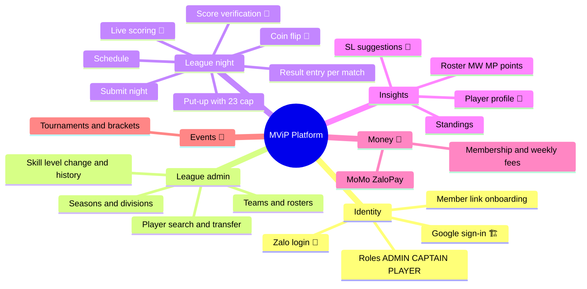

# 03 — Scope and Delivery Phases

> Phase 1 follows the team's MVP plan in `league-fe/plans/20261104-2126-bida-league-mvp/`. Status values: 🏗 built and on `master` · 🅿️ built but parked (FE `_parked/`) · 📐 specified, code missing from the repo · 🎯 not started.

## 1. Capability map

## 2. Phases

### Phase 1: MVP "run a team night on a phone"

**Goal:** a captain runs a whole night on a phone: open tonight's fixture, put up 5 players within the 23-SL cap, enter 5 results, submit. An admin changes a skill level and sees the history.

| Area | Scope | Status |
|---|---|---|
| Auth | Google OIDC + PKCE, cookie session, CSRF, logout, `/me` | 🏗 |
| Onboarding | Link a Google account to a member ID (`/members/preview`, `/me/link`) | 🏗 UI · 📐 API |
| Roles | ADMIN / CAPTAIN / PLAYER from `users_roles`; captain-owns-night check | 🏗 tables · 📐 enforcement |
| Schema | Seasons, divisions (cap 23), venues, players (SL 2–7, paid flag), teams, race chart, team/individual matches, stats, RBAC | 🏗 `00001_init.sql` |
| Business rules | `team_rosters`, snapshot / score / roll-up / stats triggers, `can_put_up()`, `change_skill_level()`, views | 📐 `00002` (missing) |
| League API | 13 endpoints + `/teams` | 📐 `internal/league` (missing) |
| Schedule screen | Season/division select, week chips, fixture cards | 🅿️ |
| Night screen | Both rosters (SL, MW/MP, points), 5-match scoresheet, next action | 🅿️ |
| Put-up | Candidate list with `x/23` and block reasons; home puts up first on odd matches | 🅿️ |
| Result entry | Games (capped at race), innings, defensive shots; points preview | 🅿️ |
| Submit | Captain submits a complete night; admin may edit afterwards | 🅿️ |
| Admin players | Search, SL change with reason, history, transfer, add paid member | 🅿️ |
| PWA | Installable, static-asset cache, light/dark, en/vi | 🏗 |
| Delivery | FE → Vercel on tag; BE image → Artifact Registry on tag | 🏗 · 🎯 GKE deploy |

**Out of Phase 1** (the MVP plan's own out-of-scope list): coin flip, live tap-by-tap scoring, offline sync, rack-level data, notifications, payments, 9-Ball.

### Phase 2: full league operations

| Area | Scope |
|---|---|
| Live scoring | Coin flip, lag, Screen 5 (turn over, DS, timeouts, 6 rack outcomes, undo), racks, accolades (BR, 8OB, Rackless, Double-strike), offline queue, live viewers ([08](08-scorekeeping-engine.md)) |
| Verification | Dual-captain score matching, +1 (8B) / +10 (9B) bonus, disputes, LO resolution |
| 9-Ball | Ball-tap scoring, dead balls, 20-point matrix, per-format SL (1–9) |
| Handicap | SL suggestion (8B effective innings over the last 10 wins; 9B PPI) with admin approval |
| Profile and standings | Stats / Teams tabs, public standings |
| Payments | Membership + weekly fees, MoMo / ZaloPay |
| Identity | Zalo login / Mini App; generated Member ID and Team ID |
| Platform | Redis, worker + outbox, rate limiting, structured logs, GKE manifests, migration runner, staging environment |

### Phase 3: growth

Master division, tournaments and brackets, anti-sandbagging anomaly detection, multi-league tenancy (League Operator role), sponsors, 10-Ball / Carom, venue dashboard.

## 3. Phase 1 user stories

| ID | Story | Acceptance criteria | Status |
|---|---|---|---|
| US-01 | As a user I sign in with Google | PKCE + state + nonce; `sid`/`csrf` cookies; new users go to `/onboarding`; errors show a banner | 🏗 |
| US-02 | As a new user I link my member ID | Preview shows a display name, SL and team; refused if already linked to another account; then `/me.playerId` is set | 🏗 UI · 📐 API |
| US-03 | As a player I see the schedule for my division | Season/division select, week chips; cards show teams, venue, time, status, points | 🅿️ · 📐 |
| US-04 | As anyone I open a night | Both rosters with SL, MW/MP, points (`player_division_stats`); 5 matches with snapshots | 🅿️ · 📐 |
| US-05 | As a captain I put up a player | Only on my own night; list shows `canPutUp` + reason; `would_break_23` reads the division cap; the server re-checks (`40004`) | 🅿️ · 📐 |
| US-06 | As a captain I enter a result | Games ≤ race; points computed by trigger (3/0, 2/1 hill = race − 1, 2/0); night totals roll up | 🅿️ · 📐 |
| US-07 | As a captain I submit the night | Only when all 5 are complete; `submitted_by/at` set; standings count only submitted nights | 🅿️ · 📐 |
| US-08 | As a captain I add a paid member to my roster | Unpaid → `40003`; one active roster per player | 🅿️ · 📐 |
| US-09 | As an admin I change a player's SL | Reason required; history row with author; played matches keep their snapshot | 🅿️ · 📐 |
| US-10 | As an admin I transfer a player | Close the old roster row (`left_at`) and open the new one | 🅿️ · 📐 |
| US-11 | As a player-role user I can't act | 403 on every write | 📐 |

## 4. Next steps to finish Phase 1

1. **Restore league-be** to plan-2/plan-3 state:
   - The `team_rosters` + CHECK changes.
   - `00002_business_rules.sql`.
   - `internal/league` + `router/league.go`.
   - The `/me` role and `playerId`.
   - The member preview/link endpoints.
   - `make migrate`/`make seed`.

   See [15](15-as-built-vs-target.md).
2. Un-park the FE screens per `_parked/RESTORE.md`, bringing them up to the current conventions (named exports, `react-router`, `queryOptions`).
3. Generate FE types from swagger and delete `types/league.ts`.
4. Run the FE and BE together (browser), then deploy the API to GKE and publish the Google consent screen.
5. Beta: one division, the seed teams, real captains.
