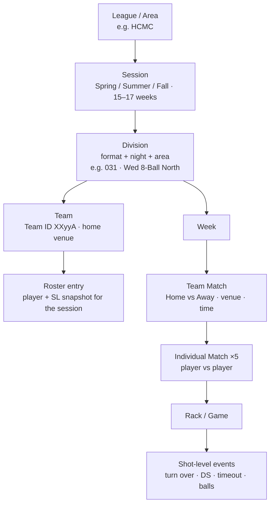
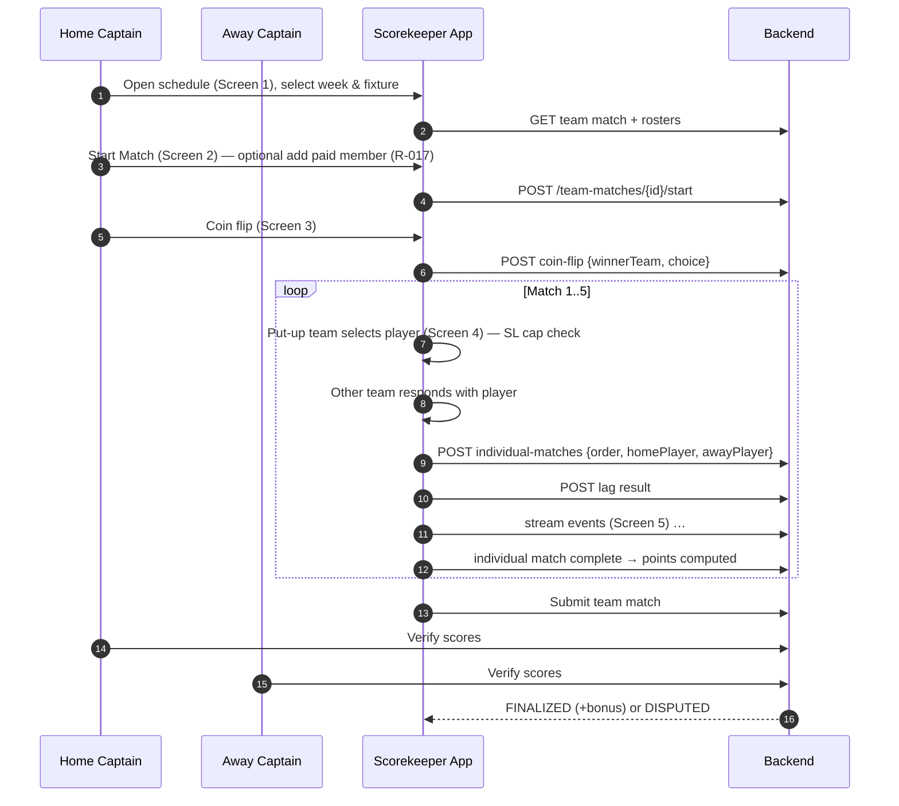
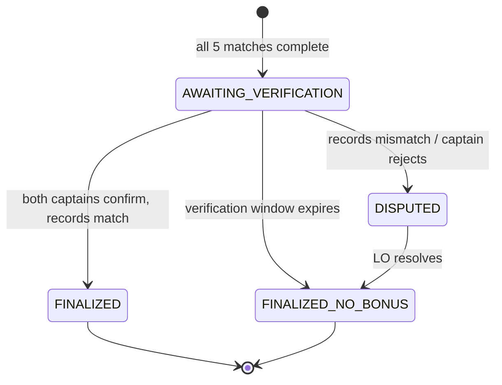

# 04 — Domain Rules Specification

> This chapter is the **source of truth for business logic**. Every rule has an ID (`R-xxx`) that code, tests and tickets should reference. Rule tables are reproduced in machine-readable form in [appendix-rule-tables.md](appendix-rule-tables.md).
>
> Legend: ✅ confirmed by the Notion sources · ⚠️ assumption (not in the sources, APA default adopted; see [14-open-questions.md](14-open-questions.md)) · 🛠 corrected source defect

## 0. Where each rule is implemented

Per [ADR-004](05-architecture.md#7-architecture-decisions), rules live in **Postgres**. The FE mirror (`league-fe/_parked/src/lib/rules.ts`) is only a preview, and the server value wins. 🏗 = in `00001_init.sql` today; 📐 = in the planned `00002_business_rules.sql` (missing from the repo, see [15](15-as-built-vs-target.md)); 🎯 = later phase.

| Rule | Implementation | Status |
|---|---|---|
| R-011 single roster | Partial unique index on `team_rosters (player_id) WHERE left_at IS NULL` (one active roster in total, stricter than the rule; see [Q32](14-open-questions.md)) | 📐 |
| R-014 paid before play | `players.is_paid`; roster add refuses unpaid players (`40003`) | 🏗 column · 📐 check |
| R-016 roster lock after week 4 | Not implemented | 🎯 |
| R-017 captain adds a paid member | `POST /teams/{id}/roster` | 📐 |
| R-019 default SL 3 | `players.skill_level DEFAULT 3` | 🏗 |
| R-030/R-031 put-up order | MVP: **home puts up first in match 1, then alternate** (`individual_matches.first_put_up`, FE `night.ts`). Coin flip is 🎯 Phase 2 | 📐 |
| R-034/R-035 23-SL cap | `put_up_block_reason()` → `would_break_23`, reading `divisions.skill_level_cap` | 📐 |
| R-036 one match per player per night | `put_up_block_reason()` → `already_put_up` | 📐 |
| R-050/R-125 SL + race snapshot | `fn_snapshot_put_up()` (trigger `trg_10_…`), lookup in the `race_chart` table | 🏗 table · 📐 trigger |
| §5.1 race chart | `race_chart` (36 rows, SL6v4 = 5/3) | 🏗 |
| §5.3 points 3/2/1 | `fn_score_individual_match()` (trigger `trg_20_…`); hill = `race − 1` | 📐 |
| Night totals | `fn_roll_up_team_points()` → `team_matches.home_points/away_points` | 📐 |
| R-100–R-104 innings, DS, timeouts | MVP stores **match totals** entered after play (`innings`, `home_def_shots`, `away_def_shots`); no timeouts. Per-turn tracking is 🎯 Phase 2 | 🏗 columns |
| §6 9-Ball | Not implemented; `divisions.format` defaults to `'8-ball'` | 🎯 |
| §8 verification + bonus | MVP: **captain submit only** (`status = submitted`). Dual-captain matching and the bonus are 🎯 Phase 2 | 📐 submit |
| §9 accolades | Needs rack data | 🎯 |
| R-120 manual SL change | `change_skill_level()` → `skill_level_history` (reason required) | 📐 |
| R-121–R-123 SL auto-calculation | Not implemented | 🎯 |
| §11 IDs | `players.member_id` TEXT (8 digits assumed); `teams.team_number` APA-style (`03209`). The generators in §11 are 🎯 | 🏗 columns |
| §12 profile stats | `players_stats` (trigger-maintained), `player_division_stats` view | 🏗 table · 📐 trigger/view |
| Standings | `team_standings` view (counts only `submitted` nights) | 📐 |

---

## 1. League hierarchy



| ID | Rule | Source |
|---|---|---|
| R-001 ✅ | A **Session** is a seasonal block of weekly play (Spring, Summer, Fall), typically 15–17 weeks; the Beta pilot is 10 weeks. | Business intro §2.1, §6.1 |
| R-002 ✅ | A **Division** groups teams that play on the **same night** in the **same format** within a geographic area. Identified by a 3-digit code + name (e.g. `031 – Wednesday 8-Ball North`). | Division Difference §1 |
| R-003 ✅ | A Team Match consists of **5 individual head-to-head matches** (Match 1–5). | Foundation DB #3/#4, Score keeper |
| R-004 ✅ | Weekly schedule entries can be a match, a **Bye**, or **No Play** (holiday). Bye / No Play render as neutral, non-clickable banners. | Foundation DB #5 |

## 2. Division formats

| Attribute | 8-Ball | 9-Ball | Master |
|---|---|---|---|
| Scoring | In-app (racks, race-to) | In-app (ball points, race-to-points) | Open — international rules (Phase 3, TBD) |
| Rules & bylaws | Restricted by LO and local house rules | (same as 8-Ball assumed ⚠️) | Open (international rules) |
| 23-SL team cap | Yes | Yes | **No** |
| SL range | SL 2–7 | SL 1–9 | None |
| SL leveling basis | Innings (minus defensive shots) over the **last 10 won games** | **PPI** (points per inning) | None |
| Jump shots allowed | No | No | **Yes** |
| Why | Low-SL players can't control jump shots (table damage risk for the house); high-SL players who can jump gain an unfair advantage | — | Competitive-only division; players must acknowledge this |

Implementation: `divisions.format ∈ {EIGHT_BALL, NINE_BALL, MASTER}` drives which scoring engine, race calculator and cap validator are used (strategy pattern; see [10-backend-design.md](10-backend-design.md)).

## 3. Membership, eligibility and rosters

| ID | Rule |
|---|---|
| R-010 ✅ | Every player has one permanent **Member ID** (see §11). SL and stats follow the Member ID across all teams and divisions. |
| R-011 ✅ | **Single-roster rule:** a player can't be on more than **one team in the same division** in the same session. This is a hard DB constraint. |
| R-012 ✅ | Same night, **different divisions**: allowed only if the League Operator's bylaw `allow_multi_division_same_night = true` (per league or per division). Default `false`. |
| R-013 ✅ | Different nights, or different formats (8-Ball vs 9-Ball): always allowed. Team standings and division points stay independent. |
| R-014 ✅ | Annual membership must be paid before a player plays. Unpaid status shows on the roster (scoresheet shows `$25` / `$$` flags). The fee amount is configurable per league (VN target 100–150k VND/year). |
| R-015 ✅ | Weekly match fee per player per match played (VN target 50–80k VND). On a **forfeit**, both teams still pay full weekly fees. |
| R-016 ✅ | Roster changes are allowed during the **first 4 weeks** of a session. After that, an LO approval is required. |
| R-017 ✅ | A **Captain** can add an existing, paid member who is available in that division to the team **before the first match of the night starts**. |
| R-018 ✅ | Creating a **brand-new player** on the spot (name, Member ID, initial SL) is **admin/LO-only**. |
| R-019 ✅ | New players start at **SL 3** for 8-Ball, unless the LO sets otherwise. ⚠️ 9-Ball starting SL is not specified; default 3, LO-configurable. |
| R-020 ✅ | Admin can **transfer** players between teams in the same league or across divisions. R-011 is still enforced. |

## 4. Team night flow

> **Phase 1 (MVP)** skips the coin flip, the lag and live scoring. Home puts up first in match 1 and the sides alternate. After each match the captain enters the final games, innings and defensive shots, and the night is submitted by a captain (no dual verification). The diagram below is the **full target flow** (Phase 2).



| ID | Rule |
|---|---|
| R-030 ✅ | **Coin flip:** the winning team chooses to (a) put up its player first, or (b) make the opponent put up first. |
| R-031 ✅ | After Match 1, put-up order **alternates** between teams. |
| R-032 ✅ | **Lag:** in each individual match, the lag winner decides who breaks the first rack. The `LAG` badge is shown next to that player. Re-lag if both lags foul or the result is undeterminable. The app records only the outcome. |
| R-033 ⚠️ | Break order after rack 1: **winner breaks** (APA 8-Ball/9-Ball default). Configurable per division bylaw (`break_rule ∈ {WINNER, ALTERNATE}`). |
| R-034 ✅ | **23-SL cap:** across the 5 players a team uses in one team match, `Σ SL ≤ 23` (8-Ball and 9-Ball; not Master). The UI shows `x/23 Total SL` live and blocks a selection that would make it impossible to complete the lineup within the cap. |
| R-035 | Cap validation rule (derived): when choosing the k-th player, valid only if `usedSL + sl(candidate) + minSL(remaining eligible roster, 5−k players) ≤ 23`. |
| R-036 ✅ | A player plays at most one individual match per team match. |
| R-037 ✅ | **Forfeit:** if a team cannot field a player for a slot, that match is forfeited and the opponent receives the maximum points for that match (8-Ball: 3; 9-Ball: 20 ⚠️). Recorded as `forfeit=true`, no racks. |

## 5. 8-Ball rules

### 5.1 Race chart (games needed)

Read as **row player needs / column player needs**. SL range 2–7.

| Row \ Col | SL2 | SL3 | SL4 | SL5 | SL6 | SL7 |
|---|---|---|---|---|---|---|
| **SL2** | 2/2 | 2/3 | 2/4 | 2/5 | 2/6 | 2/7 |
| **SL3** | 3/2 | 2/2 | 2/3 | 2/4 | 2/5 | 2/6 |
| **SL4** | 4/2 | 3/2 | 3/3 | 3/4 | 3/5 | 2/5 |
| **SL5** | 5/2 | 4/2 | 4/3 | 4/4 | 4/5 | 3/5 |
| **SL6** | 6/2 | 5/2 | 5/3 🛠 | 5/4 | 5/5 | 4/5 |
| **SL7** | 7/2 | 6/2 | 5/2 | 5/3 | 5/4 | 5/5 |

🛠 The Notion table shows `SL6 vs SL4 = 5/6`, which contradicts its mirror cell `SL4 vs SL6 = 3/5`. It is corrected to **5/3** (matches the APA chart).

**Invariant (test):** `race(a,b) == reverse(race(b,a))` for all pairs.

| ID | Rule |
|---|---|
| R-050 ✅ | When an SL changes (admin action), races are recomputed **for matches not yet started**. An in-progress or finished match keeps the SL snapshot it started with. |

### 5.2 Rack outcomes

| Code | Button label | Result for shooter | Accolade | Condition |
|---|---|---|---|---|
| `MAKE_8` | Make 8 Ball | **WIN** | — | Legally pockets the 8 in the called pocket after clearing the group |
| `BREAK_AND_RUN` | Break and Run | **WIN** | BR | Breaker wins the rack **without the opponent getting a turn** |
| `EIGHT_ON_BREAK` | 8 on the Break | **WIN** | 8OB | 8 pocketed on the break shot without scratching |
| `EARLY_8` | Make 8 Ball Early | **LOSS** | E8 | 8 pocketed before own group is cleared |
| `SCRATCH_8` | Scratch on 8 Ball | **LOSS** | S8 | 8 pocketed but cue ball scratches / leaves the table |
| `WRONG_POCKET_8` | Make 8 Ball Wrong Pocket | **LOSS** | 8WP | 8 pocketed in an un-called pocket |

| ID | Rule |
|---|---|
| R-060 ✅ | `BREAK_AND_RUN` and `EIGHT_ON_BREAK` are **only offered** while the breaker's first turn of the rack is still live (no turn-over yet in this rack). After the first turn-over, the UI hides them. |
| R-061 ✅ | A LOSS outcome awards +1 game won to the **opponent** of the shooter. |
| R-062 | The "shooter" for the end-rack action is the **active player** in the live state. The scorekeeper can switch the active player via the overflow menu (correction). |

### 5.3 8-Ball points per individual match (3-point system)

| Outcome | Winner pts | Loser pts |
|---|---|---|
| Shutout — loser won **0** games | **3** | 0 |
| Standard win — loser won ≥ 1 game but **not on the hill** | **2** | 0 |
| Hill-hill — loser **on the hill** (1 game short of their race) | **2** | **1** |

```text
points8(winnerGW, loserGW, loserGN):
  if loserGW == 0           -> (3, 0)
  if loserGW == loserGN - 1 -> (2, 1)   # on the hill
  else                      -> (2, 0)
```

Edge case: if `loserGN == 2` and `loserGW == 1`, the loser is both "won ≥ 1" and "on the hill", so the result is **(2, 1)**. The hill check takes precedence over the standard-win check.

A match therefore totals **3, 3 or 2** points, not always 3. The planned `fn_score_individual_match()` and the FE `pointsFor()` both implement hill = `race − 1`. One example in the original kickoff prompt ("4–2 when loser race 5 = 2/1") contradicts this and is treated as a typo.

| ID | Rule |
|---|---|
| R-070 ✅ | Maximum team points per night (8-Ball) = 5 × 3 = **15**, plus the verification bonus (R-110). |
| R-071 ✅ | **PA (Points Available)** for 8-Ball = 3 per match played. |

## 6. 9-Ball rules

### 6.1 Ball values and targets

- Balls 1–8 = **1 point** each. The 9-ball = **2 points**. Each rack totals **10** (counting dead balls).
- Target points by SL:

| SL | 1 | 2 | 3 | 4 | 5 | 6 | 7 | 8 | 9 |
|---|---|---|---|---|---|---|---|---|---|
| Target | 14 | 19 | 25 | 31 | 38 | 46 | 55 | 65 | 75 |

| ID | Rule |
|---|---|
| R-080 ✅ | Points are attributed to the **active shooter** when a ball is legally pocketed. |
| R-081 ✅ | **Dead balls (DB):** balls pocketed on a foul (scratch, cue ball off table, illegal shot) count for **neither** player and are logged as DB so that `Σ(points A + points B + dead) == 10` per completed rack. |
| R-082 ✅ | The **9-ball is never a dead ball**. If pocketed on a foul, it is re-spotted (foot spot, or as close as possible). The app records nothing for that event apart from the foul. |
| R-083 ✅ | The match ends as soon as a player reaches their target. **Recorded score is capped at the target** (e.g. SL5 at 37 who makes the 9 on the break records 38, not 39). |
| R-084 ✅ | **9OB** (9 on the break) and **BR** (break and run) are recorded as accolades. The ball points still count. |
| R-085 ✅ | Rack-close validation: a rack can be closed only when the 9-ball has been credited, i.e. the remaining unaccounted balls are auto-marked dead with confirmation. |

### 6.2 Team points (20-point split)

The winner gets `20 − loserPts`. The loser's points are looked up from the **loser's SL** and the **loser's match score**.

| Loser SL | 20-0 | 19-1 | 18-2 | 17-3 | 16-4 | 15-5 | 14-6 | 13-7 | 12-8 |
|---|---|---|---|---|---|---|---|---|---|
| 1 | 0–2 | 3 | 4 | 5–6 | 7 | 8 | 9–10 | 11 | 12–13 |
| 2 | 0–3 | 4–5 | 6–7 | 8 | 9–10 | 11–12 | 13–14 | 15–16 | 17–18 |
| 3 | 0–4 | 5–6 | 7–9 | 10–11 | 12–14 | 15–16 | 17–19 | 20–21 | 22–24 🛠 |
| 4 | 0–5 | 6–8 | 9–11 | 12–14 | 15–18 | 19–21 | 22–24 | 25–27 | 28–30 |
| 5 | 0–6 | 7–10 | 11–14 | 15–18 | 19–22 | 23–26 | 27–29 | 30–33 | 34–37 |
| 6 | 0–8 | 9–12 | 13–17 | 18–22 | 23–27 | 28–31 | 32–36 | 37–40 | 41–45 |
| 7 | 0–10 | 11–15 | 16–21 | 22–26 | 27–32 | 33–37 | 38–43 | 44–49 | 50–54 |
| 8 | 0–13 | 14–19 | 20–26 | 27–32 | 33–39 | 40–45 | 46–52 | 53–58 | 59–64 |
| 9 | 0–17 | 18–24 | 25–31 | 32–38 | 39–46 | 47–53 | 54–60 | 61–67 | 68–74 |

🛠 The APA flyer prints `23&24` for SL3 at 12-8, which leaves 22 unmapped. The Notion value `22–24` is adopted (contiguous).

**Invariants (tests):**
- Each row covers `0 … target−1` contiguously with no gaps or overlaps.
- The upper bound of the 12-8 column equals `target(SL) − 1`.

Worked example (from the APA flyer): the loser is SL3 with 21 points → column 13-7 → loser gets **7**, winner **13**.

| ID | Rule |
|---|---|
| R-090 ✅ | Max team points per night (9-Ball) = 5 × 20 = **100**, plus the verification bonus. |
| R-091 ✅ | PA for 9-Ball = 20 per match played. |

## 7. Innings, defensive shots, timeouts

| ID | Rule |
|---|---|
| R-100 ✅ | An **inning** = one turn by each player. The counter increments when the player who **lost the lag** (i.e. the second shooter of the match) completes their turn. In the app this is triggered by **Turn Over** on that player. |
| R-101 ✅ | **Turn Over** is tapped when the shooter fails to pocket a legal ball (or otherwise ends their turn). It switches the active player. |
| R-102 ✅ | **Defensive Shot (DS)**: any shot with no intent to legally pocket a ball. A DS is recorded **per player**; a DS is also a turn end (app action: `DS` implies `TURN_OVER`). ⚠️ The UI keeps them as separate buttons (as in APA). Pressing DS increments the counter and ends the turn. |
| R-103 ✅ | At the end of a match each player's total DS is shown. Zero renders as "No DS". |
| R-104 ⚠️ | **Timeouts per rack:** SL ≤ 3 → 2; SL ≥ 4 → 1 (8-Ball). 9-Ball: SL ≤ 3 → 2; SL ≥ 4 → 1. Not in the sources; this is the APA default and is configurable per division bylaw. The UI shows `N time-outs left`. |
| R-105 ✅ | The scorekeeper/referee name is recorded per individual match. |
| R-106 | The shot clock on Screen 5 (`7 sec`) is **informational only** (elapsed time since the turn started). No enforcement in Phase 1. |

## 8. Score matching (verification) and bonus

> 🎯 **Phase 2.** The MVP uses `team_matches.status`: `scheduled → in_progress → submitted`. A captain of either team (or an admin) submits once all 5 matches are complete, and admins may still edit afterwards. Who exactly may submit is an open question ([Q30](14-open-questions.md)).



| ID | Rule |
|---|---|
| R-110 ✅ | Both teams must review and confirm the night's records. When both confirm **matching** records, **each** team receives a standings bonus: **+1 (8-Ball)**, **+10 (9-Ball)**. |
| R-111 | With a single shared scoring device (MVP), "matching" means both captains confirm the same snapshot hash. With two devices (Phase 2), each team submits its own record set and the server diffs them field by field (GW, points, innings, DS, outcome codes). |
| R-112 ⚠️ | Verification window: **24 h** after the team match ends (configurable). After it expires, the match finalizes **without bonus**. |
| R-113 ✅ | Mismatches create a **Dispute** that the LO resolves in the admin portal. The resolution is audited and the bonus is withheld unless the LO grants it. |

## 9. Accolades and achievements

| Code | Name | Format | Rule |
|---|---|---|---|
| `BR` | Break and Run | 8B, 9B | Breaker runs out the rack without the opponent getting a turn |
| `8OB` | 8 on the Break (Golden Break) | 8B | Legal break that pockets the 8 = instant rack win |
| `9OB` | 9 on the Break (Golden Break) | 9B | Legal break that pockets the 9 |
| `RACKLESS` | Rackless match | 8B | Won the lag and the match **without losing a single rack** |
| `DOUBLE_STRIKE` | Double-strike (Cú Đúp) | 8B, 9B, Master | **BR + Golden break on the same league night** (replaces APA "mini-slam"). See [open question Q5](14-open-questions.md). |

Accolades are derived by the server from rack events and stored in `player_accolades` for profile counters.

## 10. Skill level (handicap) management

| ID | Rule |
|---|---|
| R-120 ✅ | The LO can **manually set** a player's SL per format at any time. Every change is written to `player_skill_levels` (history) and to `audit_log` with the reason. |
| R-121 ✅ | 8-Ball SL basis: **average effective innings per won game over the last 10 won games**, where `effective innings = innings − defensive shots`. |
| R-122 ✅ | 9-Ball SL basis: **PPI = points ÷ (innings − DS)** over a rolling window ⚠️ (window size TBD; default the last 10 matches). |
| R-123 ⚠️ | Mapping thresholds (innings → SL, PPI → SL) are **not in the sources**. Phase 1: manual SL only; the system **computes and displays the suggested SL** to the LO. Phase 2: auto-apply with LO approval. |
| R-124 ✅ | **Anti-sandbagging:** DS tracking feeds the effective-innings calculation. Phase 3: statistical anomaly flags (sudden PPI drop, DS ratio outliers, innings-per-win variance) appear in an LO review queue. |
| R-125 | The SL used in a match is **snapshotted** on `individual_matches` at creation. Later changes never rewrite history. |
| R-126 | The roster shows the SL **for that session** (`team_rosters.sl_snapshot`, updated when the SL changes during the session). |

## 11. Identifier generation

> 🏗 **As-built:** `players.member_id` and `teams.team_number` are free TEXT columns entered by an admin. The seed uses APA-style values (`95007620`, `03209`), and the FE assumes 8-digit member IDs (`MEMBER_ID_LENGTH = 8`). The generators below are the 🎯 Phase 2 target. Until then, admins must enter IDs that follow these formats ([Q2/Q3](14-open-questions.md)).

### 11.1 Member ID (8 digits): `YYMMNNNN`

| Part | Meaning | Example |
|---|---|---|
| `YY` | 2-digit registration year | `26` |
| `MM` | 2-digit registration month | `11` |
| `NNNN` | Sequence within that month, zero-padded, from 0001 | `0042` |

Example: the 42nd player registered in Nov 2026 gets `26110042`. Capacity is 9,999 per month.

Implementation: a Postgres table `id_sequences(scope text primary key, last_value int)` with `UPDATE … RETURNING` in the same transaction as the insert (gap-free, concurrency-safe). The scope key is `member:2611`.

### 11.2 Team ID (5 digits): `RRVVT`

| Part | Meaning | Rule |
|---|---|---|
| `RR` | Region code (2 digits) | Derived from the host venue's district/postal region. The mapping table is managed by the admin. See [Q3](14-open-questions.md). |
| `VV` | Host venue code (2 digits) | Unique **within** the region |
| `T` | Team sequence at that venue code | 0–9 |

| ID | Rule |
|---|---|
| R-130 ✅ | All IDs are numeric only. Letters are used only if the numeric space is exhausted. |
| R-131 ✅ | A venue code holds **max 10 teams** (T = 0..9). When full, the venue is assigned an **additional venue code** (`venue_codes` 1-to-many), and new teams use the new code. |
| R-132 | Display IDs (`member_no`, `team_no`) are **immutable business keys**. All foreign keys use UUID surrogate keys. |

## 12. Statistics and profile metrics

| Metric | Formula | Scope |
|---|---|---|
| Matches Played (MP) | count(individual matches actually played). Forfeits are excluded ⚠️ | session, lifetime, format |
| Matches Won (MW) | count(matches won) | session, lifetime |
| Win % | `MW / MP × 100` (2 decimals) | session, lifetime |
| Total points | Σ team points earned | session |
| PPM (points per match) | `total points / MP` | session |
| % Points Available | `total points / (MP × PA)`, where PA = 3 (8B) or 20 (9B) | session |
| Defensive shot avg | `Σ DS / MP` | lifetime |
| Matches in last 2 years | count where `played_at ≥ now − 2y` | lifetime |
| BR / 8OB / 9OB / Rackless / Double-strike | count(accolades) | session, lifetime |
| Last date played | max(played_at) | lifetime |
| Championship lowest attainable SL ⚠️ | Lowest SL the player has held over the past N sessions, used for tournament eligibility (defined in Phase 3) | lifetime |

Profile example check (from the screenshot): session 3 won / 7 played → 42.86%. Total points 7 → PPM = 1. PA = 7 × 3 = 21 → 7/21 = 33%. ✅ Consistent with these formulas.

## 13. Schedule and results presentation rules

| ID | Rule |
|---|---|
| R-140 ✅ | Completed match card: **green** for the winning team, showing the final score `13 - 1`. Clicking it opens the match breakdown. |
| R-141 ✅ | Upcoming match card: **blue** date (`Jul 22`), score hidden, start time shown (`@ 7:00 PM`). |
| R-142 ✅ | Bye / No Play: neutral, non-clickable banner. |
| R-143 ✅ | Every card shows Team A vs Team B, venue name, venue address and date. |
| R-144 ✅ | Match breakdown: header with team totals and a crown on the winning team. Five match blocks, each with player name, SL, LAG badge, and GW/GN (8-Ball, e.g. `4/4 – 1/4`) or points/target (9-Ball). The winner's card is solid green with points earned; the loser's is gray. |
| R-145 ✅ | All matches must be queryable by team and sorted by start date (public info: opponent team name, final score, date and location). |
