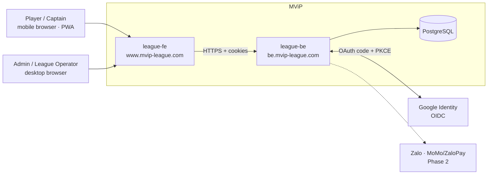
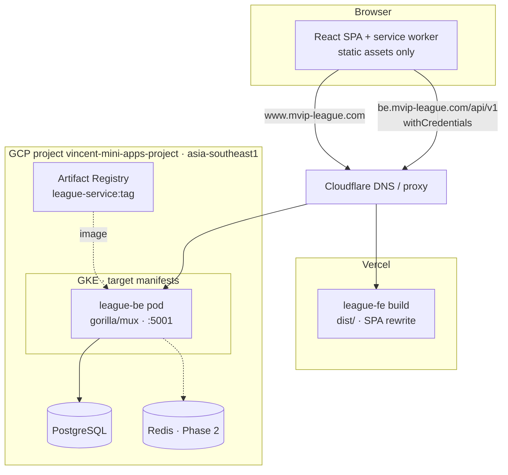
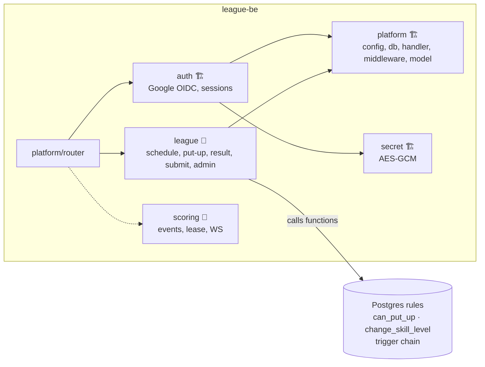
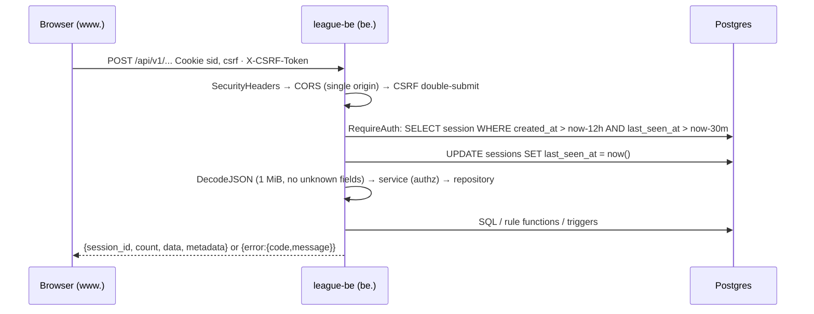

# 05 — Solution Architecture

> 🏗 as-built · 📐 planned MVP · 🎯 target

## 1. Technology stack

| Layer | As-built (🏗) | Target additions (🎯) |
|---|---|---|
| Frontend | `league-fe`: single **Vite 8 + React 19** SPA, TypeScript 6, **Tailwind 4**, **shadcn** (`radix-nova`), **TanStack Query 5**, **react-router 7**, axios, i18next | Generated API types; live-scoring state store; Zalo Mini App build |
| FE hosting | **Vercel**, deployed by **GitHub Actions** on a version tag (`vercel deploy --prebuilt --prod`); git deploys off | Preview deploys per PR |
| Backend | `league-be`: **Go 1.26**, `net/http` + **gorilla/mux**, **pgx/v5 raw SQL**, Google OIDC (go-oidc + oauth2), viper, swaggo | `internal/league` (📐), `internal/scoring`, worker |
| Database | **PostgreSQL**. Business rules in **triggers and functions** (📐 `00002`) | Cloud SQL HA, PITR |
| Cache / realtime | — | **Redis** (Memorystore) for live scoring, rate limiting |
| Container | Docker multi-stage → distroless nonroot; image in **Artifact Registry** `asia-southeast1-docker.pkg.dev/vincent-mini-apps-project/league-repository/league-service:<tag>` | — |
| Runtime | GKE (e2-medium nodes, per Makefile comments). **No deploy manifests in the repo** | Helm/Kustomize, migration Job, HPA |
| Edge / DNS | **Cloudflare**: `www.mvip-league.com` (FE), `be.mvip-league.com` (API) | WAF rules, cache rules |
| Repos | Two repos: `league-fe`, `league-be` (GitHub org `mini-apps-org`) | `league-infra` (Terraform) |

## 2. System context

## 3. Containers and deployment

**Cookie topology.** The FE and API are different hosts under one registrable domain (`mvip-league.com`):
- `__Host-sid` is locked to `be.mvip-league.com` (HttpOnly).
- `__Secure-csrf` is scoped to `Domain=mvip-league.com`, so the SPA on `www.` can read it and echo it in `X-CSRF-Token`.

Both use `SameSite=Lax`, which works because the two hosts are same-site.

## 4. Backend module map

- One deployable Go service (a modular monolith). Modules expose `Service`/`Repository` interfaces.
- **Rules live in Postgres.** Go decides *who* may act (roles, captain-owns-night); SQL decides *what the numbers are*.

## 5. Request lifecycle (🏗)

## 6. 🎯 Phase 2: realtime and offline

The live-scoring design (event log, scoring lease, Redis pub/sub, WebSocket fan-out, IndexedDB offline queue) is in [08](08-scorekeeping-engine.md). Constraints from the as-built system:
- Writes stay HTTP + cookies + CSRF.
- WebSocket auth uses the same `sid` cookie (same-site), with no bearer tokens.
- Idempotency keys travel in the request body, not in headers (keeps the CORS allow-list unchanged).
- The service worker keeps never caching HTML or API responses. Offline data goes to IndexedDB keyed by user.

## 7. Architecture decisions

These are the decisions already made in the repos. Record them as ADRs in each repo.

| ADR | Decision | Rationale | Source |
|---|---|---|---|
| ADR-001 | `net/http` + **gorilla/mux**, not a full framework | Thin handlers, stdlib middleware | `league-be/go.mod` |
| ADR-002 | **Raw SQL with pgx**, house convention (`const query` + named `args []any`), no ORM/sqlc | Rules-critical SQL stays explicit and reviewable | `.claude/rules/database.md` |
| ADR-003 | **Opaque server-side sessions in cookies**, not JWT + refresh | Revocable sessions, nothing in JS storage; the cost is CSRF, handled by double-submit | `internal/auth/README.md` |
| ADR-004 | **Business rules in Postgres** triggers/functions; the TS mirror is only a preview | A manual SQL correction gives the same numbers as the app; one source of truth. Revisit for live scoring | plan.md, plan-2 |
| ADR-005 | **SL and race are snapshotted** at put-up | A later SL change never rewrites a played match | `individual_matches` columns |
| ADR-006 | **RBAC tables** (`roles`, `permissions`, `users_roles`), no `users.role` column | One source of truth; `/me` derives the role by precedence | plan-1 |
| ADR-007 | **`app-id` header retired** (codes 40002/40303 retired) | One app, own database; GETs stay CORS-simple (no preflight) | plan-3 |
| ADR-008 | **Closed dependency list** in the FE | Small surface; additions need approval | plan.md |
| ADR-009 | **Google sign-in only** for the MVP; users link their member ID at onboarding | Fastest secure login; Zalo/OTP deferred | plan-4, login plan |
| ADR-010 | **Release by version tag** (`*.*.*`) in both repos | Explicit, auditable releases; FE guard requires the tag on `master` | `cd.yaml`, `release.yaml` |
| ADR-011 | UUID v4 for league entities, **TEXT** ids for `users`/`sessions` | Matches `auth.User.ID string`; avoids retyping auth code | `00001_init.sql` |
| ADR-012 | Event-sourced live scoring with Redis | 🎯 Proposed for Phase 2, not yet accepted | [08](08-scorekeeping-engine.md) |
