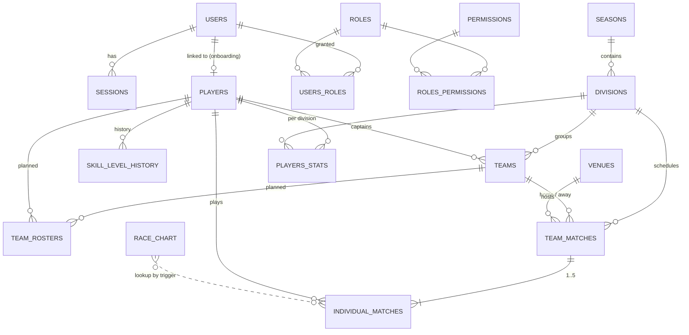
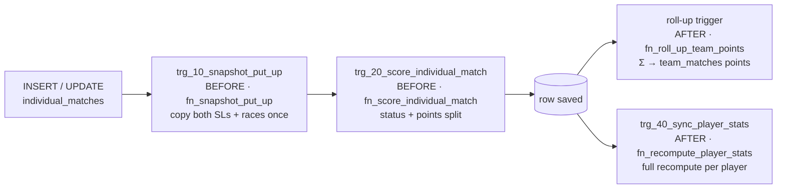

# 06 — Data Model (PostgreSQL)

> 🏗 **As-built** = in `league-be/db/migrations/00001_init.sql` on `master` today.
> 📐 **Planned** = specified in `league-fe/plans/20261104-2126-bida-league-mvp/plan-2-database-rules-and-seed.md` (`00002_business_rules.sql`). **Not in the repo** (see [15](15-as-built-vs-target.md)).
> 🎯 **Target** = later phases of this design.
>
> Conventions that come from the repo:
> - PKs are `UUID DEFAULT uuid_generate_v4()` (extension `uuid-ossp`). The exceptions are `users.id` and `sessions.id`, which are `TEXT` because the Go auth code types them as `string`. Every FK to `users` is therefore `TEXT`.
> - `skill_level_history` uses `BIGINT GENERATED ALWAYS AS IDENTITY`.
> - No Postgres `ENUM` types. Statuses are `TEXT`/`VARCHAR` with `CHECK` constraints.
> - Business rules are **Postgres triggers and functions** (decision: [05 ADR-004](05-architecture.md#7-architecture-decisions)). Go and TypeScript never compute points.
> - There is no migration tool yet: files are numbered `0000N_*.sql` and applied by hand. A `make migrate` runner is planned.

## 1. ERD (as-built + planned)



---

## A. 🏗 As-built: `00001_init.sql`

### A.1 Identity

#### `users`
| Column | Type | Notes |
|---|---|---|
| id | TEXT PK, default `uuid_generate_v4()` | TEXT to match `auth.User.ID string` |
| google_sub | TEXT NOT NULL UNIQUE | Target of the login upsert (`ON CONFLICT (google_sub)`). Users are never matched by email |
| email | TEXT NOT NULL | |
| email_verified | BOOLEAN NOT NULL default false | Login requires `true` |
| name | TEXT NOT NULL | |
| avatar_url | TEXT NOT NULL default `''` | |
| hd | TEXT NULL | Google Workspace domain (stored, not enforced) |
| created_at, last_login_at | TIMESTAMPTZ | |

#### `sessions`
| Column | Type | Notes |
|---|---|---|
| id | TEXT PK | 32 random bytes, base64url (generated in Go) |
| user_id | TEXT FK → users ON DELETE CASCADE | Index `sessions_user_id_idx` |
| created_at | TIMESTAMPTZ | Absolute TTL check (`SESSION_TTL`, 12 h) |
| last_seen_at | TIMESTAMPTZ | Idle TTL check (`SESSION_IDLE_TTL`, 30 min). Updated on every authenticated request |

#### RBAC: `roles`, `permissions`, `roles_permissions`, `users_roles`

| Table | Key columns |
|---|---|
| roles | `id UUID`, `code VARCHAR(50) UNIQUE`, `name`, `description` |
| permissions | `id UUID`, `code VARCHAR(100) UNIQUE`, `name`, `description` |
| roles_permissions | PK (`role_id`, `permission_id`), index on `permission_id` |
| users_roles | PK (`user_id TEXT`, `role_id`), `granted_by TEXT` (for audits), index on `role_id` |

Seeded in the migration:

| Role | Permissions |
|---|---|
| `PLAYER` | `player.read` |
| `CAPTAIN` | `player.read`, `match.put_up`, `match.enter_score`, `match.submit`, `roster.manage` |
| `ADMIN` | All 7: the above + `player.change_skill_level`, `season.manage` |

### A.2 League structure

#### `seasons` (= "Session" in the business docs)
| Column | Type |
|---|---|
| id | UUID PK |
| name | TEXT ("Fall 2026") |
| starts_on, ends_on | DATE |
| is_active | BOOLEAN default false |

#### `divisions`
| Column | Type | Notes |
|---|---|---|
| id | UUID PK | |
| season_id | UUID FK → seasons ON DELETE CASCADE | A division belongs to one season |
| name | TEXT | "8-Ball Open". UNIQUE (`season_id`, `name`) |
| format | TEXT default `'8-ball'` | |
| skill_level_cap | SMALLINT default 23 | The 23-Rule. Functions read this column, never a literal 23 |

#### `venues`
`id UUID`, `name TEXT NOT NULL`, `address TEXT NULL`.

#### `players`
| Column | Type | Notes |
|---|---|---|
| id | UUID PK | |
| user_id | TEXT UNIQUE FK → users ON DELETE SET NULL | Set by onboarding ("link my member ID") |
| member_id | TEXT NOT NULL UNIQUE | e.g. `'95007620'`. 8 digits is assumed by the FE (`MEMBER_ID_LENGTH = 8`) |
| full_name | TEXT | |
| skill_level | SMALLINT default 3, CHECK 2..7 | **One SL per player** (8-Ball). Per-format SL is 🎯 Phase 2 |
| is_paid | BOOLEAN default false | Captains may add only paid members |

#### `teams`
| Column | Type | Notes |
|---|---|---|
| id | UUID PK | |
| division_id | UUID FK → divisions ON DELETE CASCADE | |
| team_number | TEXT | APA-style, e.g. `'03209'`. UNIQUE (`division_id`, `team_number`) |
| name | TEXT | |
| captain_player_id | UUID FK → players NULL | Drives the "captain owns this night" check |

#### `skill_level_history`
| Column | Type |
|---|---|
| id | BIGINT identity PK |
| player_id | UUID FK → players ON DELETE CASCADE |
| old_skill_level | SMALLINT |
| new_skill_level | SMALLINT CHECK 2..7 |
| reason | TEXT |
| changed_by | TEXT FK → users |
| changed_at | TIMESTAMPTZ |

#### `race_chart`
`skill_level_a`, `skill_level_b` (CHECK 2..7), `race_a`, `race_b`. PK (`a`, `b`). **36 rows are seeded in the migration**, and they match the corrected chart in [04 §5.1](04-domain-rules.md#51-race-chart-games-needed) (SL6 v SL4 = 5/3).

### A.3 Matches

#### `team_matches`
| Column | Type | Notes |
|---|---|---|
| id | UUID PK | |
| division_id | UUID FK → divisions | Index (`division_id`, `week_no`) |
| week_no | SMALLINT | |
| home_team_id, away_team_id | UUID FK → teams | CHECK `home <> away` |
| venue_id | UUID FK → venues NULL | |
| scheduled_at | TIMESTAMPTZ | |
| status | VARCHAR(20) default `'scheduled'` | `scheduled` → `in_progress` → `submitted`. No CHECK in 00001; 00002 adds it |
| home_points, away_points | SMALLINT default 0 | Rolled up by a trigger (📐 planned) |
| submitted_by | TEXT FK → users | |
| submitted_at | TIMESTAMPTZ | |

#### `individual_matches`
| Column | Type | Notes |
|---|---|---|
| id | UUID PK | |
| team_match_id | UUID FK ON DELETE CASCADE | UNIQUE (`team_match_id`, `match_order`) |
| match_order | SMALLINT CHECK 1..5 | |
| first_put_up | TEXT NOT NULL | `home` / `away`. Home puts up first in match 1, then the sides alternate |
| home_player_id, away_player_id | UUID FK → players | Indexed |
| home_skill_level, away_skill_level | SMALLINT | **Snapshot** at put-up |
| home_race, away_race | SMALLINT | **Snapshot** from `race_chart` |
| home_games, away_games | SMALLINT ≥ 0 | |
| innings | SMALLINT ≥ 0 NULL | Shared by both players |
| home_def_shots, away_def_shots | SMALLINT ≥ 0 | |
| home_points, away_points | SMALLINT | Computed by trigger |
| status | TEXT CHECK `pending` \| `complete` | |
| entered_by | TEXT FK → users | |

#### `players_stats` (denormalized, trigger-maintained)
PK (`player_id`, `division_id`). Counters (INTEGER ≥ 0): `matches_played`, `matches_won`, `total_points`, `games_won`, `games_lost`, `innings`, `defensive_shots`, `shutouts`, plus `last_played_at`. CHECKs: `matches_won ≤ matches_played`, `shutouts ≤ matches_won`.

### A.4 Seed: `db/migrations/seeds/20261106_seed.sql`

- Season "Fall 2026" (active), division "8-Ball Open" (cap 23), venue "Saigon Cue Club" (District 1).
- Teams 03209, 03214, 03211, 03207 and 30 players. Two players are unpaid.
- The 23-Rule binds on purpose: 03209's five strongest players total 29 and 03211's total 27. 03207 totals 22 and is the control.
- Week-10 fixtures on 2026-11-10 19:30 +07.
- Dev identities `admin@example.test` (ADMIN) and `captain@example.test` (CAPTAIN, player 95007620). They can't sign in; they exist only for role checks.
- ⚠️ The seed inserts into `team_rosters`, which only exists in the planned 00002 file. **As committed, the seed fails.**

---

## B. 📐 Planned: `00002_business_rules.sql` (per plan-2; must be restored)

### B.1 `team_rosters`
Links players to teams. Plan-1 specifies it as follows:

| Column | Type | Notes |
|---|---|---|
| team_id | UUID FK → teams | Partial index on `team_id` |
| player_id | UUID FK → players | |
| left_at | TIMESTAMPTZ NULL | `NULL` = currently on the roster |

The exact remaining columns (id, timestamps) were in the lost `00001` revision. Recreate them when the file is restored.

- **Transfers are close-then-open:** set `left_at` on the old row and insert a new row. Never `UPDATE team_id`, so played matches stay reconstructable.
- **Planned index:** a partial unique index on `player_id WHERE left_at IS NULL` gives each player **one active roster in total**.

⚠️ **Conflict with business rule R-013.** The business docs allow a player on one team per *division*, so a Monday team and a Wednesday team at the same time is legal. The planned index allows only one active team overall. This is fine for the MVP (one division), but Phase 2 must change it to:
```sql
CREATE UNIQUE INDEX uq_roster_one_team_per_division
  ON team_rosters (player_id, division_id)
  WHERE left_at IS NULL;  -- division_id denormalized onto team_rosters
```
Tracked as [Q32](14-open-questions.md).

### B.2 Trigger chain on `individual_matches`

Same-event triggers fire in **name order**, so the numbers matter.



| Function | Rule |
|---|---|
| `fn_snapshot_put_up()` | When both players are set and `home_skill_level IS NULL`, copy `players.skill_level` for both sides and look up both races. Runs once and never overwrites (R-050, R-125) |
| `fn_score_individual_match()` | Derives `status` and points. Shutout 3/0; loser on the hill (`loser_games ≥ loser_race − 1`) 2/1; else 2/0. **Raises** if games exceed a race or both players reached their race |
| `fn_roll_up_team_points()` | Sums the 5 rows into `team_matches.home_points` / `away_points` |
| `fn_recompute_player_stats()` | Idempotent full recompute of `players_stats` per affected player (not a delta, so it can't drift) |
| `put_up_block_reason(team_match_id, side, player_id)` | Returns `would_break_23` \| `already_put_up` \| `not_on_roster` \| `side_complete`, or NULL. Reads `divisions.skill_level_cap` |
| `can_put_up(...)` | `put_up_block_reason(...) IS NULL` |
| `change_skill_level(player_id, new_sl, reason, changed_by)` | Validates the range, a non-blank reason, a known player and a real change. Writes history. Played matches keep their snapshot |

### B.3 Views
| View | Purpose |
|---|---|
| `individual_match_sides` | One row per player appearance (UNION of the home and away sides), so "won" is defined once |
| `player_division_stats` | `team_rosters` LEFT JOIN `players_stats`. An unplayed player shows zeros, not NULL. Feeds the roster MW/MP/points columns |
| `team_standings` | Counts only `submitted` team matches |

### B.4 Status CHECKs
`team_matches.status IN ('scheduled','in_progress','submitted')`, plus the CHECK constraints that the last league-be commit dropped (plan-3 "Phase 2 had to be restored first").

---

## C. 🎯 Target additions (later phases)

| Addition | Phase | Purpose |
|---|---|---|
| `player_skill_levels` (per format, with history) replacing `players.skill_level` | 2 | 9-Ball SL 1–9 alongside 8-Ball |
| `match_events` (append-only, `seq`, `idempotency_key`) | 2 | Live scoring ([08](08-scorekeeping-engine.md)) |
| `racks` (outcome code, innings, DS, 9-Ball balls) | 2 | Rack-level data, BR/8OB accolades |
| Coin flip columns on `team_matches` | 2 | Put-up order by coin flip |
| `score_verifications`, `disputes` | 2 | Dual-captain verification and bonus |
| `team_matches.home_bonus/away_bonus`, extra statuses `AWAITING_VERIFICATION`, `DISPUTED`, `FINALIZED_NO_BONUS`, `BYE`, `NO_PLAY` | 2 | Verification and schedule banners |
| `fees`, `payments` | 2 | MoMo / ZaloPay |
| `regions`, `venue_codes`, `id_sequences` | 2 | Generated Member ID (`YYMMNNNN`) and Team ID (`RRVVT`) |
| `player_accolades` | 2 | BR, 8OB, 9OB, Rackless, Double-strike |
| `audit_log` | 2 | All admin actions (today only SL changes are recorded) |
| `tournaments`, `tournament_entries`, `bracket_matches` | 3 | Tournaments tab |
| `leagues` (multi-LO tenancy) | 3 | Several operators / cities |

## 2. Mapping from the business-doc schemas

| Business doc term | Repo table/column |
|---|---|
| Session | `seasons` |
| TEAM_MATCHES.status DONE/DUE | `team_matches.status` `submitted` / `scheduled` |
| INDIVIDUAL_MATCHES.home_gw_gn | `home_games` / `home_race` |
| GAME_DETAILS.innings_count, defensive_shots | `individual_matches.innings`, `home_def_shots` / `away_def_shots` (per match, not per rack, in the MVP) |
| TEAM_ROSTERS.skill_level | Snapshot on `individual_matches.home_skill_level`. Rosters hold no SL |
| PLAYERS_SKILLS | `skill_level_history` |
| MATCH_SCORES (profile stats) | `players_stats` + `player_division_stats` view |
| DEMO GAME_RACKS.win_reason_code | 🎯 `racks.outcome_code` (Phase 2) |
| USERS/ADMINS role | `users_roles` + `roles` |
