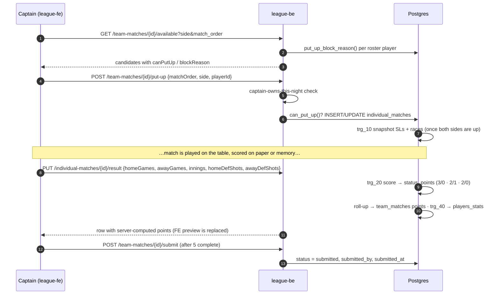
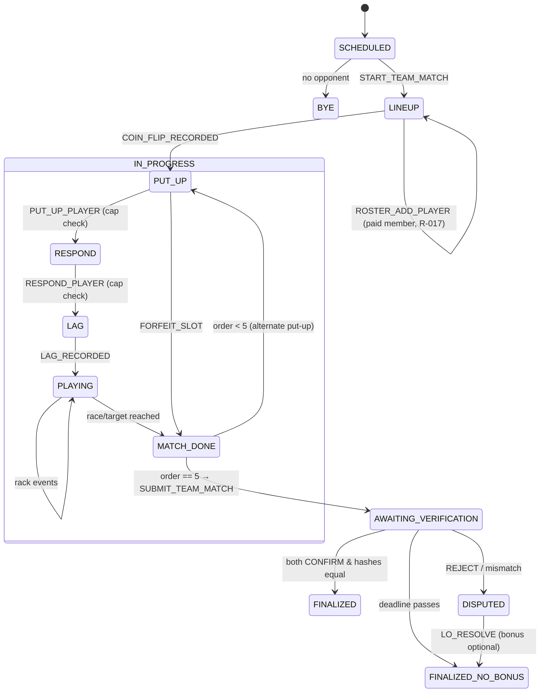
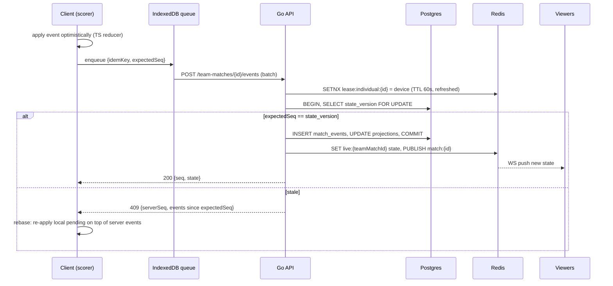
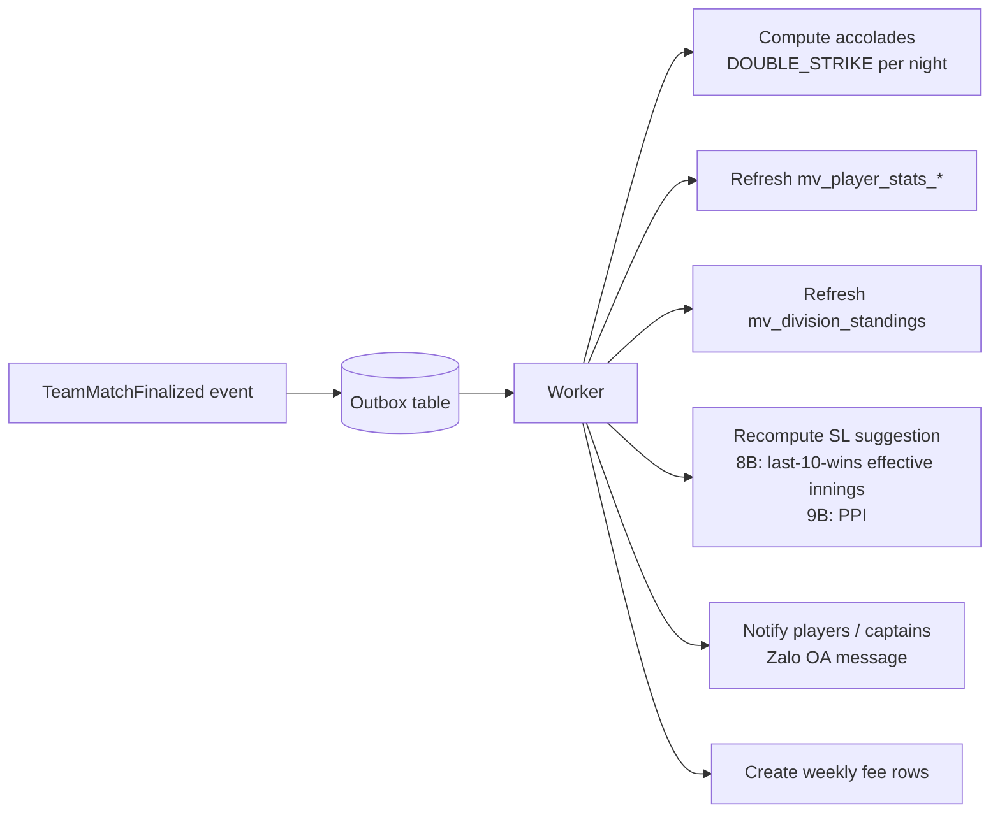

# 08 — Scorekeeping Engine

## 0. Phase 1 (MVP): result entry

The MVP does **not** score shot by shot. The captain enters each individual match's final numbers, and Postgres does the rest (📐 `00002_business_rules.sql`, see [06 §B](06-data-model.md#b--planned-00002_business_rulessql-per-plan-2-must-be-restored)).



| Concern | MVP behavior |
|---|---|
| Concurrency | Two captains can act at once; the server re-checks `can_put_up()` on every put-up. Results are last-write-wins per row (admins can correct after submit) |
| Validation | Games above a race, or both players at their race, raise in the trigger → `400 40001` |
| Undo | Re-submit the result with corrected numbers before the night is submitted |
| Offline | None. The PWA caches only static assets |
| Audit | `individual_matches.entered_by`, `team_matches.submitted_by` |

Everything below this point is the **🎯 Phase 2 target**: live tap-by-tap scoring. When it is built, it must either call the same Postgres scoring functions at rack end, or move the rules into a Go engine shared with TS (revisit ADR-004). Either way the cookie/CSRF/envelope conventions in [07 §1](07-api-design.md#1-conventions-as-built) apply.

---

Live scoring is the most critical and most complex part of the system. It runs on a phone in a noisy billiard club, often on poor Wi-Fi, for about 3 hours per night across many venues at once.

## 1. Design principles

1. **Event-sourced.** Every tap is an immutable event in `match_events`. All scores, innings, DS and points are **projections** of the event log. This gives an audit trail, undo, dispute evidence and SL recalculation from raw data.
2. **Deterministic pure reducer.** `state' = reduce(state, event)` runs on the server (authoritative) and is mirrored in TypeScript in `league-fe/src/lib` for optimistic UI and offline use. Both are tested against the **same JSON fixtures**. Whether the server side is a new Go package or stays in the Postgres scoring functions (called at rack end) is the Phase 2 ADR-004 revisit.
3. **Server authoritative.** The client applies events optimistically. The server validates, assigns `seq` and broadcasts. On conflict the client rebases.
4. **Offline-tolerant.** Events are queued in IndexedDB with client-generated `idempotency_key`s and replayed when the connection returns.
5. **Single active scoring device per individual match** (lease), with read-only live viewers.

## 2. Team match lifecycle



## 3. Event catalogue

All events share `{idempotencyKey, teamMatchId, expectedSeq, clientTs, deviceId, type, payload}`.

### 3.1 Team-level events
| Type | Payload | Validations |
|---|---|---|
| `START_TEAM_MATCH` | `{scorekeeperName}` | Status SCHEDULED; actor is a captain of either team or LO; within the start window ⚠️ (±2 h of scheduled) |
| `ROSTER_ADD_PLAYER` | `{teamId, playerId}` | Before match 1 starts; player is a paid member (R-014), eligible in the division (R-011/R-012); captain of that team. Brand-new players are created via the admin API (R-018) |
| `COIN_FLIP_RECORDED` | `{winnerTeamId, choice}` | Once |
| `PUT_UP_PLAYER` | `{order, teamId, playerId}` | Correct team per R-030/R-031; player not used yet; cap feasibility (R-035) |
| `RESPOND_PLAYER` | `{order, teamId, playerId}` | Same checks for the other team |
| `FORFEIT_SLOT` | `{order, forfeitingTeamId}` | No eligible player |
| `SUBMIT_TEAM_MATCH` | `{}` | All 5 slots COMPLETED/FORFEIT |
| `VERIFY` | `{teamId, decision, snapshotHash, comment}` | Captain of teamId; hash equals the server hash for CONFIRM |
| `LO_RESOLVE` | `{resolution, corrections[], grantBonus}` | LO only; corrections produce `ADMIN_CORRECTION` events |

### 3.2 Individual match / rack events
| Type | Payload | Effect |
|---|---|---|
| `LAG_RECORDED` | `{winnerPlayerId, breakerPlayerId}` | Lag winner chooses the breaker. Sets `activePlayer = breaker`. Rack 1 opens |
| `TURN_OVER` | `{playerId}` | Must be the active player. Switches the active player. If `playerId == secondShooter` → `innings++` (R-100) |
| `DEFENSIVE_SHOT` | `{playerId}` | `ds[player]++` and then the same effect as `TURN_OVER` (R-102) |
| `TIMEOUT` | `{playerId}` | `timeoutsLeft[player] > 0`; decrement (resets per rack) |
| `BALL_POCKETED` (9B) | `{ball:1..9, playerId}` | Ball not yet accounted for in this rack; points += 1 (or 2 for the 9); if `ball==9` → rack ends |
| `DEAD_BALL` (9B) | `{ball:1..8}` | Not the 9 (R-082); deadBalls++ |
| `RACK_END` (8B) | `{outcome, shooterPlayerId}` | BR/8OB only if `firstTurnLive` (R-060). Winner = shooter for win codes, opponent for loss codes |
| `UNDO` | `{revertsSeq}` | Only the **last** non-undone event of the individual match. The projection is re-reduced |
| `SWITCH_ACTIVE_PLAYER` | `{playerId}` | Correction from the overflow menu (⋮) |
| `ADMIN_CORRECTION` | `{path, from, to, reason}` | LO only, post-match, audited |

## 4. Reducer state (per individual match)

```ts
type LiveMatchState = {
  format: 'EIGHT_BALL' | 'NINE_BALL';
  order: 1|2|3|4|5;
  players: { home: PlayerRef; away: PlayerRef };       // with SL snapshot
  needed: { home: number; away: number };              // race games or target points
  won:    { home: number; away: number };              // games or points (capped)
  lagWinner: Side; breaker: Side;
  secondShooter: Side;                                 // innings counter side
  activePlayer: Side;
  innings: number;                                     // match total
  rack: {
    no: number; breaker: Side; innings: number;
    firstTurnLive: boolean;                            // R-060
    ds: { home: number; away: number };
    timeoutsLeft: { home: number; away: number };
    balls?: Record<1|2|3|4|5|6|7|8|9, Side | 'dead' | null>; // 9B
    points?: { home: number; away: number };           // 9B
  };
  ds: { home: number; away: number };                  // match totals
  status: 'LAG' | 'IN_PROGRESS' | 'COMPLETED';
  result?: { winner: Side; ptsEarned: { home: number; away: number } };
  accolades: Accolade[];
};
```

### 4.1 8-Ball reduction (pseudo)

```text
on RACK_END(outcome, shooter):
  assert status == IN_PROGRESS
  if outcome in {BREAK_AND_RUN, EIGHT_ON_BREAK}: assert rack.firstTurnLive && shooter == rack.breaker
  winner = outcome in WIN_CODES ? shooter : other(shooter)
  won[winner] += 1
  record accolade(BR | 8OB) for shooter if applicable
  if won[winner] == needed[winner]:
      status = COMPLETED
      loser = other(winner)
      pts = points8(won[loser], needed[loser])            # 04 §5.3
      if won[loser] == 0 and lagWinner == winner: accolade RACKLESS
      check DOUBLE_STRIKE for each player on the team-match night
  else:
      open next rack: breaker = (break_rule == WINNER ? winner : alternate)
      rack.firstTurnLive = true; timeouts reset by SL

on TURN_OVER(p):
  assert p == activePlayer
  rack.firstTurnLive = false
  if p == secondShooter: innings += 1; rack.innings += 1
  activePlayer = other(p)
```

### 4.2 9-Ball reduction (pseudo)

```text
on BALL_POCKETED(ball, p):
  assert rack.balls[ball] == null and p == activePlayer
  rack.balls[ball] = p
  pts = (ball == 9) ? 2 : 1
  won[p] = min(needed[p], won[p] + pts)                 # R-083 cap
  if won[p] == needed[p]: complete match
      loserPts = lookup20(loserSL, won[loser]); winnerPts = 20 - loserPts
  elif ball == 9:
      remaining unaccounted balls → prompt "mark as dead?" → DEAD_BALL events
      if breaker legal-break & firstTurnLive & ball==9 on break → accolade 9OB
      open next rack (breaker per rule)

on DEAD_BALL(ball): assert ball != 9; rack.balls[ball] = 'dead'
```

**Innings detail (both formats).** The inning counter belongs to the match. It increments only on the second shooter's turn ends (`TURN_OVER` or `DEFENSIVE_SHOT`). A rack that ends during the first shooter's turn does **not** increment the inning. This matches the APA paper rule "An inning is not over … until the player who lost the initial lag misses or otherwise completes his/her turn."

## 5. Concurrency, ordering, and offline



- **Idempotency:** a duplicate `idempotency_key` returns the original result (HTTP 200, same seq).
- **Scoring lease:** only the device holding `lease:individual:{id}` can write rack events. Another captain or LO can **take over** explicitly (audited). This handles a phone dying mid-match.
- **Batching:** the client sends up to 50 queued events per request, in order. The server processes them sequentially in one transaction, so partial failure stops at the first invalid event.
- **Clock:** ordering is by server `seq`. `client_ts` is used only for display and shot-timer analytics.

## 6. Verification snapshot

On `SUBMIT_TEAM_MATCH`, the server builds a canonical JSON:

```json
{
  "teamMatchId": "<team-match-uuid>",
  "matches": [
    {
      "order": 1,
      "home": {
        "memberNo": "26110042",
        "sl": 5,
        "won": 4,
        "needed": 4,
        "pts": 2,
        "innings": 17,
        "ds": 1
      },
      "away": {
        "memberNo": "26100007",
        "sl": 3,
        "won": 1,
        "needed": 2,
        "pts": 1,
        "innings": 17,
        "ds": 0
      }
    }
  ],
  "totals": {
    "home": 9,
    "away": 5
  }
}
```

A real snapshot has 5 items in `matches` (orders 1–5). Only order 1 is shown here. Keys are sorted and whitespace is removed before hashing, so formatting never changes the hash.

`snapshot_hash = sha256(canonical_json)`. Each captain's app shows the summary (mirrors Foundation #3/#4) and sends `VERIFY {decision, snapshotHash}`. If both CONFIRM with an equal hash → FINALIZED, bonus applied (R-110). In Phase 2 dual-device mode, each team's scorer keeps its own event stream. The server diffs the projections and produces `disputes.diff` if they differ.

## 7. Post-finalization pipeline



The transactional **outbox pattern** (an `outbox` table written in the finalize transaction and polled by the worker) guarantees at-least-once processing. Consumers are idempotent.

## 8. Edge cases checklist (each must have a test)

| # | Case | Expected |
|---|---|---|
| 1 | SL2 vs SL2, loser wins 1 | Hill → 2-1 |
| 2 | 8OB after a turn-over in the same rack | Rejected (R-060) |
| 3 | Early 8 by the breaker on the break | LOSS for the breaker (E8), opponent +1 |
| 4 | 9-ball pocketed on a foul | Not dead, re-spot; no points; rack continues |
| 5 | 9B player at 37/38 makes the 9 | Recorded 38 (capped), match ends |
| 6 | Rack ends on the first shooter's turn | Innings unchanged |
| 7 | Undo after a match-ending rack | Match re-opens, points cleared |
| 8 | Lineup would exceed 23 | Player disabled with reason "would exceed 23 SL cap" |
| 9 | Two devices submit the same event offline | Second is idempotent no-op |
| 10 | Two devices submit different events at the same seq | Second gets 409 and rebases, or is rejected without a lease |
| 11 | SL changed by the LO mid-night | Matches already created keep the snapshot; later slots use the new SL |
| 12 | Forfeit slot 5 | Opponent 3 pts (8B) / 20 pts (9B) ⚠️; no MP for either player |
| 13 | Verification deadline passes with one confirm | FINALIZED_NO_BONUS for both teams ⚠️ |
| 14 | BR + 8OB by the same player on the same night | DOUBLE_STRIKE accolade once per night |
