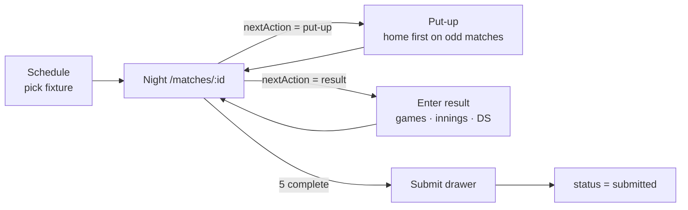
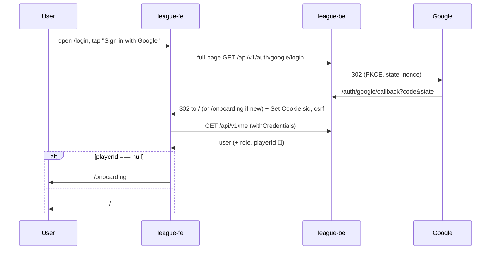

# 09 — Frontend Design (league-fe)

Repo: `league-fe` (GitHub `mini-apps-org/league-fe`). Tags 0.1.0–0.1.4.

> 🏗 live in `src/` · 🅿️ parked in `_parked/` (built, not compiled; restore per `_parked/RESTORE.md`) · 🎯 target

## 1. Stack (🏗)

| Concern | Choice |
|---|---|
| App shape | **Single Vite app** (no monorepo / Turborepo). pnpm 10.15, Node ≥ 24 (`.nvmrc`) |
| UI | **React 19.3**, TypeScript ~6.0 (strict, `noUncheckedIndexedAccess`) |
| Build | **Vite 8.3**, dev server on port 5174. A production build fails if `VITE_API_URL` is unset |
| Styling | **Tailwind 4.3** via `@tailwindcss/vite` (no config file), tokens in `src/index.css` |
| Components | **shadcn** CLI 4 (`radix-nova` style, neutral base, lucide icons), Radix UI, vaul (Drawer), sonner (toasts), next-themes (system/light/dark) |
| Server state | **TanStack React Query 5** with `queryOptions` factories |
| Routing | **react-router 7** (`createBrowserRouter`; never `react-router-dom`) |
| HTTP | **axios** (`withCredentials`) wrapped in `BaseAPI` |
| Validation | zod 4, used only by parked forms |
| i18n | i18next + react-i18next. **`en` default/fallback**, `vi`. Choice stored in `localStorage.locale` |
| Tests | Vitest 5, jsdom, Testing Library, **MSW 3**. No Playwright (ask before adding) |
| Quality | ESLint 9 flat config (typescript-eslint, react-hooks, jsx-a11y, tanstack-query, simple-import-sort), Prettier + tailwind plugin, husky (pre-commit lint-staged + typecheck; commit-msg commitlint; pre-push tests) |
| Not used | No zustand, react-hook-form or ky. **The dependency list is closed**; adding one needs approval |

## 2. Source tree

```text
src/
├─ main.tsx              # StrictMode › ThemeProvider › QueryClientProvider › RouterProvider + Toaster; registers SW
├─ api/                  # the ONLY place that touches axios
│  ├─ axios.ts           # instance, CSRF + 401 interceptors
│  ├─ baseAPI.ts         # get/post/put/patch/delete, serializeParams, withQuery
│  ├─ endpoints.ts       # ENDPOINTS, API_BASE
│  ├─ authAPI.ts         # getGoogleSignInURL, fetchMe, logout
│  └─ leagueAPI.ts       # 13 league endpoints (used by parked screens)
├─ queries/              # queryOptions factories: auth.ts ['auth','me'], members.ts ['members','preview',id]
├─ hooks/                # useMe/useLogout, useMemberPreview/useLinkMember, useRole/useIsAdmin, useLoginError
├─ lib/                  # pure logic + tests: csrf, errors, member-id, navigate, query-client, register-sw, icons
├─ types/                # api.ts (ApiEnvelope<T>), auth.ts, errors.ts, league.ts (TEMPORARY hand-written)
├─ components/           # AppHeader, AppLayout, AppSkeleton, RequireAuth, ThemeToggle, UserAvatar,
│  ├─ auth/              # AppMark, GoogleMark, GoogleSignInButton, LegalLine, LegalPageLayout, MemberPreviewCard
│  ├─ league/            # SkillLevelSquare
│  └─ ui/                # shadcn-owned (avatar, button, card, dialog, drawer, dropdown-menu, input, label, select, skeleton, sonner, tabs, textarea, toggle, toggle-group)
├─ pages/                # auth/LoginPage, HomePage, OnboardingPage, RulesPage, PrivacyPage, NotFoundPage, RouteErrorPage
├─ router/index.tsx
├─ i18n/                 # index.ts, en.json, vi.json, i18next.d.ts (vi must have every en key)
└─ test/                 # setup.ts, server.ts (msw), handlers.ts, render.tsx (renderRoutes, renderWithProviders)
_parked/src/             # 🅿️ league screens, 17 components, RequireAdmin, useLeague*, lib/rules.ts, night.ts, schemas.ts, format.ts
```

## 3. Conventions (from `CLAUDE.md` and `.claude/rules/*`)

| Area | Rule |
|---|---|
| Naming verbs | `fetch*` = HTTP, `get*` = sync read, `use*` = hook, `handle*` = handler inside a component, `on*` = handler prop. Constants are `SCREAMING_SNAKE_CASE`. Use domain words (put-up, night, race, skill level) |
| Size | Files ≤ 300 lines, functions ≤ 3 params, nesting ≤ 2. No boolean flag params |
| TypeScript | No `enum` (use `as const` / unions). `import type`. Block bodies with an explicit `return`; one-line arrows only as array callbacks |
| Modules | Named exports only. Sorted imports. Cross-folder imports via `@/`. No `fetch`/`axios` outside `src/api`. Business logic is pure functions in `src/lib` with a sibling test |
| React 19 | No `forwardRef`. `<Ctx value>` instead of `.Provider`. `useOptimistic` / `useActionState` / `useFormStatus` for mutations and forms. Effects only sync external systems. Server state stays in React Query, never copied to `useState`. React Compiler off; memoize only with a measured cost. One component per file |
| shadcn | `components/ui` is CLI-owned (`pnpm dlx shadcn add`), never hand-edited. Confirmations and panels are vaul **Drawers**, never `window.confirm`. Variants via `cva`, merge via `cn`. Semantic tokens only (no hex, lint-enforced). **44 px** tap targets (`size-11`/`h-11`). Icons only through `lib/icons.ts`. No emoji |
| Copy | No hard-coded strings, including `aria-label`, `placeholder`, `title` and `alt`. Errors render `apiError.<code>` |
| Testing | Tests sit beside the code. Query by role → label → text. `userEvent`. `renderWithProviders`. **Network mocked only with MSW**; unhandled requests fail. Assert copy via `i18next.t` |
| Git | Conventional commits (commitlint). The agent never commits or pushes unless asked |
| TODOs | `TODO(<Notion URL>)` only |

## 4. Routes and screens

| Route | Screen | Access | Status | Notes |
|---|---|---|---|---|
| `/login` | Login | public (signed-in users redirect to `/`) | 🏗 | Full-page link to `{VITE_API_URL}/api/v1/auth/google/login`. Banner for `?error=cancelled\|login_failed\|server_error` |
| `/onboarding` | Link member ID | session, no layout | 🏗 UI / 📐 API | Enter 8-digit member ID → `GET /members/preview` → `MemberPreviewCard` → `POST /me/link` |
| `/` | Home → **Schedule** | session | 🏗 placeholder / 🅿️ `SchedulePage` | Season/division select, week chips, fixture cards (status badge, points) |
| `/matches/:id` | **Team roster / night** | session | 🅿️ `MatchPage` | Both rosters (name, member ID, SL, MW/MP, points), 5-match scoresheet, night action bar |
| `/matches/:id/put-up` | **Put-up** | captain (own night) / admin | 🅿️ `PutUpPage` | `PutUpCandidateList` with `x/23` and block reasons |
| `/matches/:id/result/:order` | **Enter result** | captain (own night) / admin | 🅿️ `ResultPage` | Steppers for games (capped at race), innings, DS; `ResultVerdict` previews points via `rules.ts`; server value wins |
| (drawer) | **Night summary & submit** | captain / admin | 🅿️ `SubmitNightSheet` | Team totals, submit |
| `/admin/players` | **Admin players** | admin (`RequireAdmin`) | 🅿️ `PlayersPage` | Search, SL change with reason (`SkillLevelPanel`), history, transfer, add paid member |
| `/rules`, `/privacy` | Legal | public | 🏗 placeholder | |
| `*` | Not found | public | 🏗 | |
| — | Profile (Stats / Teams / Tournaments) | session | 🎯 Phase 2 | [04 §12](04-domain-rules.md#12-statistics-and-profile-metrics), over `player_division_stats` |
| — | Standings | public | 🎯 Phase 2 | Over `team_standings` |
| — | Coin flip, live scoring (Screen 5), verification | captain | 🎯 Phase 2 | [08](08-scorekeeping-engine.md) |

### 4.1 MVP night flow (🅿️)



`_parked/src/lib/night.ts` holds `MATCHES_PER_NIGHT = 5`, `firstPutUpFor(order)` (home puts up first on odd matches) and a `nextAction` state machine.

## 5. Auth client (🏗)



- **No token storage in JS.** The session is the HttpOnly `sid` cookie. The only value in `localStorage` is `locale`.
- **CSRF interceptor:** on unsafe methods, read cookie `__Secure-csrf` (prod) or `csrf` (dev/staging) and send `X-CSRF-Token`.
- **401 interceptor:** `window.location.assign('/login')`, except for `/me` itself. There is no refresh flow.
- **`RequireAuth`:** `useMe` (`retry: false`). While pending it shows `AppSkeleton`; on error it navigates to `/login` with `state.from`. `playerId === null` → `/onboarding`.
- **Logout:** `POST /auth/logout` → clear the query cache → `/login`.
- **Errors:** `toApiError` normalizes to `ApiRequestError(status, code, message)`. An unknown code becomes `50001`; no response gives status 0. The UI shows `messageFor(err)`.
- **Query defaults:** no retry on 4xx, up to 2 retries otherwise; `refetchOnWindowFocus: false`; mutations never retry.

## 6. PWA (🏗)

- `public/manifest.webmanifest`: "Billiard League" / "Bida", standalone, portrait, theme `#1F6FEB`, icons 192/512/maskable.
- `public/sw.js` (production only, cache `bida-static-v1`): cache-first for `/assets/*`, icons and the manifest. It **never caches HTML or `/api/v1`**, so one user's signed-in page can't be shown to the next user on a shared club device.
- 🎯 Phase 2 offline scoring needs an IndexedDB event queue. The rule above still holds: cache app data in IndexedDB keyed by user, never in the HTTP cache.

## 7. 🎯 Phase 2+ frontend additions

| Addition | Notes |
|---|---|
| Generated API types | `openapi-typescript` from league-be swagger (needs swagger 3 or a conversion step). Delete `types/league.ts` |
| Live scoring screens | Coin flip, lag, Screen 5 (turn over / DS / timeouts / 6 outcomes), offline queue. Needs a client state store; propose a dependency (e.g. zustand) for approval |
| Zalo Mini App build | Separate target or wrapper. Zalo login would need a backend identity provider beside Google |
| Language switcher | Keys exist; there is no UI yet. Consider `vi` as the default for the Vietnam launch |
| Playwright E2E | Two-captain night flow (ask before adding the dependency) |
| Profile and standings | Over the existing views |

## 8. Testing (🏗)

| Level | Tooling | Current coverage |
|---|---|---|
| Unit | Vitest | `lib/errors`, `lib/member-id`; 🅿️ `rules.test.ts`, `night.test.ts` |
| Component | Testing Library + MSW | `RequireAuth`, `OnboardingPage` |
| Default MSW handlers | `src/test/handlers.ts` | `/me`, logout, fixtures |
| E2E | — | 🎯 Playwright |

CI (`.github/workflows/ci.yaml`) runs `format:check`, `lint` (zero warnings), `typecheck`, `test` and `build` on every PR to `dev`/`master`.
