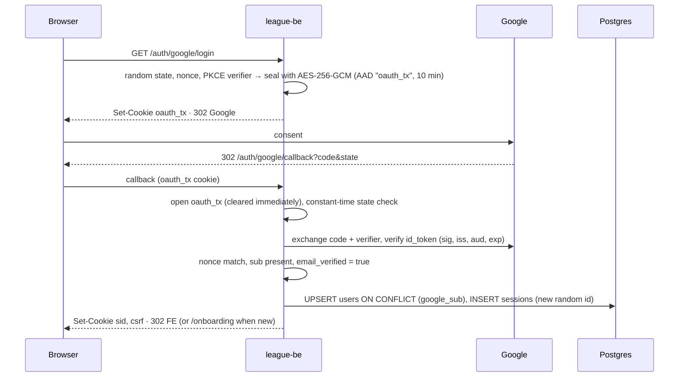

# 11 — Security, Roles and Compliance

> 🏗 as-built · 📐 planned MVP · 🎯 target

## 1. Authentication (🏗 `league-be/internal/auth`)

**Method:** Google OAuth 2.0 / OIDC, Authorization Code + **PKCE (S256)** + `state` + `nonce`. Scopes are `openid email profile`.

| Property | Value |
|---|---|
| Session token | Opaque, 32 CSPRNG bytes (base64url), stored in `sessions.id`. **No JWT, no refresh token** |
| Absolute TTL | `SESSION_TTL` = 12 h (enforced in SQL on `created_at`) |
| Idle TTL | `SESSION_IDLE_TTL` = 30 min (enforced on `last_seen_at`, refreshed on every authenticated request) |
| Session fixation | A new session id is issued on every login |
| Cleanup | Sweep at startup and every 24 h |
| User lookup | By `google_sub` only, never by email |
| Errors | Redirect to `/login?error=cancelled\|login_failed\|server_error` |

### 1.1 Cookies

| Cookie | Prod name | HttpOnly | Path | Domain | Max-Age |
|---|---|---|---|---|---|
| Session | `__Host-sid` | yes | `/` | none (host-locked to `be.`) | `SESSION_TTL` |
| CSRF | `__Secure-csrf` | **no** (SPA reads it) | `/` | `mvip-league.com` | `SESSION_TTL` |
| OAuth transaction | `__Secure-oauth_tx` | yes | `/api/v1/auth/google` | none | 10 min |

- All three cookies are `SameSite=Lax`. They are Secure and use the name prefixes **only when `APP_ENV=production`**; dev and staging use plain names (`sid`, `csrf`, `oauth_tx`) without Secure or Domain.
- The FE reads `__Secure-csrf` and falls back to `csrf`. (`league-fe` `CLAUDE.md` and README still say `__Host-csrf`, which is stale; see [Q35](14-open-questions.md).)

### 1.2 CSRF

Double-submit on the whole `/api/v1` subrouter. Unsafe methods need the `csrf` cookie to equal header `X-CSRF-Token` (constant-time compare). A missing cookie returns `40301`; a mismatch returns `40302`.

### 1.3 Onboarding / member link (📐)

After first login, `players.user_id` is NULL for this user, so `/me` returns `playerId: null` and the FE routes to `/onboarding`:
1. The user enters their 8-digit member ID.
2. `GET /members/preview` returns a limited `MemberPreview` (`displayName`, SL, team, `alreadyLinked`, `linkedToMe`).
3. `POST /me/link` sets `players.user_id`.

**Privacy risk:** member IDs are guessable (the seeded IDs are sequential), so the preview must reveal as little as possible and be rate-limited ([Q31](14-open-questions.md)).

## 2. Roles and permissions

### 2.1 As-built data (🏗 seeded in `00001_init.sql`)

| Permission code | PLAYER | CAPTAIN | ADMIN |
|---|---|---|---|
| `player.read` | ✅ | ✅ | ✅ |
| `match.put_up` | — | ✅ | ✅ |
| `match.enter_score` | — | ✅ | ✅ |
| `match.submit` | — | ✅ | ✅ |
| `roster.manage` | — | ✅ | ✅ |
| `player.change_skill_level` | — | — | ✅ |
| `season.manage` | — | — | ✅ |

- **Role resolution (📐):** a user may have several rows in `users_roles`. `/me` returns the highest by **ADMIN > CAPTAIN > PLAYER**; no row means PLAYER (least privilege).
- **Enforcement today:** none. No Go code reads these tables yet. The role middleware and permission checks come with `internal/league` (📐).

### 2.2 Action matrix (📐 MVP)

| Action | Player | Captain | Admin |
|---|---|---|---|
| View schedule, nights, rosters | ✅ | ✅ | ✅ |
| Put up / enter result / submit night | — | ✅ **own night only** | ✅ any |
| Edit after submit | — | — | ✅ |
| Add a paid member to own roster | — | ✅ | ✅ |
| Search players | — | — | ✅ |
| Change SL (with reason) / see history | — | — | ✅ |
| Transfer player | — | — | ✅ |

**Captain-owns-this-night:** the role is CAPTAIN **and** the user's `players.id` equals `captain_player_id` of the home or away team. The server computes this once (`viewerCanManage`, `viewerSide`). The FE hiding a button is cosmetic, not a permission check.

### 2.3 🎯 Later roles

`LEAGUE_OPERATOR` and `DIVISION_REP` scoped per league/division (needs `users_roles.scope_*` or a separate grants table), and `SCOREKEEPER` as a lease holder for live scoring. These map onto the current ADMIN role until multi-league tenancy exists.

## 3. Transport and headers (🏗)

| Control | Setting |
|---|---|
| CORS | Single origin `https://www.mvip-league.com`, credentials allowed, headers `Accept, Content-Type, Origin, X-CSRF-Token` |
| API headers | `X-Content-Type-Options: nosniff`, `X-Frame-Options: DENY`, `Referrer-Policy: no-referrer`, `Cross-Origin-Opener-Policy: same-origin`, CSP `default-src 'none'; frame-ancestors 'none'`, HSTS 1 y + subdomains (prod) |
| FE headers (`vercel.json`) | `nosniff`, `Referrer-Policy: strict-origin-when-cross-origin`, `X-Frame-Options: DENY`, `Permissions-Policy` (camera, mic, geolocation off) |
| Request size | 1 MiB JSON limit, unknown fields rejected |
| Secrets | Env vars only; `.env*` excluded from the image. CI → GCP via **Workload Identity Federation** (no JSON keys) |

## 4. Known gaps

| Gap | Risk | Action |
|---|---|---|
| No rate limiting | Member IDs can be enumerated through the preview endpoint, and the login endpoints can be hammered | Redis or in-memory token bucket; Cloudflare rate-limit rules on `/auth/*` and `/members/preview` |
| No role middleware yet | All future league routes are unprotected until it exists | Build it with `internal/league` |
| Google consent screen in Testing mode | Only test users can sign in | Publish before the beta |
| Login CSRF (cookie forcing) not mitigated | Low | Accept for the MVP (documented in the auth README) |
| `audit_log` missing | Only SL changes are recorded (`skill_level_history`) | Phase 2 table |
| Stale security docs | Engineers follow wrong cookie names | Fix the auth README and FE `CLAUDE.md` ([Q35](14-open-questions.md)) |

## 5. Data integrity and anti-fraud

- SL changes go through `change_skill_level()` (reason required, history row, `changed_by`).
- Played matches keep their SL and race snapshots.
- Admins can edit after submit. 🎯 Phase 2 adds `audit_log` for every such edit, plus dual-captain verification and dispute records ([04 §8](04-domain-rules.md#8-score-matching-verification-and-bonus)).
- 🎯 Phase 3: anomaly detection on innings and defensive-shot ratios (anti-sandbagging).

## 6. Privacy: Vietnam Decree 13/2023/ND-CP (PDPD)

| Requirement | Implementation |
|---|---|
| Consent | Consent at first login (purpose: league operations, stats publication); store the version and time (🎯) |
| Minimization | Store only Google `sub`, email, name and avatar. Public views show name, member ID and stats only |
| Member preview | Reveal a display name only, never full contact data |
| Data subject rights | Export; deletion → pseudonymize the player and keep match history ("Former member #ID") |
| Location | GCP `asia-southeast1` (Singapore). Document a cross-border transfer impact assessment |
| Breach | Notify within 72 h (runbook) |
