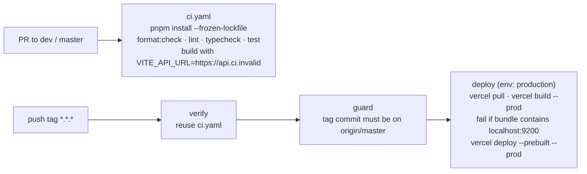
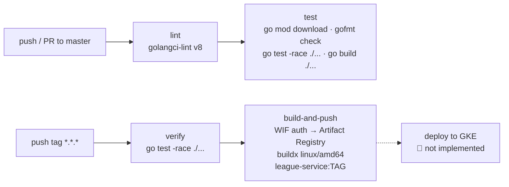
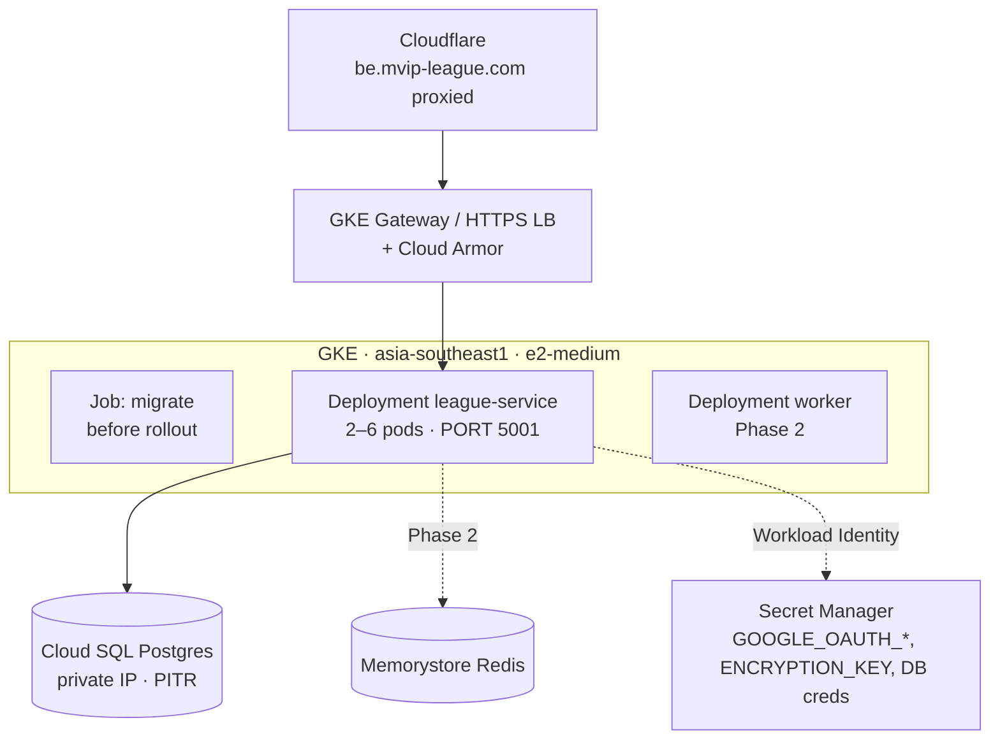

# 12 — Infrastructure and DevOps

> 🏗 as-built · 🎯 target (not yet in any repo)

## 1. Environments and hosts

| Env | Frontend | API | Config |
|---|---|---|---|
| development | `http://localhost:5174` (`pnpm dev`) | `http://localhost:9200` (`make run` with air hot reload) | `development.yaml`, `.env` |
| staging | 🎯 (no separate Vercel target yet) | `https://be.mvip-league.com` per `staging.yaml` | ⚠️ `staging.yaml` = `production.yaml` (same hosts), so staging needs its own hostnames |
| production | `https://www.mvip-league.com` (Vercel) | `https://be.mvip-league.com` | `production.yaml` + env vars |

DNS: **Cloudflare** for `mvip-league.com`. `www` points to Vercel; `be` points to the GCP load balancer (🎯 manifests).

## 2. Frontend pipeline (🏗 `league-fe/.github/workflows`)

- Secrets: `VERCEL_TOKEN`, `VERCEL_ORG_ID`, `VERCEL_PROJECT_ID`. Vercel env: `VITE_API_URL`.
- `vercel.json`: build `pnpm build`, output `dist`, **git deployments disabled**, SPA rewrite (except icons, manifest, `assets/`), security headers, `/assets/*` immutable for 1 year, `/sw.js` no-cache.
- Concurrency: deploys queue rather than cancel.
- Rollback: `vercel rollback`.
- Post-release checks (README): sign in, open a deep link, and confirm logout sends `X-CSRF-Token`.

## 3. Backend pipeline (🏗 `league-be/.github/workflows`)

- **Auth to GCP:** Workload Identity Federation. Pool `github-pool`, provider `github-provider` (project number 225614846438), service account `github-actions@vincent-mini-apps-project.iam.gserviceaccount.com`.
- **Image:** `asia-southeast1-docker.pkg.dev/vincent-mini-apps-project/league-repository/league-service:<tag>`. The build arg `VERSION` is stamped into the binary and shown by `/health`.
- **Dockerfile:** `golang:1.26-alpine` builder (CGO off, `-trimpath -s -w`) → `gcr.io/distroless/static-debian12:nonroot`. Exposes 9200 (⚠️ the staging/prod YAML listens on 5001; set `PORT` or align them).
- **Makefile:** `run`, `api`, `swagger`, `vet`, `test`, `coverage`, `ar-login`, `image`, `image-push`. 🎯 Add `migrate` and `seed`.

## 4. 🎯 Target runtime on GCP

| Item | Plan |
|---|---|
| Manifests | Helm chart or Kustomize in `league-be/deploy/` with Deployment, Service, HPA, PDB, readiness probe (`/readyz` with a DB ping, 🎯) and liveness probe (`/api/v1/health`) |
| Deploy step | Add a `deploy` job to `release.yaml`: `gcloud container clusters get-credentials` → migrate Job → `helm upgrade --atomic` |
| Migrations | Adopt `golang-migrate` or `goose`. Rename files to the tool's format. Expand/contract releases |
| Database | Cloud SQL Postgres (version to match the dev/scratch DB, 16+), automated backups + PITR, private IP, pool max 20 per pod |
| Secrets | Secret Manager via the CSI driver; no secrets in YAML |
| Freeze window | No prod deploys on league nights (Mon–Fri 17:00–23:30 ICT) |
| Staging | Separate hostnames (e.g. `staging.mvip-league.com` / `be-staging.mvip-league.com`), a separate `staging.yaml`, and a separate Google OAuth redirect |
| IaC | Terraform for the VPC, GKE, Cloud SQL, Artifact Registry, IAM (WIF) and Cloudflare DNS |

## 5. 🎯 Observability

| Concern | Today | Target |
|---|---|---|
| Logs | stdlib `log.Printf` (method, path, status, code, reason, cause) | `log/slog` JSON → Cloud Logging, request ID middleware |
| Metrics | — | Managed Prometheus: request latency, 5xx rate, DB pool, Phase 2 scoring metrics |
| Tracing | — | OpenTelemetry → Cloud Trace |
| FE errors | — | Sentry or Vercel monitoring |
| Uptime | — | Cloud Monitoring checks on `/api/v1/health` and `www.` |

## 6. Backup and DR (🎯)

- Cloud SQL daily backups (35 days) + PITR (7 days), with a monthly restore test.
- RPO ≤ 5 min, RTO ≤ 1 h.
- Images are immutable per tag, so a rollback is redeploying the previous tag. FE rollback is `vercel rollback`.

## 7. Indicative monthly cost (🎯 Phase 1)

| Item | Size | USD / month |
|---|---|---|
| GKE (Standard, 2 × e2-medium) or Autopilot | small | 60–150 |
| Cloud SQL Postgres | db-custom-1-3840, 20 GB, backups | 60–120 (HA ≈ ×2) |
| LB + egress + logs | | 25–60 |
| Artifact Registry | < 5 GB | < 5 |
| Vercel | Hobby/Pro | 0–20 |
| Cloudflare | Free | 0 |
| **Total** | | **≈ 150–350** |

Phase 2 adds Memorystore Redis (≈ 35–70) and HA Postgres.
