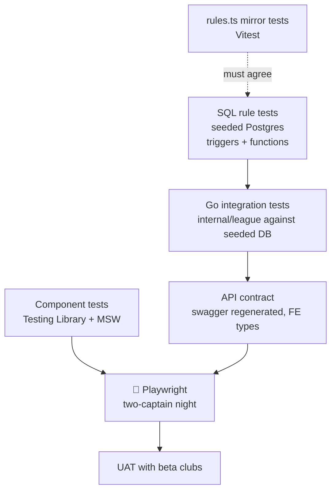

# 13 — Non-Functional Requirements and Test Strategy

## 1. Non-functional requirements

| ID | Category | Requirement | Measure | Phase |
|---|---|---|---|---|
| NFR-01 | Performance | API response for MVP reads/writes from Vietnam | p95 < 300 ms | 1 |
| NFR-02 | Performance | Schedule / night page load on 4G | LCP < 2.5 s | 1 |
| NFR-03 | Correctness | Points, race, cap and stats are computed **only** by Postgres functions | Server value always wins over the TS preview | 1 |
| NFR-04 | Concurrency | Two captains acting on one night at the same time | Server re-checks `can_put_up()`; no double put-up | 1 |
| NFR-05 | Availability | League nights (Mon–Fri 18:00–24:00 ICT) | 99.5% (MVP) → 99.9% (Phase 2) | 1–2 |
| NFR-06 | Security | Session cookies + CSRF; OWASP ASVS L2 baseline; PDPD | Pen-test before public launch | 1 |
| NFR-07 | Shared devices | No signed-in HTML or API data cached by the service worker | Verified by SW tests | 1 |
| NFR-08 | Usability | Phone-first; 44 px tap targets; no hard-coded copy | Lint and review | 1 |
| NFR-09 | Localization | en + vi; vi must contain every en key | Typecheck-enforced | 1 |
| NFR-10 | Auditability | Every SL change has a reason, author and time | `skill_level_history` | 1 |
| NFR-11 | Live scoring latency | Tap → local UI < 50 ms; server round-trip p95 < 200 ms | | 2 |
| NFR-12 | Offline | A full individual match can be scored offline and synced without loss | | 2 |
| NFR-13 | Scale | 200 concurrent team matches; 5k WebSocket viewers | k6 | 2 |

## 2. Test strategy

### 2.1 Rule tests (single source = Postgres)

| Suite | Where | Cases |
|---|---|---|
| Race chart | SQL test + `rules.test.ts` | All 36 pairs; mirror symmetry; SL6v4 = 5/3 |
| Points (`fn_score_individual_match`) | SQL | 3–0 → 3/0; 4–3 both race 4 → 2/1 (hill); 4–1 loser race 3 → 2/0; 5–2 both race 5 → 2/0; games > race raises; both at race raises; loser race 2 with 1 game → 2/1 |
| Snapshot (`fn_snapshot_put_up`) | SQL | Fires once both sides are up; never overwrites; an SL change afterwards leaves the snapshot |
| Roll-up | SQL | Night totals equal the sum of 5 rows after insert, update and delete |
| `put_up_block_reason` | SQL | `would_break_23` (reads `skill_level_cap`), `already_put_up`, `not_on_roster`, `side_complete`; `can_put_up` agrees on every row |
| `change_skill_level` | SQL | Rejects SL outside 2..7, a blank reason, an unknown player, a no-op; writes history with `changed_by` |
| Stats | SQL | `players_stats` recompute; `player_division_stats` shows zeros for unplayed players; `team_standings` counts only `submitted` |
| Mirror drift | Vitest | `_parked/src/lib/rules.ts` race chart and `pointsFor` equal the SQL cases above |

### 2.2 Backend

- `go test -race ./...` in CI (🏗).
- 📐 `internal/league` integration test with `LEAGUE_TEST_DATABASE_URL`, covering:
  - Reference data and joins.
  - Put-up twice refused.
  - Shutout rolls up to 3.
  - Submit of an incomplete night refused.
  - A player-role user gets 403 on writes.
  - A captain of another team gets 403.
  - `LIKE` input `100%` matched literally.
- Cookie/CSRF tests (🏗 `handlers_cookie_test.go`).

### 2.3 Frontend

- Vitest + Testing Library + **MSW only** (never `vi.mock` the API); unhandled requests fail.
- 🏗 Coverage: `RequireAuth`, `OnboardingPage`, `lib/errors`, `lib/member-id`.
- When restoring parked screens: put-up block reasons, result steppers capped at race, verdict preview, submit drawer, admin SL change (reason required).

### 2.4 End-to-end (🎯)

Playwright is not installed (it needs approval). The first scenario to automate:
1. Admin and captain users are seeded.
2. The captain signs in and opens the week-10 fixture.
3. The captain puts up 5 players; the cap block appears for 03209.
4. The captain enters 5 results and submits.
5. Standings and roster MW/MP update.
6. A player-role user can view but not act.

### 2.5 Integration gate before beta

The FE and BE have **never been run together in a browser** (plan.md status). Before the beta:
1. Run them together locally and in production.
2. Check the CORS preflight is absent on GETs.
3. Check cookie scoping across `www.` and `be.`.
4. Check logout sends `X-CSRF-Token`.

## 3. Definition of Done

- Rule changes are made in SQL **and** in the `rules.ts` mirror in the same change set, with tests on both sides.
- Swagger is regenerated (`make swagger`) and the FE types are updated.
- New error codes are added to the BE registry, the FE `ERROR_CODE` list and both locales; shipped codes are never renumbered.
- vi/en strings are added; no hard-coded copy.
- Repo conventions pass: BE `database.md` rules, FE lint (zero warnings), typecheck, tests.
- Privileged actions are recorded (SL history now; `audit_log` in Phase 2).
