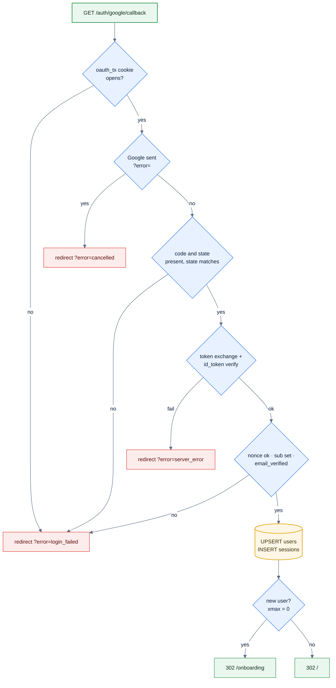

# F1 — Google sign-in

> [Feature specs](../README.md) › [E01 — Identity & Access](README.md) › **F1** · Phase 1

| Phase | Status | Rules | Repo refs |
|---|---|---|---|
| 1 | 🏗 | ADR-003, ADR-009 | `league-be/internal/auth/{handlers,services,services_google,login_transaction}.go` · `league-fe/src/pages/auth/LoginPage.tsx`, `src/components/auth/GoogleSignInButton.tsx`, `src/hooks/useLoginError.ts` |

## Requirements
*As a player, I sign in with my Google account so I don't need a league password.*

| ID | Requirement |
|---|---|
| FR-1.1 | The sign-in control is an `<a href>` to `{VITE_API_URL}/api/v1/auth/google/login` with no query params. It is never an XHR, because the browser must follow the 302 and show Google's origin in the address bar |
| FR-1.2 | The backend uses Authorization Code + PKCE (S256) + `state` + `nonce`, scopes `openid email profile` |
| FR-1.3 | State, nonce and verifier are sealed with AES-256-GCM in the `oauth_tx` cookie (10 min, path `/api/v1/auth/google`), and the cookie is cleared as soon as the callback reads it |
| FR-1.4 | The callback accepts only a verified `id_token` (signature, iss, aud, exp), a matching nonce, a non-empty `sub` and `email_verified = true` |
| FR-1.5 | Users are upserted by `google_sub` only, never by email |
| FR-1.6 | A new user is redirected to `/onboarding`; a returning user to `/` |
| FR-1.7 | Failures redirect to `/login?error=cancelled\|login_failed\|server_error`. The FE shows a banner only for these three values |
| FR-1.8 | A signed-in user who opens `/login` is redirected to `/` |
| FR-1.9 | After the click the button shows a spinner and is disabled, without `preventDefault` |

## Rules & logic

## UI

| Element | Spec |
|---|---|
| Mobile | 88 px app mark "8", "Billiard League", tagline, Google button pinned near the bottom (56 px, radius 14), legal line |
| ≥ 1024 px | Two columns: brand panel (headline + 3 check points + "Fall 2026 · 8-Ball Open") and a 400 px "Sign in" card |
| Google mark | Official four-colour G, 20 px. The only exception to the colour palette |
| Error banner | `loginError.cancelled` "You cancelled the sign-in." · `login_failed` "Sign-in did not complete. Please try again." · `server_error` "Something went wrong on our side. Please try again." |
| Legal line | One key with `<rules>` and `<privacy>` placeholders rendered via `<Trans>`. Links go to the public `/rules` and `/privacy` pages |

## Edge cases

| ID | Situation | Expected |
|---|---|---|
| EC-1.1 | `?error=teapot` or any other unknown value | No banner |
| EC-1.2 | User replays an old callback URL | `oauth_tx` is already cleared → `login_failed` |
| EC-1.3 | Google account with an unverified email | `login_failed` |
| EC-1.4 | Same Google account changes its email | Same user row (matched by `sub`), email updated |
| EC-1.5 | Login takes more than 10 min on Google's page | The transaction expires → `login_failed` |
| EC-1.6 | Consent screen still in Testing mode | Non-test users are refused by Google (F23) |

## Acceptance criteria
- **AC-1.1** Given a new Google account, when sign-in completes, then cookies `sid` and `csrf` are set and the browser lands on `/onboarding`.
- **AC-1.2** Given `/login?error=cancelled`, then the banner reads "You cancelled the sign-in."
- **AC-1.3** Given a signed-in user, when they open `/login`, then they are redirected to `/`.
- **AC-1.4** After sign-in, `localStorage` contains no token (only `locale`).

## Implementation gaps
- The deep link back to the page the user wanted (`next` path in sessionStorage, 24 validation tests) is marked done in login plan-3, but it isn't in `src/`. A stale comment in `src/router/index.tsx` still refers to it. Rebuild it or drop it from scope.
- The `ui-spec.md` error wording differs from `en.json`. Pick one.
- The league-be auth README describes a `hd` (Workspace domain) check and a `return_to` parameter, neither of which exists.

---

[E01 overview](README.md) · [F2 →](F02-sessions-logout.md)
