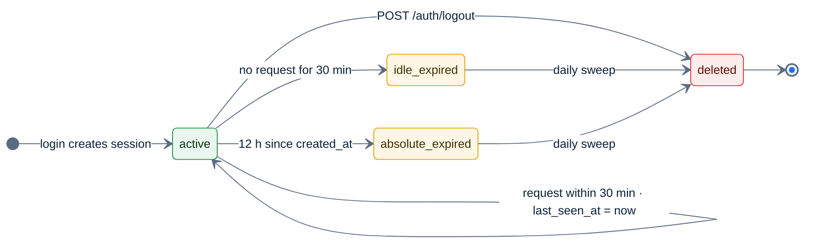

# F2 — Sessions & logout

> [Feature specs](../README.md) › [E01 — Identity & Access](README.md) › **F2** · Phase 1

| Phase | Status | Rules | Repo refs |
|---|---|---|---|
| 1 | 🏗 | ADR-003 | `league-be/internal/auth/{middleware,cleanup,handlers_cookie,repositories}.go` · `league-fe/src/components/RequireAuth.tsx`, `src/hooks/useMe.ts` |

## Requirements

| ID | Requirement |
|---|---|
| FR-2.1 | A session is an opaque 32-byte id (base64url) stored in `sessions`. There is no JWT and no refresh token |
| FR-2.2 | Absolute lifetime `SESSION_TTL` (12 h) and idle lifetime `SESSION_IDLE_TTL` (30 min), both enforced in SQL. Startup fails if idle > absolute |
| FR-2.3 | Every authenticated request updates `last_seen_at` |
| FR-2.4 | A new session id is issued on every login (prevents session fixation) |
| FR-2.5 | Expired sessions are deleted at startup and then every 24 h |
| FR-2.6 | `POST /auth/logout` (CSRF required) deletes the session and clears `sid` and `csrf`. It returns 204 even with no session |
| FR-2.7 | FE `RequireAuth`: `GET /me` with `retry: false`. Pending → `AppSkeleton`; error → `/login` with `state.from` |
| FR-2.8 | Any 401 outside `/me` hard-redirects to `/login`, because there is no refresh |
| FR-2.9 | FE logout clears the React Query cache before navigating to `/login` |

## Rules & logic

| Cookie (prod) | HttpOnly | Domain | Path | Purpose |
|---|---|---|---|---|
| `__Host-sid` | yes | host-only `be.` | `/` | Session |
| `__Secure-csrf` | no | `mvip-league.com` | `/` | Double-submit token, readable by the SPA on `www.` |
| `__Secure-oauth_tx` | yes | host-only | `/api/v1/auth/google` | Login transaction |

In development and staging the cookies use plain names (`sid`, `csrf`, `oauth_tx`), without Secure and without Domain.

## Edge cases

| ID | Situation | Expected |
|---|---|---|
| EC-2.1 | Captain idles for 35 min mid-night, then taps save | 401 `40102` → `/login`; unsaved form input is lost. Recommendation: show a "session expired" toast first |
| EC-2.2 | The night runs longer than 12 h | Re-login is required. Acceptable, since nights are about 4 h |
| EC-2.3 | Logout without a cookie | 204, nothing deleted |
| EC-2.4 | Two tabs open; one logs out | The other gets a 401 on its next request → `/login` |

## Acceptance criteria
- **AC-2.1** Given a session idle for 31 minutes, when `/me` is called, then the response is 401 with code `40102` and the `sid` cookie is cleared.
- **AC-2.2** When the user logs out, then `POST /auth/logout` sends `X-CSRF-Token`, returns 204 and the app shows `/login`.

## Implementation gaps
- `DeleteUserSessions` ("log out everywhere") exists in the repository layer but no route uses it.
- No FE warning before idle expiry. Consider a 25-minute warning on scoring screens.

---

[← F1](F01-google-sign-in.md) · [E01 overview](README.md) · [F3 →](F03-csrf.md)
