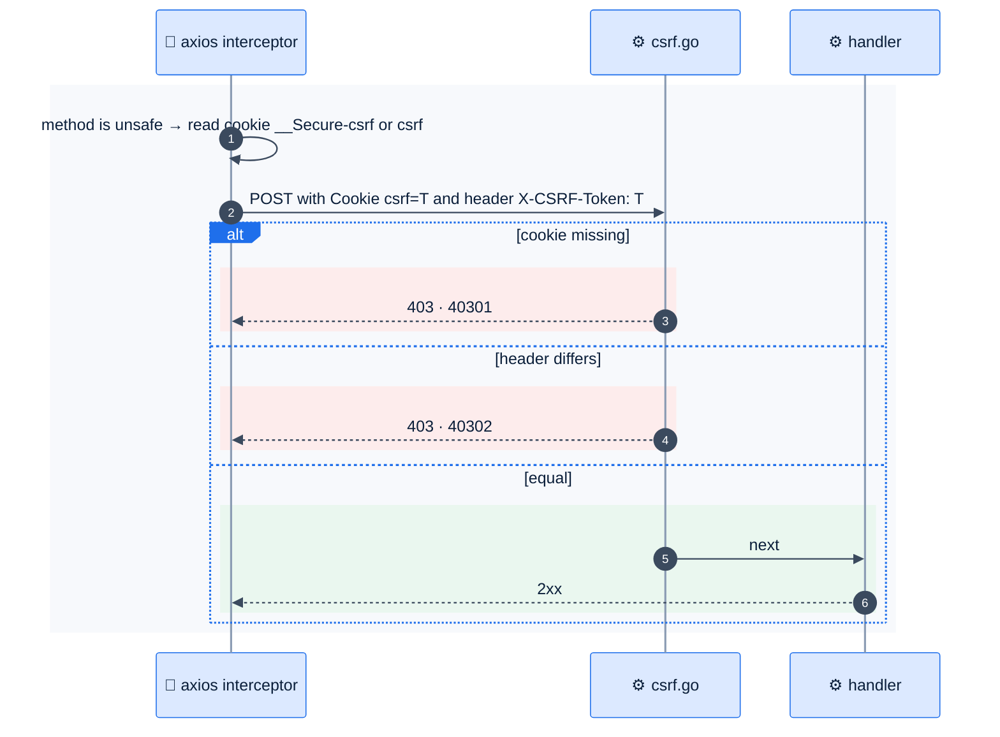

# F3 — CSRF protection

> [Feature specs](../README.md) › [E01 — Identity & Access](README.md) › **F3** · Phase 1

| Phase | Status | Rules | Repo refs |
|---|---|---|---|
| 1 | 🏗 | ADR-003 | `league-be/internal/platform/middleware/csrf.go` · `league-fe/src/lib/csrf.ts`, `src/api/axios.ts` |

## Requirements

| ID | Requirement |
|---|---|
| FR-3.1 | Double-submit: every non-GET/HEAD/OPTIONS/TRACE request under `/api/v1` must send header `X-CSRF-Token` equal to the `csrf` cookie (constant-time compare) |
| FR-3.2 | A missing cookie returns `40301`; a mismatch returns `40302` |
| FR-3.3 | The FE reads `__Secure-csrf` first and falls back to `csrf` |
| FR-3.4 | GETs carry no custom headers, so they stay CORS-simple (no preflight) |

## Flow

## Acceptance criteria
- **AC-3.1** A POST with no `X-CSRF-Token` returns 403 `40302`, or `40301` if the cookie is absent.
- **AC-3.2** In a browser, `GET /api/v1/me` from `www.` shows no preflight in the Network tab.

## Implementation gaps
- The FE `CLAUDE.md` and README name the cookie `__Host-csrf`, but the code (correctly) uses `__Secure-csrf`. Fix the docs ([Q35](../../14-open-questions.md)).

---

[← F2](F02-sessions-logout.md) · [E01 overview](README.md) · [F4 →](F04-me-role-player.md)
