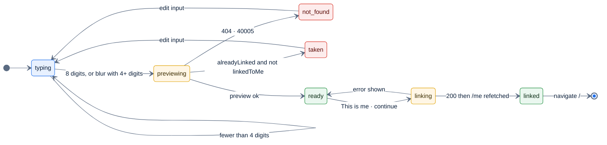

# F5 — Onboarding: link member ID

> [Feature specs](../README.md) › [E01 — Identity & Access](README.md) › **F5** · Phase 1

| Phase | Status | Rules | Repo refs |
|---|---|---|---|
| 1 | 🏗 UI · ❌ API | [Q31](../../14-open-questions.md), [Q33](../../14-open-questions.md) | `league-fe/src/pages/OnboardingPage.tsx`, `src/components/auth/MemberPreviewCard.tsx`, `src/lib/member-id.ts`, `src/hooks/useMemberLink.ts`, `src/queries/members.ts` |

## Requirements
*As a newly signed-in player, I enter the member ID on my league card so the app knows which player I am.*

| ID | Requirement |
|---|---|
| FR-5.1 | Shows "Find your member ID" and "Signed in as {email}", plus a numeric input (`inputMode=numeric`, max 8) with a real label |
| FR-5.2 | Input is normalized to digits only and truncated to 8 (`normalizeMemberId`) |
| FR-5.3 | Lookup runs once the ID has 8 digits, or on blur when it has at least 4. Never on every keystroke |
| FR-5.4 | The preview shows the minimum: `displayName`, SL, team number and name, a captain flag, `alreadyLinked`, `linkedToMe` |
| FR-5.5 | Confirm is enabled only when a preview exists and the member isn't taken by another account (`isTaken = alreadyLinked && !linkedToMe`). Re-linking to yourself is allowed (idempotent) |
| FR-5.6 | Linking waits for the `/me` refetch before navigating to `/`, so the gate never sees a stale `playerId: null` |
| FR-5.7 | "Not you? Sign out" logs out |
| FR-5.8 | The backend refuses linking to a member owned by another user (`40006`) and linking a user who already has a different member (`40007`). An unknown ID returns `40005` |

## Logic



## API & data

`GET /members/preview?member_id=95007620`
```json
{
  "session_id": "<session-id>",
  "count": 1,
  "data": {
    "playerId": "<player-uuid>",
    "displayName": "Thomas D.",
    "skillLevel": 5,
    "teamId": "<team-uuid>",
    "teamNumber": "03209",
    "teamName": "Chalk Dirty to Me",
    "isCaptain": true,
    "alreadyLinked": false,
    "linkedToMe": false
  },
  "metadata": {}
}
```

`POST /me/link`
```json
{
  "memberId": "95007620"
}
```

DB effect: `UPDATE players SET user_id = $user WHERE member_id = $1 AND (user_id IS NULL OR user_id = $user)`. `RowsAffected() = 0` means the member was taken in the meantime → `40006`.

| Error | Copy |
|---|---|
| 40005 | "We can't find that member ID. Check your league card." |
| 40006 | "This member ID is linked to another account. Ask your league admin." |
| 40007 | "This account is already linked to a different member." |

## Edge cases

| ID | Situation | Expected |
|---|---|---|
| EC-5.1 | User types `9500-7620` | Normalized to `95007620` |
| EC-5.2 | Two people race to link the same member | The first wins; the second gets `40006` |
| EC-5.3 | Double-tap on confirm | The second call is idempotent (`linkedToMe`), no error |
| EC-5.4 | Attacker enumerates IDs via preview | Rate-limit the endpoint and reveal only a display name ([Q31](../../14-open-questions.md)) |
| EC-5.5 | Member not on any team | Card shows "No team yet" |

## Acceptance criteria
- **AC-5.1** Given `00000000`, the alert reads the `40005` copy and receives focus.
- **AC-5.2** Given a member linked to another account, the card shows the warning tint and confirm is disabled.
- **AC-5.3** After linking, `/me.playerId` is set and the user never sees `/onboarding` again.

## Implementation gaps
- The backend endpoints don't exist, so every real user is stuck on onboarding. This is the most urgent part of E01.
- The 8-digit length is an FE assumption (`MEMBER_ID_LENGTH`); the DB has no length rule.

---

[← F4](F04-me-role-player.md) · [E01 overview](README.md) · [F6 →](F06-rbac-captain-owns-night.md)
