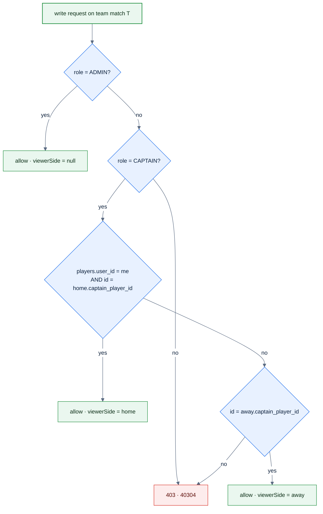

# F6 — Role checks and captain-owns-night

> [Feature specs](../README.md) › [E01 — Identity & Access](README.md) › **F6** · Phase 1

| Phase | Status | Rules | Repo refs |
|---|---|---|---|
| 1 | 🏗 RBAC tables · ❌ enforcement | ADR-006, [11 §2](../../11-security-and-roles.md) | `league-be/db/migrations/00001_init.sql` (RBAC seed) · planned `internal/league/services.go` · `league-fe/_parked/src/components/RequireAdmin.tsx` |

## Requirements

| ID | Requirement |
|---|---|
| FR-6.1 | Every league write route is wrapped in `RequireAuth` plus a role check |
| FR-6.2 | **Captain-owns-night:** put-up, result and submit are allowed when the role is ADMIN, or when the role is CAPTAIN **and** the user's player is `captain_player_id` of the night's home or away team |
| FR-6.3 | The server returns `viewerCanManage` and `viewerSide` on the night payload. The FE never derives them itself |
| FR-6.4 | Admin-only routes: player search, SL change and history, transfer, `/teams` |
| FR-6.5 | Denials return 403 `40304` |
| FR-6.6 | FE `RequireAdmin` hides `/admin/*` from non-admins (cosmetic only) |

## Logic

Permission codes (seeded): `player.read`, `match.put_up`, `match.enter_score`, `match.submit`, `roster.manage`, `player.change_skill_level`, `season.manage`. In the MVP, checks are by role and ownership; permission codes become checks when the LO and Rep roles arrive (F50).

## Edge cases

| ID | Situation | Expected |
|---|---|---|
| EC-6.1 | Captain of team A posts a put-up to a night between B and C | 403 `40304` |
| EC-6.2 | Captain puts up for the opposing side | 403. A captain may act only for `viewerSide` |
| EC-6.3 | A team has no `captain_player_id` | Only an admin can run that night |
| EC-6.4 | Admin edits a submitted night | Allowed (and audited in Phase 2, F41) |

## Acceptance criteria
- **AC-6.1** A PLAYER-role session gets 403 on every POST and PUT in the league API.
- **AC-6.2** The captain of 03209 gets `viewerCanManage: true, viewerSide: "home"` on 03209 vs 03214.

---

[← F5](F05-onboarding-member-link.md) · [E01 overview](README.md) · [F37 →](F37-zalo-login-mini-app.md)
