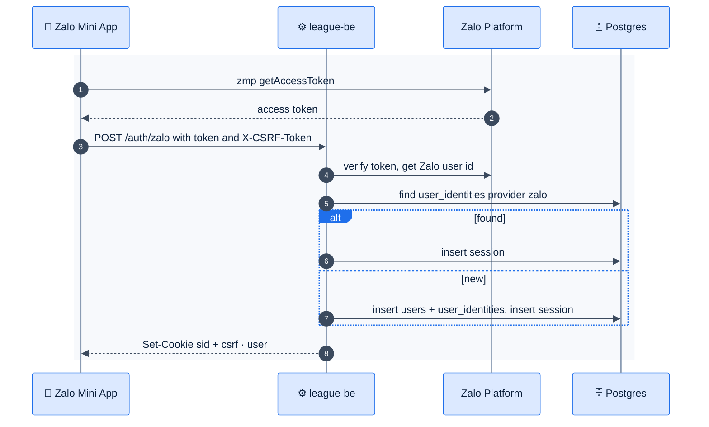

# F37 — Zalo login & Mini App

> [Feature specs](../README.md) › [E01 — Identity & Access](README.md) › **F37** · Phase 2

| Phase | Status | Rules | Repo refs |
|---|---|---|---|
| 2 | 🎯 | ADR-009 revisit | new `internal/auth/services_zalo.go`, FE platform adapter |

## Requirements

| ID | Requirement |
|---|---|
| FR-37.1 | Add Zalo as a second identity provider behind the existing `IdentityProvider` interface. Sessions and cookies stay unchanged |
| FR-37.2 | New table `user_identities (user_id, provider, subject, UNIQUE(provider, subject))`. Google rows migrate from `users.google_sub` |
| FR-37.3 | Account linking: a signed-in user can attach Zalo to their account. Accounts are never merged by phone or email automatically |
| FR-37.4 | The Mini App build wraps the same React app. A `platform` adapter provides `login`, `share` and `storage` |
| FR-37.5 | Inside the Mini App, Zalo login runs automatically; on the web, Google stays the default |

## Flow

## Edge cases and open points
- **Cookies inside the Zalo WebView:** third-party and SameSite behaviour must be verified. If cookies fail, a header-token fallback would need a new ADR.
- **Same person on Google and Zalo:** resolved by explicit linking from the profile (FR-37.3).

## Acceptance criteria
- **AC-37.1** A Mini App user is signed in without a Google prompt, and `/me` works with the cookie session.

---

[← F6](F06-rbac-captain-owns-night.md) · [E01 overview](README.md)
