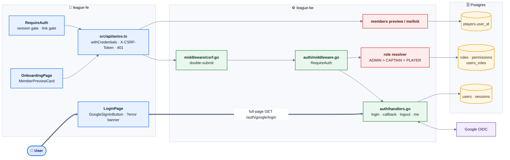
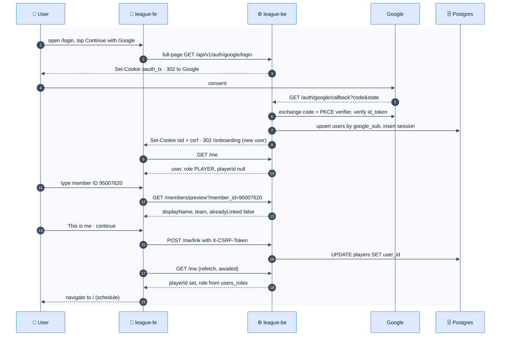
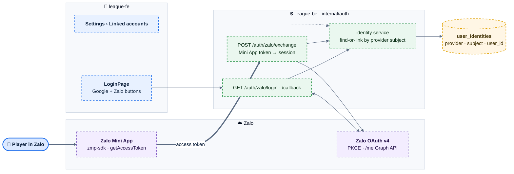
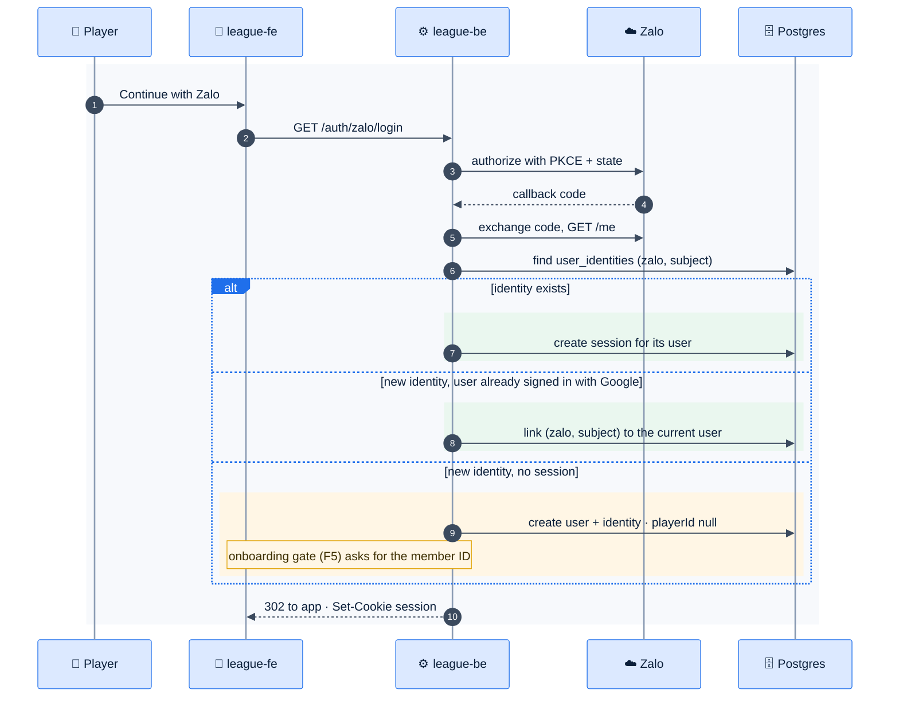

# E01 — Identity & Access

> [Feature specs](../README.md) › **E01**

| | |
|---|---|
| **Goal** | Every person signs in with one identity, is linked to their league membership, and can only do what their role allows |
| **Phase** | 1 (F1–F6) · 2 (F37) |
| **Status** | 🏗 Google sign-in, sessions, CSRF · ❌ `/me` role + `playerId`, member-link API, role enforcement |
| **Actors** | Player, Captain, Admin, Google |
| **Related** | [05 §3 cookie topology](../../05-architecture.md) · [07 error codes](../../07-api-design.md) · [11 security](../../11-security-and-roles.md) |

## Features by phase

### Phase 1

| # | Feature | Status |
|---|---|---|
| F1 | [Google sign-in](F01-google-sign-in.md) | 🏗 |
| F2 | [Sessions & logout](F02-sessions-logout.md) | 🏗 |
| F3 | [CSRF protection](F03-csrf.md) | 🏗 |
| F4 | [`/me` with role + playerId](F04-me-role-player.md) | 🏗 / ❌ |
| F5 | [Onboarding: link member ID](F05-onboarding-member-link.md) | 🏗 UI / ❌ API |
| F6 | [Role checks + captain-owns-night](F06-rbac-captain-owns-night.md) | ❌ |

### Phase 2

| # | Feature | Status |
|---|---|---|
| F37 | [Zalo login & Mini App](F37-zalo-login-mini-app.md) | 🎯 |

## Phase 1 deep dive

### Components

*Red = specified in plan-3 but not in league-be. Everything else is built.*

### Main flow: first sign-in to a linked account

### API surface

| Endpoint | Feature | Status |
|---|---|---|
| `GET /auth/google/login` | F1 | 🏗 |
| `GET /auth/google/callback` | F1 | 🏗 |
| `POST /auth/logout` | F2 | 🏗 |
| `GET /me` | F2, F4 | 🏗 basic · ❌ `role`, `playerId` |
| `GET /members/preview?member_id=` | F5 | ❌ |
| `POST /me/link` | F5 | ❌ |

## Phase 2 deep dive

**Scope:** [F37 Zalo login & Mini App](F37-zalo-login-mini-app.md). Most Vietnamese players live in Zalo, so Phase 2 adds Zalo as a second identity provider and runs the app inside a Zalo Mini App. Sessions, CSRF, RBAC and the member link from Phase 1 stay the same. Only the *front door* changes.

### Components: what Phase 2 adds

*Everything is dashed (Phase 2). Both Zalo paths end in the same identity service, which creates the usual `__Host-sid` session.*

### Key flow: one person, two providers

### Data delta

| Change | Why |
|---|---|
| New `user_identities (user_id, provider, subject, created_at)`, `UNIQUE (provider, subject)` | One user, many providers. Google moves here from `users.google_sub` |
| `users.email` becomes nullable | Zalo doesn't always return an email |
| `GET /me` adds `identities: ["google","zalo"]` | The Linked accounts screen |
| Errors `40008` identity already linked to another user, `40009` cannot unlink the last identity | Safe linking and unlinking |
