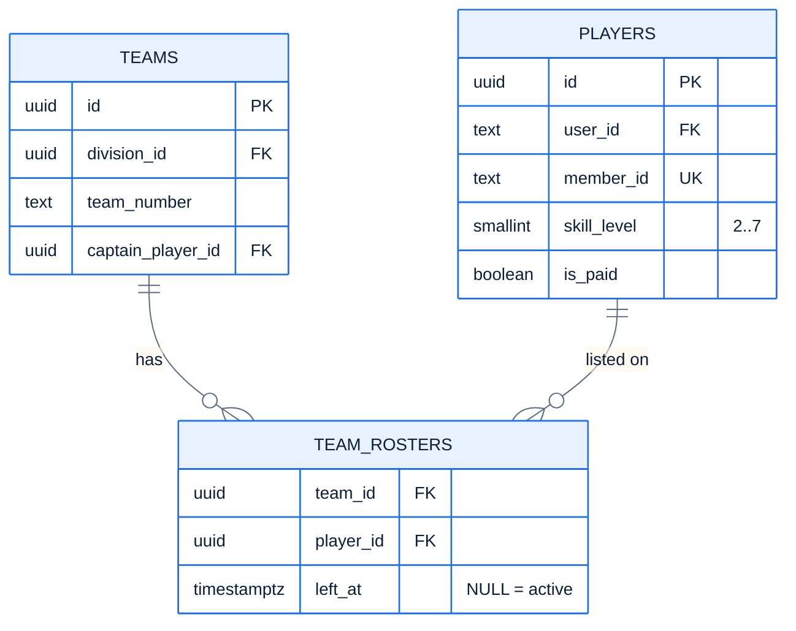

# F7 — Schema restore

> [Feature specs](../README.md) › [E02 — League Data Foundation](README.md) › **F7** · Phase 1

| Phase | Status | Rules | Repo refs |
|---|---|---|---|
| 1 | ❌ | R-011, R-036 | `league-be/db/migrations/00001_init.sql` · spec: `league-fe/plans/…/plan-1-database-foundation.md` |

## Requirements

| ID | Requirement |
|---|---|
| FR-7.1 | Create `team_rosters (team_id, player_id, left_at NULL, …)`. `left_at IS NULL` means "currently on the roster" |
| FR-7.2 | Partial unique index: a player has **at most one active roster** (`WHERE left_at IS NULL`). Phase 2 changes this to one per division ([Q32](../../14-open-questions.md), F39c) |
| FR-7.3 | Partial index on `team_rosters (team_id) WHERE left_at IS NULL` for roster reads |
| FR-7.4 | CHECK on `team_matches.status IN ('scheduled','in_progress','submitted')` |
| FR-7.5 | CHECK on `individual_matches.first_put_up IN ('home','away')` (`status` already has a CHECK) |
| FR-7.6 | Transfers are **close-then-open**: set `left_at`, insert a new row. Never `UPDATE team_id` |
| FR-7.7 | Keep the TEXT `users.id` and every TEXT FK into `users` (matches `auth.User.ID string`) |

## Data

## Edge cases

| ID | Situation | Expected |
|---|---|---|
| EC-7.1 | Inserting a second active roster row for one player | Unique violation → service returns `40001` with a clear message |
| EC-7.2 | Player transferred mid-season | Old row gets `left_at`; played matches still reference the player via `individual_matches` |
| EC-7.3 | Status typo `'Submitted'` | Rejected by the CHECK |

## Acceptance criteria
- **AC-7.1** `psql -v ON_ERROR_STOP=1 -f 00001… -f 00002…` succeeds on an empty database.
- **AC-7.2** A second active roster for the same player fails.

---

[E02 overview](README.md) · [F8 →](F08-postgres-business-rules.md)
