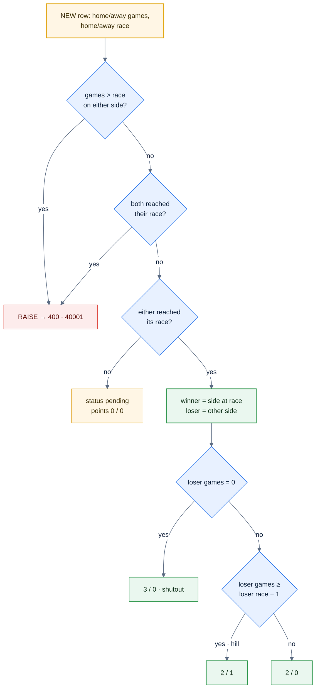
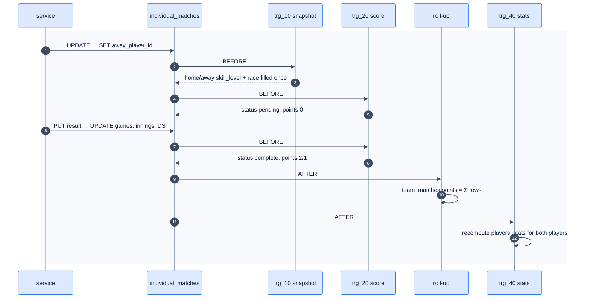

# F8 — Postgres business rules

> [Feature specs](../README.md) › [E02 — League Data Foundation](README.md) › **F8** · Phase 1

| Phase | Status | Rules | Repo refs |
|---|---|---|---|
| 1 | ❌ | R-034/035/036, R-050, R-120, R-125, §5.3 | spec: `plan-2-database-rules-and-seed.md` · mirror: `league-fe/_parked/src/lib/rules.ts` |

## Requirements

| ID | Requirement |
|---|---|
| FR-8.1 | `fn_snapshot_put_up()` BEFORE INSERT/UPDATE on `individual_matches`: when both players are set and `home_skill_level IS NULL`, copy both `players.skill_level` values and look up `race_chart`. Never overwrite |
| FR-8.2 | `fn_score_individual_match()` BEFORE INSERT/UPDATE: derive `status` and points. Raise if games exceed a race or both players reached their race |
| FR-8.3 | `fn_roll_up_team_points()` AFTER INSERT/UPDATE/DELETE: `team_matches.home_points/away_points = Σ` of the 5 rows |
| FR-8.4 | `fn_recompute_player_stats()` (trigger `trg_40_sync_player_stats`): **full recompute** per affected player and division, not a delta |
| FR-8.5 | `put_up_block_reason(team_match_id, side, player_id)` returns `would_break_23 \| already_put_up \| not_on_roster \| side_complete` or NULL. `can_put_up()` is `reason IS NULL` |
| FR-8.6 | `change_skill_level(player_id, new_sl, reason, changed_by)` validates, updates `players.skill_level`, inserts history, and returns the history id |
| FR-8.7 | Views `individual_match_sides`, `player_division_stats` (zeros for unplayed players), `team_standings` (submitted nights only) |
| FR-8.8 | Trigger names are numbered (`trg_10_…`, `trg_20_…`, `trg_40_…`) because Postgres fires same-event triggers in name order |
| FR-8.9 | Functions read `divisions.skill_level_cap`, never a literal 23 |

## Logic: points (`fn_score_individual_match`)



*A match totals 3, 3 or 2 points ([Q29](../../14-open-questions.md)).*

## Logic: put-up block reason

```text
put_up_block_reason(tm, side, player):
  if player not in active team_rosters of tm.<side>_team        → 'not_on_roster'
  if player already in any individual_matches of tm (either side) → 'already_put_up'
  if count(<side>_player_id set in tm) = 5                        → 'side_complete'
  used := Σ snapshot <side>_skill_level of tm rows  (+ live SL of a put-up not yet snapshotted)
  if used + player.skill_level > division.skill_level_cap        → 'would_break_23'
  return NULL
```

> Phase 2 refinement (R-035): also block a pick that leaves the remaining slots impossible to fill within the cap. The MVP checks only the sum including this pick.

## Logic: trigger chain



## Edge cases

| ID | Situation | Expected |
|---|---|---|
| EC-8.1 | Admin changes SL 4 → 6 after match 2 was played | Match 2 keeps SL 4 and race; the next put-up uses 6 |
| EC-8.2 | Result corrected from 3–0 to 3–2 | Points recomputed (3/0 → 2/1); roll-up and stats recomputed |
| EC-8.3 | Row deleted by an admin | Roll-up and stats recompute (the AFTER DELETE path) |
| EC-8.4 | `change_skill_level` with SL 9, a blank reason, or the same SL | Raises; nothing changes |
| EC-8.5 | Loser race 2, loser won 1 | Hill → 2/1 |

## Acceptance criteria
- **AC-8.1** 3–0, winner race 3 → `3/0 complete`. 4–3, both race 4 → `2/1`. 4–1, loser race 3 → `2/0`. 5–2, both race 5 → `2/0`.
- **AC-8.2** With 20 SL used and cap 23: SL 6 → `would_break_23`; SL 3 → NULL.
- **AC-8.3** `team_standings` lists all teams at 0 until a night is `submitted`.

---

[← F7](F07-schema-restore.md) · [E02 overview](README.md) · [F9 →](F09-seed-migrate.md)
