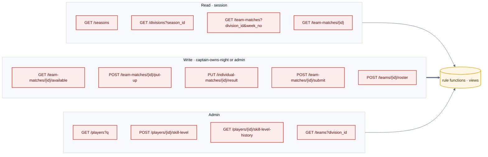

# F10 — League API

> [Feature specs](../README.md) › [E02 — League Data Foundation](README.md) › **F10** · Phase 1

| Phase | Status | Repo refs |
|---|---|---|
| 1 | ❌ | spec: `plan-3-league-api-endpoints.md` · client: `league-fe/src/api/leagueAPI.ts`, `src/types/league.ts` |

## Requirements

| ID | Requirement |
|---|---|
| FR-10.1 | Implement the routes in [07 §2](../../07-api-design.md) under `internal/league` with the repo layering (handlers → services → repositories) |
| FR-10.2 | Responses use `{session_id, count, data, metadata}`. Lists set `count`. Bodies are camelCase; query params are snake_case |
| FR-10.3 | Writes re-check rules server-side (`can_put_up`) even if the UI already blocked the action |
| FR-10.4 | New error codes `40003 UNPAID_MEMBER`, `40004 PUT_UP_REJECTED`, `40005–40007` (member link). Never renumber |
| FR-10.5 | `make swagger` regenerates `docs/swagger`, and the FE types are generated from it (F24) |
| FR-10.6 | An integration test runs every query against a seeded DB (`LEAGUE_TEST_DATABASE_URL`) |

## Endpoint map

## Edge cases

| ID | Situation | Expected |
|---|---|---|
| EC-10.1 | Request body has an unknown field (e.g. snake_case `match_order`) | 400 `40001` (`DecodeJSON` rejects unknown fields) |
| EC-10.2 | `LIKE` search for `100%` | Matched literally (input escaped) |
| EC-10.3 | Two captains put up at the same time | One succeeds; the other gets `40004`, and the FE refreshes the list |

## Acceptance criteria
- **AC-10.1** Swagger lists 18 paths.
- **AC-10.2** The integration test passes all plan-3 assertions.

---

[← F9](F09-seed-migrate.md) · [E02 overview](README.md) · [F38 →](F38-generated-ids.md)
