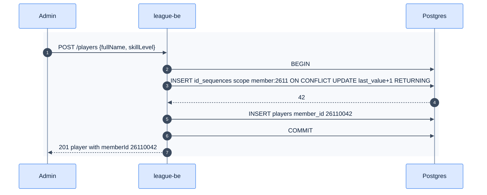

# F38 — Generated Member ID and Team ID

> [Feature specs](../README.md) › [E02 — League Data Foundation](README.md) › **F38** · Phase 2

| Phase | Status | Rules |
|---|---|---|
| 2 | 🎯 | [04 §11](../../04-domain-rules.md), [Q2/Q3/Q33](../../14-open-questions.md) |

## Requirements

| ID | Requirement |
|---|---|
| FR-38.1 | On player creation, generate `member_id = YYMM + 4-digit sequence for that month` (e.g. `26110042`). Admins can no longer type IDs |
| FR-38.2 | On team creation, generate `team_number = RR (region) + VV (venue code) + T (0–9)` **only if** the business confirms region + venue numbering. Otherwise keep the APA-style admin input |
| FR-38.3 | A venue code holds up to 10 teams. When full, a new venue code is allocated |
| FR-38.4 | Sequences are gap-free and safe under concurrency: `id_sequences(scope, last_value)` updated with `UPDATE … RETURNING` in the same transaction |
| FR-38.5 | Existing IDs are never changed |

## Logic

## Edge cases
- **EC-38.1** The 10,000th registration in one month fails clearly (capacity 9,999).
- **EC-38.2** A rolled-back transaction leaves no gap, because the sequence row is updated in the same transaction.

---

[← F10](F10-league-api.md) · [E02 overview](README.md) · [F43 →](F43-migration-tool.md)
