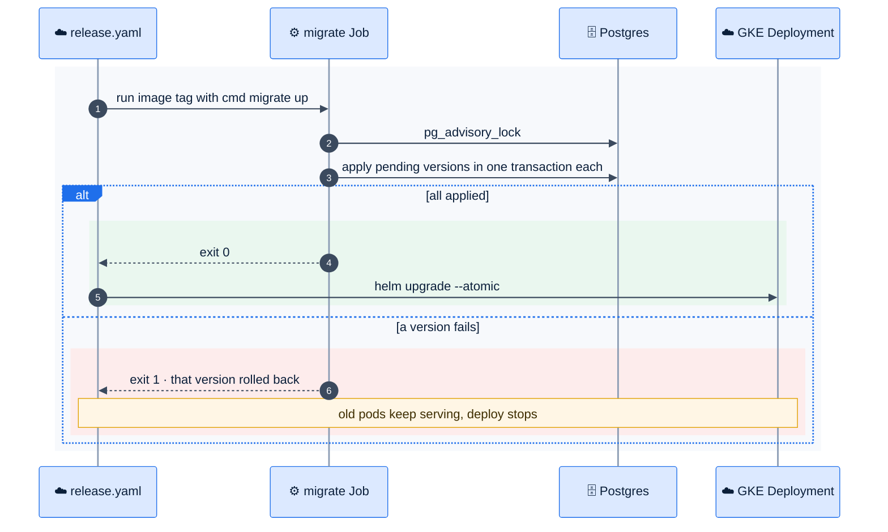

# E02 — League Data Foundation

> [Feature specs](../README.md) › **E02**

| | |
|---|---|
| **Goal** | The league's data, rules and API exist in league-be, so every screen has something real to call |
| **Phase** | 1 (F7–F10) · 2 (F38, F43) |
| **Status** | ❌ **P0 blocker.** Specified in league-fe `plans/…/plan-1..3` as "done", but missing from league-be ([15](../../15-as-built-vs-target.md)) |
| **Actors** | Backend engineers, Admin |
| **Related** | [06 data model](../../06-data-model.md) · [07 API](../../07-api-design.md) · [10 backend](../../10-backend-design.md) · [04 rules](../../04-domain-rules.md) |

## Features by phase

### Phase 1

| # | Feature | Status |
|---|---|---|
| F7 | [Schema restore (`team_rosters`, CHECKs)](F07-schema-restore.md) | ❌ |
| F8 | [Postgres business rules](F08-postgres-business-rules.md) | ❌ |
| F9 | [Seed + migrate/seed targets](F09-seed-migrate.md) | ❌ |
| F10 | [League API](F10-league-api.md) | ❌ |

### Phase 2

| # | Feature | Status |
|---|---|---|
| F38 | [Generated Member ID & Team ID](F38-generated-ids.md) | 🎯 |
| F43 | [Migration tool](F43-migration-tool.md) | 🎯 |

## Phase 1 deep dive

### Components

```mermaid
%%{init: {"theme": "base", "themeVariables": {"fontFamily": "Arial", "fontSize": "14px", "primaryColor": "#E8F1FF", "primaryBorderColor": "#1F6FEB", "primaryTextColor": "#0B1F3A", "lineColor": "#5B6B82", "secondaryColor": "#EAF7EF", "tertiaryColor": "#FFF6E5", "actorBkg": "#DCE9FF", "actorTextColor": "#0B1F3A", "actorBorder": "#1F6FEB", "actorLineColor": "#8A9BB3", "signalColor": "#3B4A5E", "signalTextColor": "#0B1F3A", "noteBkgColor": "#FFF6E5", "noteBorderColor": "#E0A100", "noteTextColor": "#3D2E00", "activationBkgColor": "#C7DBFF", "activationBorderColor": "#1F6FEB", "sequenceNumberColor": "#FFFFFF", "labelBoxBkgColor": "#1F6FEB", "labelBoxBorderColor": "#1F6FEB", "labelTextColor": "#FFFFFF", "loopTextColor": "#0B1F3A", "clusterBkg": "#F7F9FC", "clusterBorder": "#C9D3E0", "edgeLabelBackground": "#FFFFFF", "transitionLabelColor": "#0B1F3A", "cScale0": "#1F6FEB", "cScaleLabel0": "#FFFFFF", "cScale1": "#1E8E3E", "cScaleLabel1": "#FFFFFF", "cScale2": "#7E57C2", "cScaleLabel2": "#FFFFFF"}}}%%
flowchart LR
  subgraph MIG["db/migrations"]
    direction TB
    M1[("<b>00001_init.sql</b><br/>tables · RBAC · race_chart")]:::db
    M2[("<b>00002_business_rules.sql</b><br/>team_rosters · CHECKs<br/>triggers · functions · views")]:::db
    SEED[("<b>seeds/…_seed.sql</b><br/>Fall 2026 · 4 teams · 30 players")]:::db
  end
  subgraph GO["league-be · internal/league"]
    direction TB
    RT["<b>router/league.go</b><br/>13 routes + /teams"]:::api
    HD["<b>handlers.go</b><br/>decode · envelope"]:::api
    SV["<b>services.go</b><br/>authz · error mapping"]:::api
    RP["<b>repositories.go</b><br/>SQL · rule functions"]:::api
  end
  MK["<b>Makefile</b><br/>migrate · seed"]:::api
  FE["league-fe<br/>src/api/leagueAPI.ts"]:::fe
  FE == "/api/v1/…" ==> RT --> HD --> SV --> RP
  RP == "SELECT · can_put_up() · change_skill_level()" ==> M2
  M2 --> M1
  MK -.-> M1
  MK -.-> M2
  MK -.-> SEED
  class M2,SEED,RT,HD,SV,RP,MK gap
  classDef fe fill:#E8F1FF,stroke:#1F6FEB,stroke-width:1.5px,color:#0B1F3A
  classDef api fill:#EAF7EF,stroke:#1E8E3E,stroke-width:1.5px,color:#0B2E16
  classDef db fill:#FFF6E5,stroke:#E0A100,stroke-width:1.5px,color:#3D2E00
  classDef ext fill:#F3EDFF,stroke:#7E57C2,stroke-width:1.5px,color:#25124A
  classDef gap fill:#FDECEC,stroke:#D93025,stroke-width:1.5px,color:#5C0B06
  classDef actor fill:#DCE9FF,stroke:#1F6FEB,stroke-width:2px,color:#0B1F3A,font-weight:bold
  classDef ok fill:#EAF7EF,stroke:#1E8E3E,color:#0B2E16
  classDef warn fill:#FFF6E5,stroke:#E0A100,color:#3D2E00
  classDef bad fill:#FDECEC,stroke:#D93025,color:#5C0B06
  classDef start fill:#E8F1FF,stroke:#1F6FEB,color:#0B1F3A
  classDef planned stroke-dasharray:5 4
```

*Only `00001_init.sql` exists today. Everything red has to be restored or rebuilt, in that order.*

### Restore order

```mermaid
%%{init: {"theme": "base", "themeVariables": {"fontFamily": "Arial", "fontSize": "14px", "primaryColor": "#E8F1FF", "primaryBorderColor": "#1F6FEB", "primaryTextColor": "#0B1F3A", "lineColor": "#5B6B82", "secondaryColor": "#EAF7EF", "tertiaryColor": "#FFF6E5", "actorBkg": "#DCE9FF", "actorTextColor": "#0B1F3A", "actorBorder": "#1F6FEB", "actorLineColor": "#8A9BB3", "signalColor": "#3B4A5E", "signalTextColor": "#0B1F3A", "noteBkgColor": "#FFF6E5", "noteBorderColor": "#E0A100", "noteTextColor": "#3D2E00", "activationBkgColor": "#C7DBFF", "activationBorderColor": "#1F6FEB", "sequenceNumberColor": "#FFFFFF", "labelBoxBkgColor": "#1F6FEB", "labelBoxBorderColor": "#1F6FEB", "labelTextColor": "#FFFFFF", "loopTextColor": "#0B1F3A", "clusterBkg": "#F7F9FC", "clusterBorder": "#C9D3E0", "edgeLabelBackground": "#FFFFFF", "transitionLabelColor": "#0B1F3A", "cScale0": "#1F6FEB", "cScaleLabel0": "#FFFFFF", "cScale1": "#1E8E3E", "cScaleLabel1": "#FFFFFF", "cScale2": "#7E57C2", "cScaleLabel2": "#FFFFFF"}}}%%
flowchart LR
  A["<b>F7</b><br/>schema delta<br/>team_rosters + CHECKs"]:::gap --> B["<b>F8</b><br/>rules migration<br/>triggers + functions + views"]:::gap
  B --> C["<b>F9</b><br/>seed works ·<br/>make migrate / seed"]:::gap
  C --> D["<b>F10</b><br/>internal/league<br/>13 endpoints + /me role"]:::gap
  D --> E["un-park FE screens<br/>E03 · E04 · E05"]:::fe
  E --> F["FE + BE in a browser<br/>F24"]:::ok
  classDef fe fill:#E8F1FF,stroke:#1F6FEB,stroke-width:1.5px,color:#0B1F3A
  classDef api fill:#EAF7EF,stroke:#1E8E3E,stroke-width:1.5px,color:#0B2E16
  classDef db fill:#FFF6E5,stroke:#E0A100,stroke-width:1.5px,color:#3D2E00
  classDef ext fill:#F3EDFF,stroke:#7E57C2,stroke-width:1.5px,color:#25124A
  classDef gap fill:#FDECEC,stroke:#D93025,stroke-width:1.5px,color:#5C0B06
  classDef actor fill:#DCE9FF,stroke:#1F6FEB,stroke-width:2px,color:#0B1F3A,font-weight:bold
  classDef ok fill:#EAF7EF,stroke:#1E8E3E,color:#0B2E16
  classDef warn fill:#FFF6E5,stroke:#E0A100,color:#3D2E00
  classDef bad fill:#FDECEC,stroke:#D93025,color:#5C0B06
  classDef start fill:#E8F1FF,stroke:#1F6FEB,color:#0B1F3A
  classDef planned stroke-dasharray:5 4
```

*Each step is a separate PR. Each must pass its own tests before the next one starts.*

## Phase 2 deep dive

**Scope:** [F38 Generated Member ID & Team ID](F38-generated-ids.md) and [F43 Migration tool](F43-migration-tool.md). Phase 1 trusts IDs typed in by the admin and runs SQL files by hand. Phase 2 has the database allocate IDs and makes schema change a versioned, CI-driven step of every release.

### Components: what Phase 2 adds

```mermaid
%%{init: {"theme": "base", "themeVariables": {"fontFamily": "Arial", "fontSize": "14px", "primaryColor": "#E8F1FF", "primaryBorderColor": "#1F6FEB", "primaryTextColor": "#0B1F3A", "lineColor": "#5B6B82", "secondaryColor": "#EAF7EF", "tertiaryColor": "#FFF6E5", "actorBkg": "#DCE9FF", "actorTextColor": "#0B1F3A", "actorBorder": "#1F6FEB", "actorLineColor": "#8A9BB3", "signalColor": "#3B4A5E", "signalTextColor": "#0B1F3A", "noteBkgColor": "#FFF6E5", "noteBorderColor": "#E0A100", "noteTextColor": "#3D2E00", "activationBkgColor": "#C7DBFF", "activationBorderColor": "#1F6FEB", "sequenceNumberColor": "#FFFFFF", "labelBoxBkgColor": "#1F6FEB", "labelBoxBorderColor": "#1F6FEB", "labelTextColor": "#FFFFFF", "loopTextColor": "#0B1F3A", "clusterBkg": "#F7F9FC", "clusterBorder": "#C9D3E0", "edgeLabelBackground": "#FFFFFF", "transitionLabelColor": "#0B1F3A", "cScale0": "#1F6FEB", "cScaleLabel0": "#FFFFFF", "cScale1": "#1E8E3E", "cScaleLabel1": "#FFFFFF", "cScale2": "#7E57C2", "cScaleLabel2": "#FFFFFF"}}}%%
flowchart LR
  ADM(["👤 Admin"]):::actor
  subgraph BE["⚙️ league-be"]
    direction TB
    AP["POST /players · POST /teams<br/>no ID in the body"]:::api
    MIG["<b>cmd/migrate</b><br/>goose up · versioned SQL"]:::api
  end
  subgraph DB["🗄️ Postgres"]
    direction TB
    SEQ[("<b>id_counters</b><br/>area · next value")]:::db
    FN[("<b>next_member_id(area)</b><br/>next_team_id(division)")]:::db
    VER[("<b>goose_db_version</b>")]:::db
  end
  subgraph CI["☁️ GitHub Actions · GKE"]
    direction TB
    REL["release.yaml"]:::ext
    JOB["K8s Job migrate<br/>before helm upgrade"]:::ext
  end
  ADM ==> AP == "INSERT … DEFAULT" ==> FN --> SEQ
  REL ==> JOB ==> MIG --> VER
  class AP,MIG,SEQ,FN,VER,REL,JOB planned
  classDef fe fill:#E8F1FF,stroke:#1F6FEB,stroke-width:1.5px,color:#0B1F3A
  classDef api fill:#EAF7EF,stroke:#1E8E3E,stroke-width:1.5px,color:#0B2E16
  classDef db fill:#FFF6E5,stroke:#E0A100,stroke-width:1.5px,color:#3D2E00
  classDef ext fill:#F3EDFF,stroke:#7E57C2,stroke-width:1.5px,color:#25124A
  classDef gap fill:#FDECEC,stroke:#D93025,stroke-width:1.5px,color:#5C0B06
  classDef actor fill:#DCE9FF,stroke:#1F6FEB,stroke-width:2px,color:#0B1F3A,font-weight:bold
  classDef ok fill:#EAF7EF,stroke:#1E8E3E,color:#0B2E16
  classDef warn fill:#FFF6E5,stroke:#E0A100,color:#3D2E00
  classDef bad fill:#FDECEC,stroke:#D93025,color:#5C0B06
  classDef start fill:#E8F1FF,stroke:#1F6FEB,color:#0B1F3A
  classDef planned stroke-dasharray:5 4
```

### Key flow: a release with a schema change

### Data delta

| Change | Why |
|---|---|
| `id_counters (scope, next_value)` + `next_member_id()` / `next_team_id()` with `SELECT … FOR UPDATE` | No duplicate or skipped IDs under concurrency |
| `players.member_id` and `teams.team_number` default to the functions | The admin UI stops asking for IDs |
| `migrations/` renamed to `NNNNN_name.sql` with `-- +goose Up/Down` | Ordered, reversible migrations |
| Rule: migrations are expand → migrate → contract, never breaking the running version | Zero-downtime deploys (F22) |
