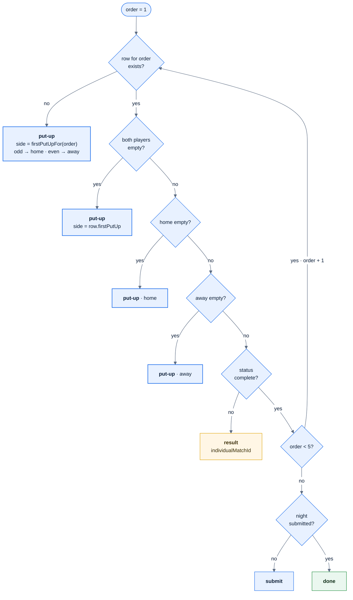
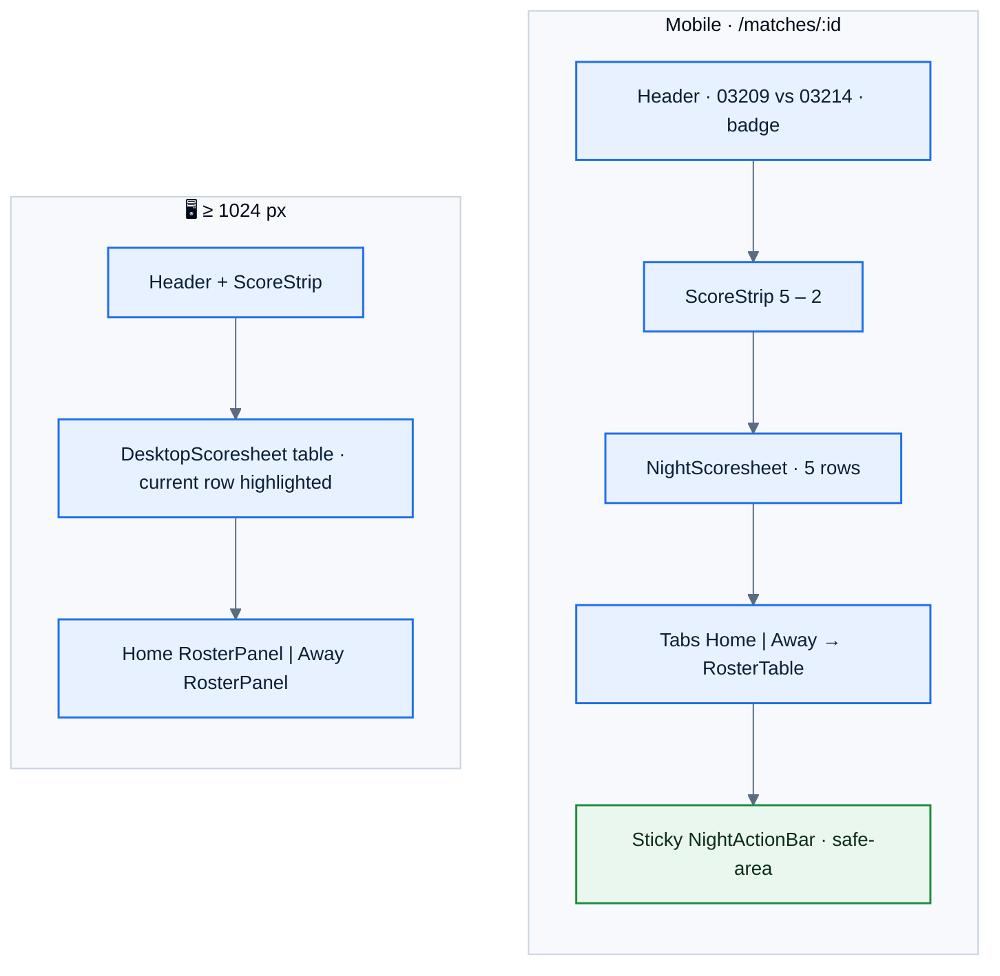

# F12 — Night view and scoresheet

> [Feature specs](../README.md) › [E03 — Schedule & Night View](README.md) › **F12** · Phase 1

| Phase | Status | Repo refs |
|---|---|---|
| 1 | 🅿️ | `_parked/src/pages/MatchPage.tsx`, `components/league/{ScoreStrip,RosterPanel,RosterTable,NightScoresheet,DesktopScoresheet,NightActionBar}.tsx`, `lib/night.ts` |

## Requirements
*As a captain, I open tonight's match and see both rosters, the five match slots, and the one thing I need to do next.*

| ID | Requirement |
|---|---|
| FR-12.1 | Header: back link, "{homeNo} vs {awayNo}", venue · date, status badge |
| FR-12.2 | Score strip (30 px numerals) once any result exists |
| FR-12.3 | Rosters from `player_division_stats`: name + member ID (+ "· Unpaid"), SL square, MW/MP "3/5", points. A new player shows 0/0 and 0, never blank |
| FR-12.4 | Mobile: Home/Away tabs, defaulting to `viewerSide ?? 'home'`. ≥ 1024 px: both rosters side by side |
| FR-12.5 | Scoresheet with always five rows "Match n": SL square, name and games per side; "Not played" when empty; winner highlighted. Desktop is a real table with a "Night summary" footer |
| FR-12.6 | Action bar only when `viewerCanManage`. It's driven by `nextAction()` |
| FR-12.7 | After submit: the bar shows "Submitted by {name} · {time}"; captains see no edit controls; admins still do |

## Logic: `nextAction`

| `nextAction` | Bar shows | Goes to |
|---|---|---|
| `put-up {order, side}` | "Put up match {order}" | `/matches/:id/put-up` |
| `result {order, individualMatchId}` | "Enter result · match {order}" | `/matches/:id/result/:order` |
| `submit` | "Submit night" | `SubmitNightSheet` drawer |
| `done` | "Submitted by {name} · {time}" | — |

## UI: layout

## Edge cases

| ID | Situation | Expected |
|---|---|---|
| EC-12.1 | A player views another team's night | Read-only; no action bar |
| EC-12.2 | An admin views any night | `viewerCanManage: true`, `viewerSide: null`; the bar acts for whichever side is next |
| EC-12.3 | Night submitted | Captains: no "Add paid member", no bar actions. Admins keep both |
| EC-12.4 | Roster empty | `Users` icon · "No players on this roster" · "A captain can add a paid member of this division." |

## Acceptance criteria
- **AC-12.1** An empty night → `put-up, order 1, home`. Home picked → `put-up, order 1, away`. Both up → `result 1`. Match 1 complete → `put-up, order 2, away`. Five complete → `submit`. Submitted → `done`.
- **AC-12.2** A player-role user sees no action bar.

## Implementation gaps (`_parked`)
- The bar label is always "Start match", even for result entry.
- "Add paid member" isn't hidden after submit.
- `done` shows the home team's name instead of the submitter, and no time.
- The score strip shows when `status !== 'scheduled'` instead of "once a result exists".
- The ≥ 1024 px left rail (the week's fixtures) isn't built.

---

[← F11](F11-schedule.md) · [E03 overview](README.md) · [F39a →](F39a-bye-no-play.md)
