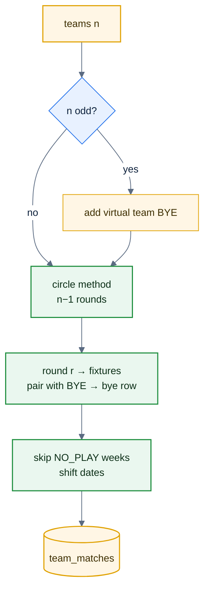

# F39a — Bye and No-Play weeks

> [Feature specs](../README.md) › [E03 — Schedule & Night View](README.md) › **F39a** · Phase 2

| Phase | Status | Rules |
|---|---|---|
| 2 | 🎯 | R-004, R-142 |

## Requirements

| ID | Requirement |
|---|---|
| FR-39a.1 | Add a `schedule_weeks` table (`division_id`, `week_no`, `play_date`, `kind REGULAR\|NO_PLAY\|PLAYOFF`) |
| FR-39a.2 | Allow `team_matches.away_team_id NULL` meaning **BYE** for the home team; a CHECK keeps `status = 'bye'` consistent |
| FR-39a.3 | Schedule renders Bye and No-Play as neutral, **non-clickable** banners ("Bye · 03207", "No play · public holiday") |
| FR-39a.4 | Standings: a bye counts as neither win nor loss (policy decision; default: no points) |
| FR-39a.5 | An admin schedule generator: round-robin with automatic byes for odd team counts |

## Logic: round-robin with bye

## Acceptance criteria
- **AC-39a.1** A 5-team division produces exactly one bye per round, and each team gets the same number of byes ± 1.

---

[← F12](F12-night-view-scoresheet.md) · [E03 overview](README.md)
