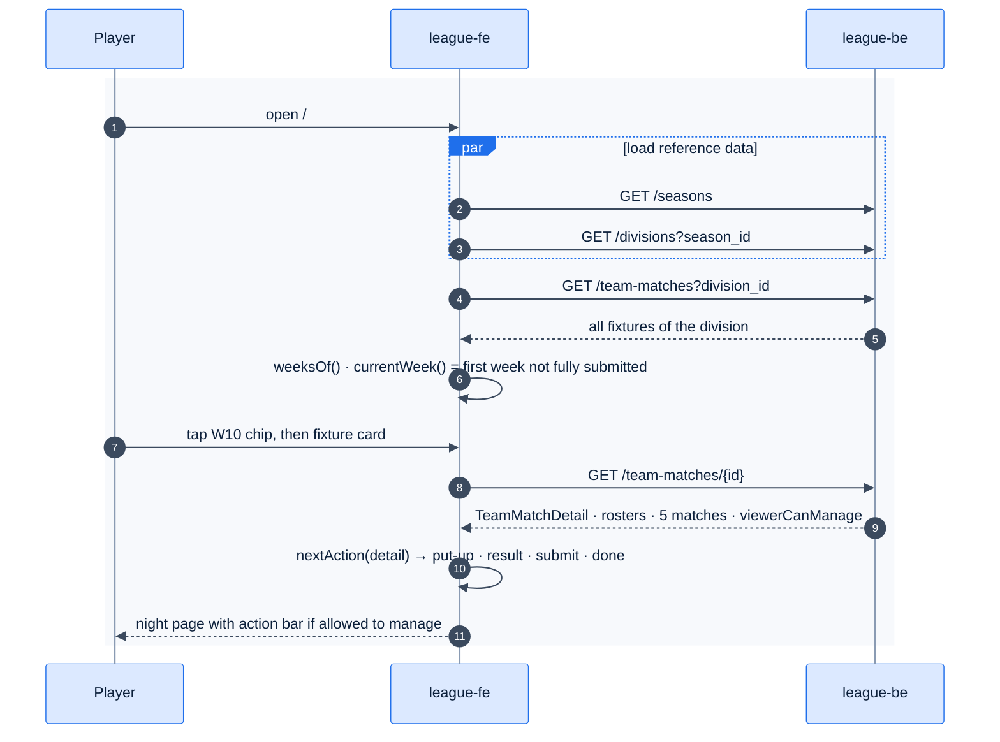
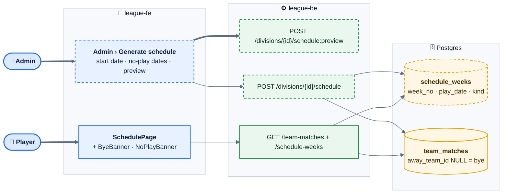
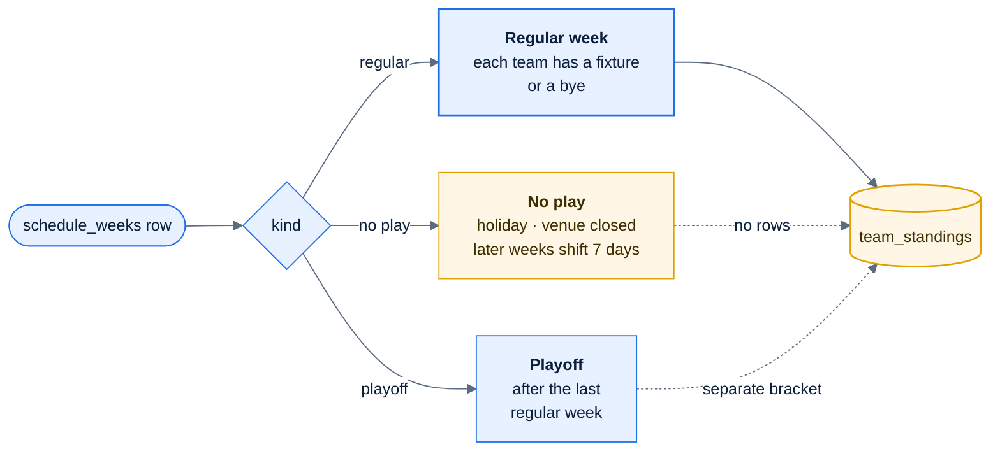

# E03 — Schedule & Night View

> [Feature specs](../README.md) › **E03**

| | |
|---|---|
| **Goal** | Anyone can find a fixture and see the state of a night. Captains see what to do next |
| **Phase** | 1 (F11, F12) · 2 (F39a Bye / No Play) |
| **Status** | 🅿️ Screens built in `league-fe/_parked/`, waiting for the E02 API |
| **Actors** | Player, Captain, Admin |
| **Related** | [09 §4 routes](../../09-frontend-design.md) · [07 §2](../../07-api-design.md) · [E04](../E04-night-operations/README.md) |

## Features by phase

### Phase 1

| # | Feature | Status |
|---|---|---|
| F11 | [Schedule](F11-schedule.md) | 🅿️ |
| F12 | [Night view & scoresheet](F12-night-view-scoresheet.md) | 🅿️ |

### Phase 2

| # | Feature | Status |
|---|---|---|
| F39a | [Bye no play](F39a-bye-no-play.md) | 🎯 |

## Phase 1 deep dive

### Components

```mermaid
%%{init: {"theme": "base", "themeVariables": {"fontFamily": "Arial", "fontSize": "14px", "primaryColor": "#E8F1FF", "primaryBorderColor": "#1F6FEB", "primaryTextColor": "#0B1F3A", "lineColor": "#5B6B82", "secondaryColor": "#EAF7EF", "tertiaryColor": "#FFF6E5", "actorBkg": "#DCE9FF", "actorTextColor": "#0B1F3A", "actorBorder": "#1F6FEB", "actorLineColor": "#8A9BB3", "signalColor": "#3B4A5E", "signalTextColor": "#0B1F3A", "noteBkgColor": "#FFF6E5", "noteBorderColor": "#E0A100", "noteTextColor": "#3D2E00", "activationBkgColor": "#C7DBFF", "activationBorderColor": "#1F6FEB", "sequenceNumberColor": "#FFFFFF", "labelBoxBkgColor": "#1F6FEB", "labelBoxBorderColor": "#1F6FEB", "labelTextColor": "#FFFFFF", "loopTextColor": "#0B1F3A", "clusterBkg": "#F7F9FC", "clusterBorder": "#C9D3E0", "edgeLabelBackground": "#FFFFFF", "transitionLabelColor": "#0B1F3A", "cScale0": "#1F6FEB", "cScaleLabel0": "#FFFFFF", "cScale1": "#1E8E3E", "cScaleLabel1": "#FFFFFF", "cScale2": "#7E57C2", "cScaleLabel2": "#FFFFFF"}}}%%
flowchart LR
  U(["Player / Captain"]):::actor
  subgraph FE["league-fe"]
    direction TB
    SP["<b>SchedulePage</b><br/>season select · WeekChips · FixtureCard"]:::fe
    MP["<b>MatchPage</b><br/>ScoreStrip · RosterPanel · scoresheet"]:::fe
    NAB["<b>NightActionBar</b><br/>nextAction() from lib/night.ts"]:::fe
    Q["<b>useLeague.ts</b><br/>seasons · divisions · fixtures · team-match"]:::fe
  end
  subgraph BE["league-be"]
    direction TB
    L1["GET /seasons · /divisions"]:::api
    L2["GET /team-matches?division_id"]:::api
    L3["GET /team-matches/{id}<br/>viewerCanManage · viewerSide"]:::api
  end
  subgraph DB["Postgres"]
    direction TB
    T1[("seasons · divisions · venues")]:::db
    T2[("team_matches · individual_matches")]:::db
    V1[("player_division_stats")]:::db
  end
  U ==> SP == "tap card" ==> MP --> NAB
  SP --> Q
  MP --> Q
  Q --> L1 --> T1
  Q --> L2 --> T2
  Q --> L3 --> T2
  L3 --> V1
  class L1,L2,L3 gap
  classDef fe fill:#E8F1FF,stroke:#1F6FEB,stroke-width:1.5px,color:#0B1F3A
  classDef api fill:#EAF7EF,stroke:#1E8E3E,stroke-width:1.5px,color:#0B2E16
  classDef db fill:#FFF6E5,stroke:#E0A100,stroke-width:1.5px,color:#3D2E00
  classDef ext fill:#F3EDFF,stroke:#7E57C2,stroke-width:1.5px,color:#25124A
  classDef gap fill:#FDECEC,stroke:#D93025,stroke-width:1.5px,color:#5C0B06
  classDef actor fill:#DCE9FF,stroke:#1F6FEB,stroke-width:2px,color:#0B1F3A,font-weight:bold
  classDef ok fill:#EAF7EF,stroke:#1E8E3E,color:#0B2E16
  classDef warn fill:#FFF6E5,stroke:#E0A100,color:#3D2E00
  classDef bad fill:#FDECEC,stroke:#D93025,color:#5C0B06
  classDef start fill:#E8F1FF,stroke:#1F6FEB,color:#0B1F3A
  classDef planned stroke-dasharray:5 4
```

### Main flow

## Phase 2 deep dive

**Scope:** [F39a Bye and No-Play weeks](F39a-bye-no-play.md). Phase 1 assumes every week has a full round of fixtures. Phase 2 models the calendar (`schedule_weeks`), byes for odd team counts, and an admin schedule generator.

### Components: what Phase 2 adds

*Dashed boxes are new. The schedule page and fixture list gain fields but keep their shape.*

### Week kinds

### Data delta

| Change | Why |
|---|---|
| New `schedule_weeks (division_id, week_no, play_date, kind)` | The calendar exists even when a week has no fixtures |
| `team_matches.away_team_id` nullable, `status` gains `bye`, CHECK `(away_team_id IS NULL) = (status = 'bye')` | One row per bye keeps standings simple |
| `team_standings` view ignores `bye` rows (default policy) | A bye is neither a win nor a loss |
| `currentWeek()` skips `NO_PLAY` weeks | The schedule opens on the next real week |
