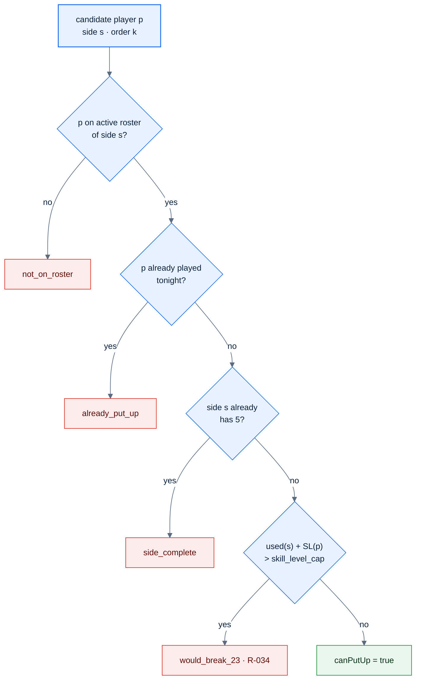

# F13 — Put-up with 23-SL cap

> [Feature specs](../README.md) › [E04 — Night Operations: Put-up, Result, Submit](README.md) › **F13** · Phase 1

| Phase | Status | Rules | Repo refs |
|---|---|---|---|
| 1 | 🅿️ | R-030/031 (MVP order), R-034, R-035, R-036, R-050 | `_parked/src/pages/PutUpPage.tsx`, `components/league/PutUpCandidateList.tsx`, `lib/night.ts`, `lib/rules.ts` (`skillLevelUsed`, `raceFor`) |

## Requirements
*As a captain, I pick my player for the next match and can't accidentally break the 23 cap.*

| ID | Requirement |
|---|---|
| FR-13.1 | The screen is active only when `nextAction = put-up`, which supplies `order` and `side` |
| FR-13.2 | Order: home puts up first in odd matches, away in even matches. The second picker sees the first pick (the opponent panel) |
| FR-13.3 | Candidates come from `GET /available?side&match_order` (`staleTime 0`), each with `canPutUp` and `blockReason` |
| FR-13.4 | Block reasons and copy: `would_break_23` "Would break 23" · `already_put_up` "Already playing tonight" · `not_on_roster` "Not on this roster" · `side_complete` "Five players already put up" |
| FR-13.5 | Blocked rows stay visible **and focusable** (`aria-disabled`), muted, with a warn badge. Tapping one does nothing |
| FR-13.6 | Badge "SL used {used}/{cap}" sums the side's snapshot SLs; the badge turns warn when `used = cap` |
| FR-13.7 | Once the opponent is known, each selectable row previews the race "mine–theirs" (`raceFor`) |
| FR-13.8 | Confirm posts the put-up. The server re-checks `can_put_up()`. A refusal returns `40004`, which clears the selection and refetches the list |
| FR-13.9 | After success: if both sides are now up, go to result entry; otherwise stay on the same screen for the other side |
| FR-13.10 | Accessibility: `role=radiogroup` "Select a player", rows are `role=radio` with `aria-checked`, at least 56 px tall |

## Rules & logic

Worked example (seed): 03209 has used SL 5 + 6 + 5 + 4 = 20 after 4 matches. With cap 23, match 5 allows SL 2 and 3, and greys out SL 4+ with "Would break 23". The badge reads `20/23`.

## UI states

| State | Shown |
|---|---|
| Loading | List skeleton |
| Error | `ErrorBanner` + Retry (refetch available) |
| Empty | "No players available" · "Every player on this roster is already playing or would break 23." |
| Rejected (`40004`) | "That player can no longer be put up. The list has changed." Selection cleared, list refetched |
| Not my turn / not my night | Route shows read-only "Waiting for {other side}" (server is authoritative) |

## Edge cases

| ID | Situation | Expected |
|---|---|---|
| EC-13.1 | Both captains confirm at the same moment for the same side | One insert wins; the other gets `40004` |
| EC-13.2 | Admin changes a player's SL while the list is open | The server uses the new SL; a stale list may be refused (`40004`) |
| EC-13.3 | Team has fewer than 5 eligible players | Forfeit path (F39b) |
| EC-13.4 | Captain opens put-up for the side that isn't next | Server refuses (`40004`); UI shows the waiting state |

## Acceptance criteria
- **AC-13.1** Given 20 SL used, then SL 4+ rows are greyed "Would break 23", SL 2–3 are selectable, and the badge reads `20/23`.
- **AC-13.2** Match 1 asks home first; match 2 asks away first.
- **AC-13.3** After both sides are up, the row has `home/away_skill_level` and `home/away_race` filled by the trigger.

## Implementation gaps (`_parked`)
- The badge never turns warn at the cap.
- The selection isn't cleared on error.
- The second picker's subtitle is wrong (away picking second sees "Away puts up first").
- No `viewerCanManage` check on the route.
- The copy key `putUp.staleList` is unused (two different wordings exist).

---

[E04 overview](README.md) · [F14 →](F14-result-entry.md)
