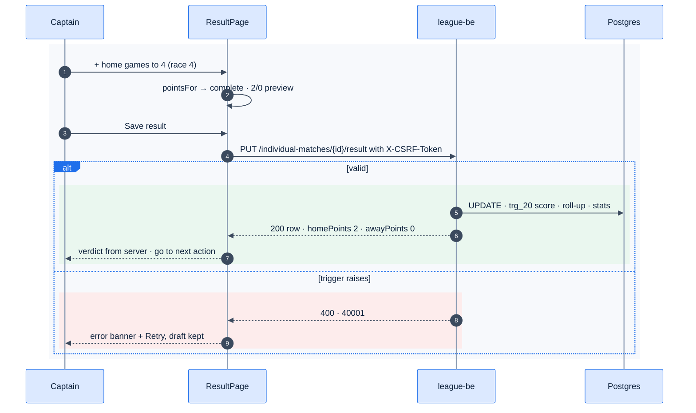

# F14 — Result entry

> [Feature specs](../README.md) › [E04 — Night Operations: Put-up, Result, Submit](README.md) › **F14** · Phase 1

| Phase | Status | Rules | Repo refs |
|---|---|---|---|
| 1 | 🅿️ | §5.3 points, R-100/102 (totals only in MVP) | `_parked/src/pages/ResultPage.tsx`, `components/league/{Stepper,ResultVerdict}.tsx`, `lib/rules.ts` (`pointsFor`), `lib/schemas.ts` (`resultSchema`) |

## Requirements
*After the match is played, I enter the games each player won, the innings and the defensive shots, and the app shows the points.*

| ID | Requirement |
|---|---|
| FR-14.1 | Title "Match {n} of 5". Two lines: "{name} (SL {sl}) races to {race}", using the **snapshot** SL and race |
| FR-14.2 | Games stepper per player, from 0 to the player's race (+ disabled at the race), with a "/ {race}" suffix |
| FR-14.3 | One innings stepper per match (≥ 0), and one defensive-shots stepper per player (≥ 0) |
| FR-14.4 | Live verdict from `pointsFor`: pending → "Enter games to see the result." · invalid → "That score is not possible." · complete → "{winner} wins {w}–{l}" + "{wp}–{lp} points" |
| FR-14.5 | Save is enabled only when `resultSchema` passes: games ≤ race and exactly one player at the race |
| FR-14.6 | Saving uses `PUT /individual-matches/{id}/result`. **The response's points replace the preview** |
| FR-14.7 | After saving, go straight to the next action (the next put-up, or the submit drawer) |
| FR-14.8 | A captain can correct a result until the night is submitted. Afterwards only an admin can |

## Logic: client validation (`resultSchema`)

```text
homeGames, awayGames  ∈ ℕ, ≤ their race
innings, homeDefShots, awayDefShots ∈ ℕ
exactly one of (homeGames = homeRace, awayGames = awayRace)
```

The server's `fn_score_individual_match` re-validates the same rules and computes the points (see the [E02-F8 diagram](../E02-league-foundation/F08-postgres-business-rules.md)).

## Flow



## Edge cases

| ID | Situation | Expected |
|---|---|---|
| EC-14.1 | The preview mirror disagrees with the server | The server wins; log a mirror-drift test failure |
| EC-14.2 | User types 9 in a race-4 stepper | Clamped to 4 |
| EC-14.3 | Innings left at 0 | Allowed (the MVP doesn't validate innings); show a soft warning |
| EC-14.4 | Session expired while editing | 401 → login; the draft is lost (see EC-2.1) |
| EC-14.5 | Night already submitted, opened by a captain | Read-only verdict, no Save |

## Acceptance criteria
- **AC-14.1** A race-3 stepper stops at 3, with + disabled.
- **AC-14.2** Saving 3–0 returns `homePoints: 3, awayPoints: 0`, and the night total rolls up.
- **AC-14.3** 4–3, both race 4 → 2/1 (hill).

## Implementation gaps (`_parked`)
- The PUT response is ignored, and the screen returns to the night page instead of the next action.
- No Retry on error.
- No read-only state for a submitted night or a non-manager.
- Stepper aria-labels don't include the player's name.

---

[← F13](F13-put-up-sl-cap.md) · [E04 overview](README.md) · [F15 →](F15-submit-night.md)
