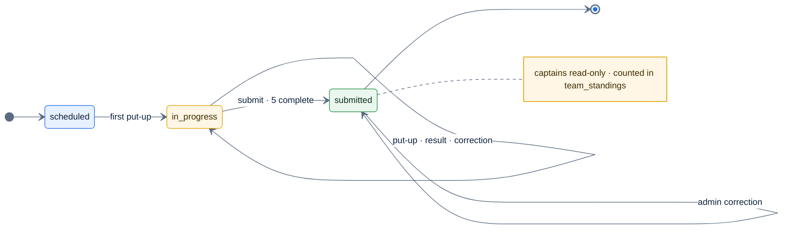

# F15 — Submit night

> [Feature specs](../README.md) › [E04 — Night Operations: Put-up, Result, Submit](README.md) › **F15** · Phase 1

| Phase | Status | Rules | Repo refs |
|---|---|---|---|
| 1 | 🅿️ | [04 §8 MVP note](../../04-domain-rules.md), [Q30](../../14-open-questions.md) | `_parked/src/components/league/SubmitNightSheet.tsx`, `hooks/useLeagueMutations.ts` (`useSubmitNight`) |

## Requirements

| ID | Requirement |
|---|---|
| FR-15.1 | Available only when all 5 matches are complete and the night isn't submitted |
| FR-15.2 | Confirmation is a vaul **drawer**, never `window.confirm`. "Submit this night?" · "Scores are final for captains after submitting. An admin can still make corrections." · Cancel (focused first) · Submit night |
| FR-15.3 | The server sets `status = submitted`, `submitted_by`, `submitted_at`. It refuses an incomplete night with `40001` |
| FR-15.4 | After submit: the night is read-only for captains; the bar shows "Submitted by {user name} · {time}"; the standings include the night |
| FR-15.5 | Who may submit: either captain of the night, or an admin (default for [Q30](../../14-open-questions.md)) |

## Logic

## Edge cases

| ID | Situation | Expected |
|---|---|---|
| EC-15.1 | Both captains tap Submit | The first succeeds; the second gets a 200 no-op, or `40001` "already submitted" (pick one: idempotent 200 recommended) |
| EC-15.2 | Admin corrects a result after submit | Points re-roll; standings update; audited in Phase 2 (F41) |
| EC-15.3 | Cancel in the drawer | Nothing changes |

## Acceptance criteria
- **AC-15.1** After submit, the captain sees no editable control and the admin still does.
- **AC-15.2** The score in the summary equals `team_matches.home_points–away_points`, and the halves add up to the sum of the 5 matches' 3, 3 or 2 points, **not** always 15.

## Implementation gaps (`_parked`)
- "Submitted by" shows the home team's name; the submitter and time aren't rendered, although `submittedAt` exists.
- The plan's check "halves sum to 15" contradicts the 3/3/2 rule. Correct the test.

---

[← F14](F14-result-entry.md) · [E04 overview](README.md) · [F39b →](F39b-forfeits.md)
