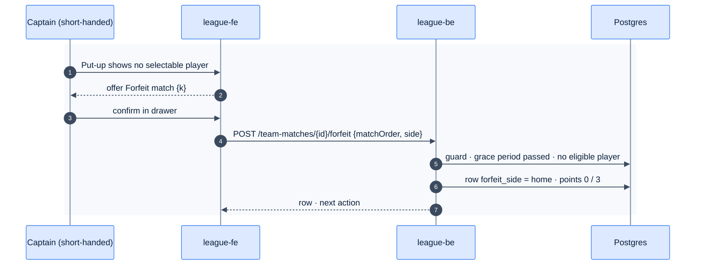

# F39b — Forfeits

> [Feature specs](../README.md) › [E04 — Night Operations: Put-up, Result, Submit](README.md) › **F39b** · Phase 2

| Phase | Status | Rules |
|---|---|---|
| 2 | 🎯 | R-037, [Q15/Q16](../../14-open-questions.md) |

## Requirements

| ID | Requirement |
|---|---|
| FR-39b.1 | A captain or admin can forfeit a slot when their side has no eligible player (after a 15 min grace period from the scheduled start) |
| FR-39b.2 | The opponent's player is still put up and recorded, and gets the maximum points: 3 (8-Ball) or 20 (9-Ball). The forfeiting side gets 0. No match counts as played for either player's MP |
| FR-39b.3 | New columns: `individual_matches.forfeit_side`; `fn_score_individual_match` handles it |
| FR-39b.4 | Both teams still owe weekly fees (F36) |

## Flow

## Acceptance criteria
- **AC-39b.1** A forfeited slot shows "Forfeit" in the scoresheet, awards the maximum points to the opponent, and doesn't change either player's MP.

---

[← F15](F15-submit-night.md) · [E04 overview](README.md)
