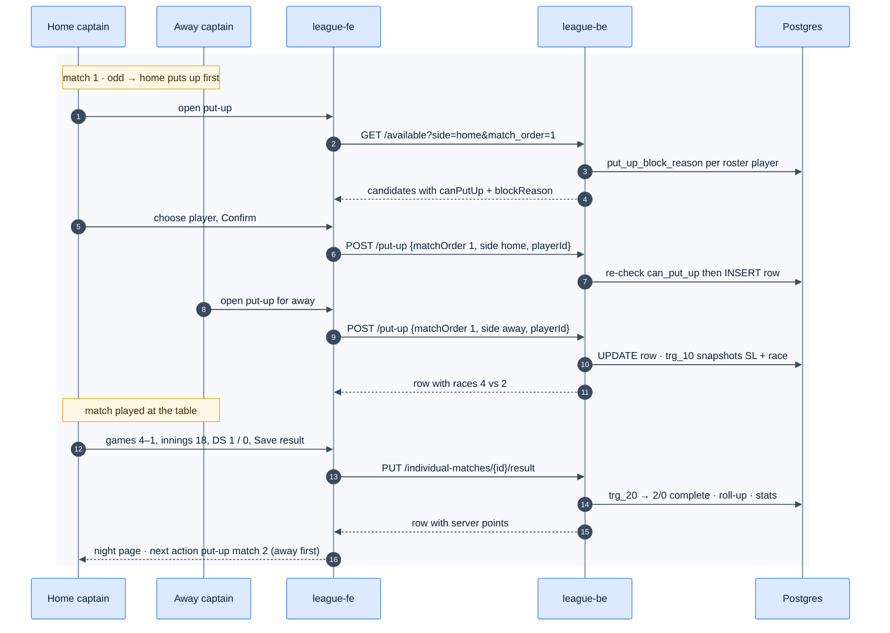
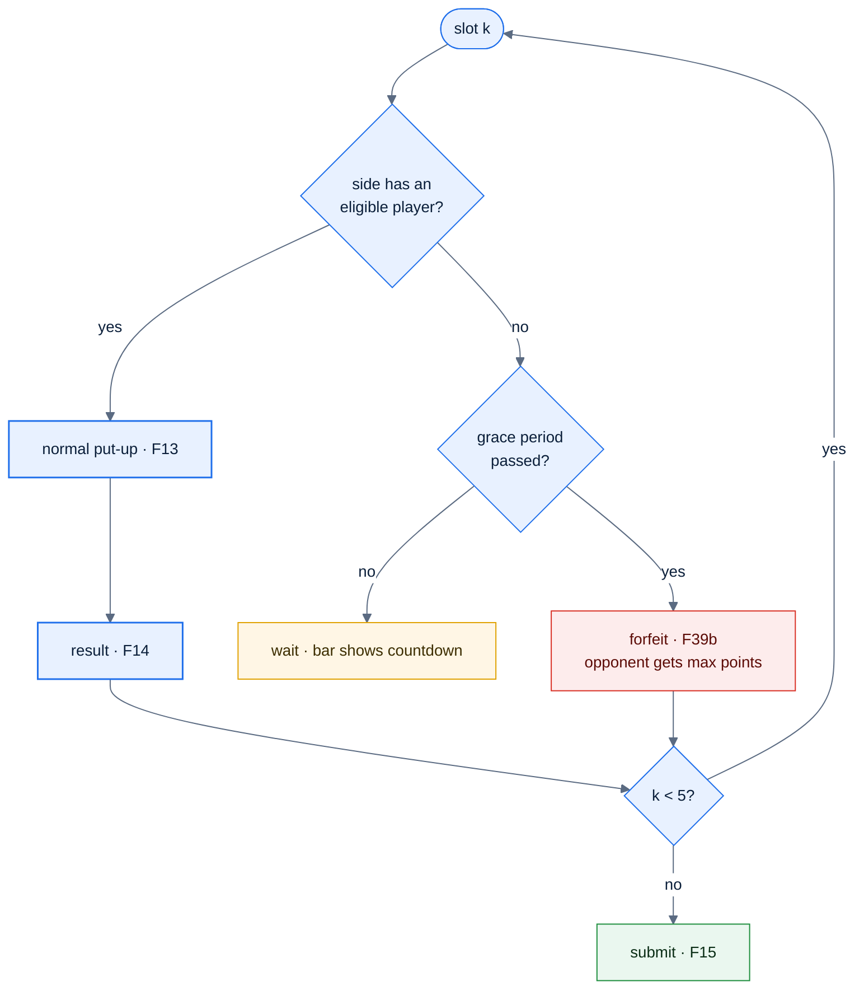

# E04 — Night Operations: Put-up, Result, Submit

> [Feature specs](../README.md) › **E04**

| | |
|---|---|
| **Goal** | A captain runs all 5 matches of a night on a phone: put up players within the 23 cap, enter each result, submit |
| **Phase** | 1 (F13–F15) · 2 (F39b forfeits) |
| **Status** | 🅿️ Screens parked in league-fe · ❌ endpoints and rule functions missing (E02) |
| **Actors** | Home captain, Away captain, Admin |
| **Related** | [04 §4–§5](../../04-domain-rules.md) · [08 §0](../../08-scorekeeping-engine.md) · [E02-F8](../E02-league-foundation/F08-postgres-business-rules.md) |

## Features by phase

### Phase 1

| # | Feature | Status |
|---|---|---|
| F13 | [Put-up with 23-SL cap](F13-put-up-sl-cap.md) | 🅿️ |
| F14 | [Result entry](F14-result-entry.md) | 🅿️ |
| F15 | [Submit night](F15-submit-night.md) | 🅿️ |

### Phase 2

| # | Feature | Status |
|---|---|---|
| F39b | [Forfeits](F39b-forfeits.md) | 🎯 |

## Phase 1 deep dive

### Components

```mermaid
%%{init: {"theme": "base", "themeVariables": {"fontFamily": "Arial", "fontSize": "14px", "primaryColor": "#E8F1FF", "primaryBorderColor": "#1F6FEB", "primaryTextColor": "#0B1F3A", "lineColor": "#5B6B82", "secondaryColor": "#EAF7EF", "tertiaryColor": "#FFF6E5", "actorBkg": "#DCE9FF", "actorTextColor": "#0B1F3A", "actorBorder": "#1F6FEB", "actorLineColor": "#8A9BB3", "signalColor": "#3B4A5E", "signalTextColor": "#0B1F3A", "noteBkgColor": "#FFF6E5", "noteBorderColor": "#E0A100", "noteTextColor": "#3D2E00", "activationBkgColor": "#C7DBFF", "activationBorderColor": "#1F6FEB", "sequenceNumberColor": "#FFFFFF", "labelBoxBkgColor": "#1F6FEB", "labelBoxBorderColor": "#1F6FEB", "labelTextColor": "#FFFFFF", "loopTextColor": "#0B1F3A", "clusterBkg": "#F7F9FC", "clusterBorder": "#C9D3E0", "edgeLabelBackground": "#FFFFFF", "transitionLabelColor": "#0B1F3A", "cScale0": "#1F6FEB", "cScaleLabel0": "#FFFFFF", "cScale1": "#1E8E3E", "cScaleLabel1": "#FFFFFF", "cScale2": "#7E57C2", "cScaleLabel2": "#FFFFFF"}}}%%
flowchart LR
  C(["Captain"]):::actor
  subgraph FE["league-fe"]
    direction TB
    PU["<b>PutUpPage</b><br/>PutUpCandidateList · SL used x/23"]:::fe
    RE["<b>ResultPage</b><br/>Stepper · ResultVerdict"]:::fe
    SN["<b>SubmitNightSheet</b><br/>vaul drawer"]:::fe
    RL["<b>lib/rules.ts</b><br/>raceFor · pointsFor (preview)"]:::fe
    MU["<b>useLeagueMutations</b><br/>usePutUp · useSaveResult · useSubmitNight"]:::fe
  end
  subgraph BE["league-be · internal/league"]
    direction TB
    S1["<b>services.go</b><br/>captain-owns-night"]:::api
    E1["GET /available · POST /put-up"]:::api
    E2["PUT /individual-matches/{id}/result"]:::api
    E3["POST /team-matches/{id}/submit"]:::api
  end
  subgraph DB["Postgres"]
    direction TB
    F1[("put_up_block_reason()<br/>can_put_up()")]:::db
    T1[("individual_matches<br/>trg_10 · trg_20 · roll-up · trg_40")]:::db
    T2[("team_matches.status")]:::db
  end
  C ==> PU ==> RE ==> SN
  PU -.-> RL
  RE -.-> RL
  PU --> MU
  RE --> MU
  SN --> MU
  MU --> E1 --> S1
  MU --> E2 --> S1
  MU --> E3 --> S1
  S1 --> F1
  S1 ==> T1
  S1 --> T2
  class E1,E2,E3,S1,F1,T1 gap
  classDef fe fill:#E8F1FF,stroke:#1F6FEB,stroke-width:1.5px,color:#0B1F3A
  classDef api fill:#EAF7EF,stroke:#1E8E3E,stroke-width:1.5px,color:#0B2E16
  classDef db fill:#FFF6E5,stroke:#E0A100,stroke-width:1.5px,color:#3D2E00
  classDef ext fill:#F3EDFF,stroke:#7E57C2,stroke-width:1.5px,color:#25124A
  classDef gap fill:#FDECEC,stroke:#D93025,stroke-width:1.5px,color:#5C0B06
  classDef actor fill:#DCE9FF,stroke:#1F6FEB,stroke-width:2px,color:#0B1F3A,font-weight:bold
  classDef ok fill:#EAF7EF,stroke:#1E8E3E,color:#0B2E16
  classDef warn fill:#FFF6E5,stroke:#E0A100,color:#3D2E00
  classDef bad fill:#FDECEC,stroke:#D93025,color:#5C0B06
  classDef start fill:#E8F1FF,stroke:#1F6FEB,color:#0B1F3A
  classDef planned stroke-dasharray:5 4
```

### Main flow: one match slot

## Phase 2 deep dive

**Scope:** [F39b Forfeits](F39b-forfeits.md). Phase 1 assumes both sides always field five players. Phase 2 lets a short-handed side forfeit a slot after a grace period. Live scoring of each rack (E07) and dual-captain verification (E08) build on this epic's result and submit steps.

### Components: what Phase 2 adds

```mermaid
%%{init: {"theme": "base", "themeVariables": {"fontFamily": "Arial", "fontSize": "14px", "primaryColor": "#E8F1FF", "primaryBorderColor": "#1F6FEB", "primaryTextColor": "#0B1F3A", "lineColor": "#5B6B82", "secondaryColor": "#EAF7EF", "tertiaryColor": "#FFF6E5", "actorBkg": "#DCE9FF", "actorTextColor": "#0B1F3A", "actorBorder": "#1F6FEB", "actorLineColor": "#8A9BB3", "signalColor": "#3B4A5E", "signalTextColor": "#0B1F3A", "noteBkgColor": "#FFF6E5", "noteBorderColor": "#E0A100", "noteTextColor": "#3D2E00", "activationBkgColor": "#C7DBFF", "activationBorderColor": "#1F6FEB", "sequenceNumberColor": "#FFFFFF", "labelBoxBkgColor": "#1F6FEB", "labelBoxBorderColor": "#1F6FEB", "labelTextColor": "#FFFFFF", "loopTextColor": "#0B1F3A", "clusterBkg": "#F7F9FC", "clusterBorder": "#C9D3E0", "edgeLabelBackground": "#FFFFFF", "transitionLabelColor": "#0B1F3A", "cScale0": "#1F6FEB", "cScaleLabel0": "#FFFFFF", "cScale1": "#1E8E3E", "cScaleLabel1": "#FFFFFF", "cScale2": "#7E57C2", "cScaleLabel2": "#FFFFFF"}}}%%
flowchart LR
  C(["👤 Captain"]):::actor
  subgraph FE["📱 league-fe"]
    direction TB
    PU["<b>PutUpPage</b><br/>+ Forfeit match k"]:::fe
    FD["<b>ForfeitSheet</b><br/>confirm · reason"]:::fe
    SS["<b>Scoresheet</b><br/>Forfeit chip"]:::fe
  end
  subgraph BE["⚙️ league-be · internal/league"]
    direction TB
    FF["POST /team-matches/{id}/forfeit"]:::api
    GU["guard · grace 15 min · no eligible player"]:::api
  end
  subgraph DB["🗄️ Postgres"]
    direction TB
    IM[("<b>individual_matches</b><br/>+ forfeit_side")]:::db
    SC[("<b>fn_score_individual_match</b><br/>forfeit → max points")]:::db
  end
  C ==> PU ==> FD ==> FF --> GU --> IM --> SC
  SS -.-> IM
  class FD,FF,GU planned
  class SC gap
  classDef fe fill:#E8F1FF,stroke:#1F6FEB,stroke-width:1.5px,color:#0B1F3A
  classDef api fill:#EAF7EF,stroke:#1E8E3E,stroke-width:1.5px,color:#0B2E16
  classDef db fill:#FFF6E5,stroke:#E0A100,stroke-width:1.5px,color:#3D2E00
  classDef ext fill:#F3EDFF,stroke:#7E57C2,stroke-width:1.5px,color:#25124A
  classDef gap fill:#FDECEC,stroke:#D93025,stroke-width:1.5px,color:#5C0B06
  classDef actor fill:#DCE9FF,stroke:#1F6FEB,stroke-width:2px,color:#0B1F3A,font-weight:bold
  classDef ok fill:#EAF7EF,stroke:#1E8E3E,color:#0B2E16
  classDef warn fill:#FFF6E5,stroke:#E0A100,color:#3D2E00
  classDef bad fill:#FDECEC,stroke:#D93025,color:#5C0B06
  classDef start fill:#E8F1FF,stroke:#1F6FEB,color:#0B1F3A
  classDef planned stroke-dasharray:5 4
```

*Red: the scoring trigger is still missing in Phase 1 (E02-F8) and gains the forfeit branch here.*

### Night flow with a forfeit

### Data delta

| Change | Why |
|---|---|
| `individual_matches.forfeit_side text NULL CHECK (forfeit_side IN ('home','away'))` | Marks the slot |
| One player row may be null when `forfeit_side` is set | The forfeiting side fields nobody |
| `fn_score_individual_match`: forfeit → 3/0 (8-Ball) or 20/0 (9-Ball), MP unchanged | R-037 |
| `nextAction()` gains `forfeit-available {order, side}` | The bar offers the action |
