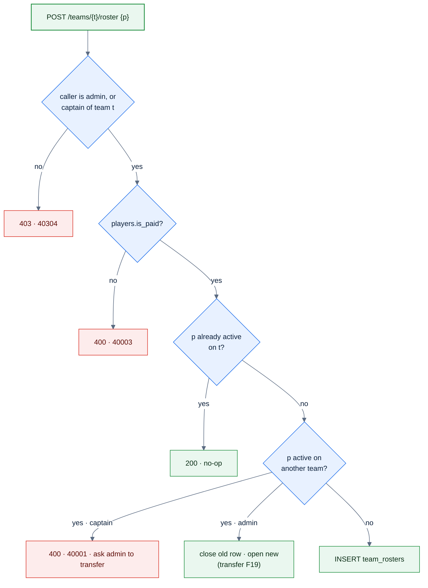

# F16 — Add paid member to roster

> [Feature specs](../README.md) › [E05 — Roster & Player Admin](README.md) › **F16** · Phase 1

| Phase | Status | Rules | Repo refs |
|---|---|---|---|
| 1 | 🅿️ | R-014, R-017 | `_parked/src/components/league/AddPaidMemberSheet.tsx`, `RosterPanel.tsx` · `useAddRosterPlayer` |

## Requirements
*As a captain, I add a paid member to my roster before the night starts.*

| ID | Requirement |
|---|---|
| FR-16.1 | "Add paid member" appears on the captain's own roster panel only while the night isn't submitted. Admins always see it |
| FR-16.2 | A drawer searches players (≥ 2 chars): SL, name, member ID, and an "Unpaid" flag |
| FR-16.3 | Unpaid members stay visible but their Add button is disabled, so the refusal makes sense |
| FR-16.4 | `POST /teams/{teamId}/roster {playerId}`. The server refuses unpaid players with `40003` "That member has not paid dues for this division yet." |
| FR-16.5 | The server refuses a player who already has an active roster (F7 index) with `40001` |
| FR-16.6 | On success the drawer closes and the roster refetches |

## Logic

## Edge cases

| ID | Situation | Expected |
|---|---|---|
| EC-16.1 | Member pays during the night | Admin flips `is_paid`; the captain retries |
| EC-16.2 | Captain adds a player during match 3 | Allowed in the MVP (the R-017 "before match 1" rule is Phase 2, F39c) |
| EC-16.3 | Captain tries to poach a player from another team | 400; only an admin can transfer |

## Acceptance criteria
- **AC-16.1** A player-role user doesn't see "Add paid member"; the captain does.
- **AC-16.2** Adding a seeded unpaid player returns `40003` with the copy above.

## Implementation gaps (`_parked`)
- The button isn't hidden after the night is submitted.

---

[E05 overview](README.md) · [F17 →](F17-player-search.md)
