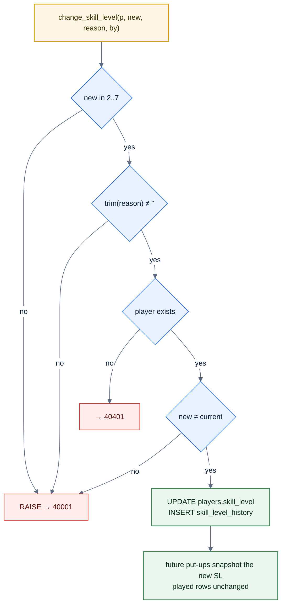

# F18 — Skill-level change and history

> [Feature specs](../README.md) › [E05 — Roster & Player Admin](README.md) › **F18** · Phase 1

| Phase | Status | Rules | Repo refs |
|---|---|---|---|
| 1 | 🅿️ | R-050, R-120, R-125 | `_parked/src/components/league/SkillLevelPanel.tsx`, `lib/schemas.ts` (`skillLevelChangeSchema`) |

## Requirements
*As an admin, I change a player's skill level with a reason, and anyone with access can see why it changed.*

| ID | Requirement |
|---|---|
| FR-18.1 | Six toggle buttons, SL 2–7 (44 px, `aria-pressed`). The current level is accent; the pending choice is primary |
| FR-18.2 | Preview: "vs SL 5: races to {now} (was {before})", shown only when the level changed |
| FR-18.3 | Static note: "Applies from the next match. Played matches keep their snapshot." |
| FR-18.4 | Reason is required (trimmed, ≥ 1 char): "Required. Shown in this player's history." |
| FR-18.5 | Save is enabled only if valid **and** changed. Calls `change_skill_level()` via `POST /players/{id}/skill-level` |
| FR-18.6 | History is append-only: "old → new", reason, "by {admin} · {date}". Empty: "No changes yet." With loading and error states |
| FR-18.7 | After saving: invalidate the player list and history; reset the form |

## Logic

## Edge cases

| ID | Situation | Expected |
|---|---|---|
| EC-18.1 | Player is put up but the opponent isn't yet (no snapshot) | The snapshot is taken when both sides are up, so the new SL applies. Acceptable; documented |
| EC-18.2 | Two admins change the same player at once | Both succeed in order; history shows both |
| EC-18.3 | 9-Ball SL | Phase 2 (F32): per-format SL table |

## Acceptance criteria
- **AC-18.1** Save stays disabled for an empty or whitespace-only reason.
- **AC-18.2** 4 → 6 adds a history row "4 → 6" with the reason and the admin's name; played matches still show SL 4.
- **AC-18.3** The preview for SL 6 vs SL 5 reads 5–4.

## Implementation gaps (`_parked`)
- The preview renders even when the level is unchanged.
- History has no loading or error state.

---

[← F17](F17-player-search.md) · [E05 overview](README.md) · [F19 →](F19-player-transfer.md)
