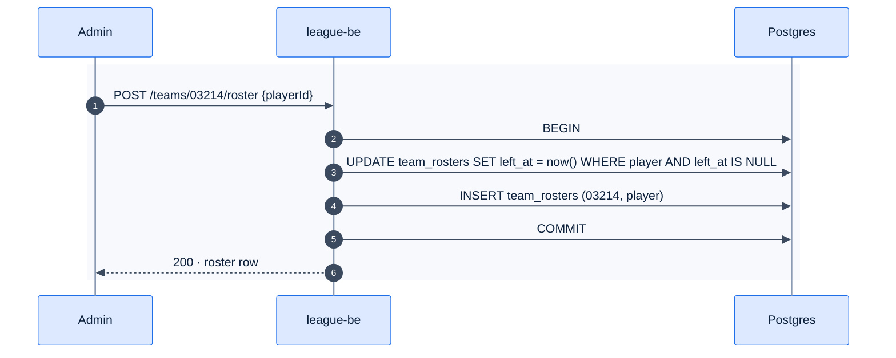

# F19 — Player transfer

> [Feature specs](../README.md) › [E05 — Roster & Player Admin](README.md) › **F19** · Phase 1

| Phase | Status | Rules | Repo refs |
|---|---|---|---|
| 1 | 🅿️ | R-020, FR-7.6 | `_parked/src/pages/admin/PlayersPage.tsx` (transfer) · `useTransferPlayer` |

## Requirements

| ID | Requirement |
|---|---|
| FR-19.1 | In the player drawer, a select lists "No team" plus the teams of **the player's division** (not just the first division) |
| FR-19.2 | "Transfer" calls `POST /teams/{toTeamId}/roster {playerId}` as admin. The server closes the old active row (`left_at = now()`) and opens the new one in **one transaction** |
| FR-19.3 | "No team" closes the active row without opening a new one |
| FR-19.4 | Success shows a toast "Moved to {team}"; the player list and rosters refetch |
| FR-19.5 | Played matches keep the old team context (they reference the player, not the roster) |

## Flow

## Acceptance criteria
- **AC-19.1** After a transfer, the player appears on the new roster for future nights, and past nights are unchanged.

## Implementation gaps (`_parked`)
- The team list is taken from the first division only.
- No success feedback.

---

[← F18](F18-skill-level-change.md) · [E05 overview](README.md) · [F39c →](F39c-roster-lock.md)
