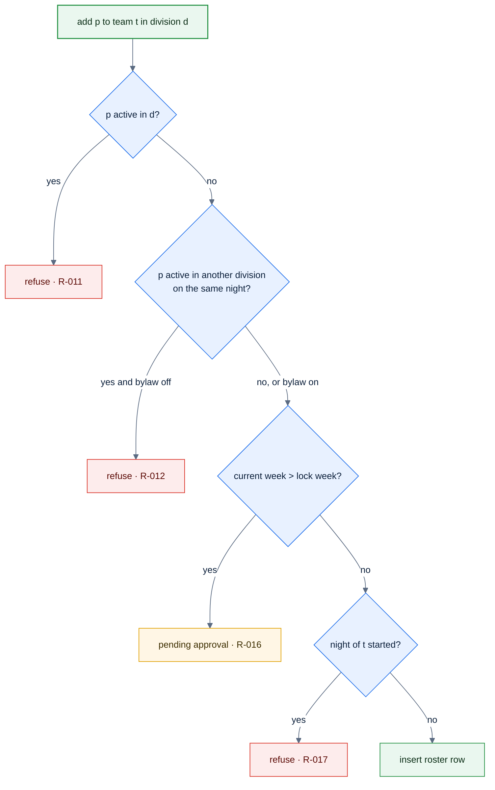

# F39c — Roster lock and one team per division

> [Feature specs](../README.md) › [E05 — Roster & Player Admin](README.md) › **F39c** · Phase 2

| Phase | Status | Rules |
|---|---|---|
| 2 | 🎯 | R-011, R-012, R-013, R-016, R-017, [Q24](../../14-open-questions.md), [Q32](../../14-open-questions.md) |

## Requirements

| ID | Requirement |
|---|---|
| FR-39c.1 | Replace the single-active-roster index with **one active roster per division**: `UNIQUE (player_id, division_id) WHERE left_at IS NULL` (denormalize `division_id`) |
| FR-39c.2 | Same night, different divisions: allowed only if the league bylaw `allow_multi_division_same_night` is true |
| FR-39c.3 | Roster changes after week 4 (`roster_lock_week`) need admin approval: the captain's add becomes a pending request |
| FR-39c.4 | Captain adds during a night are allowed only before match 1 starts |

## Logic

## Acceptance criteria
- **AC-39c.1** A player can be active on a Monday team and a Wednesday team, but not on two Wednesday teams in the same division.

---

[← F19](F19-player-transfer.md) · [E05 overview](README.md) · [F41 →](F41-audit-log.md)
