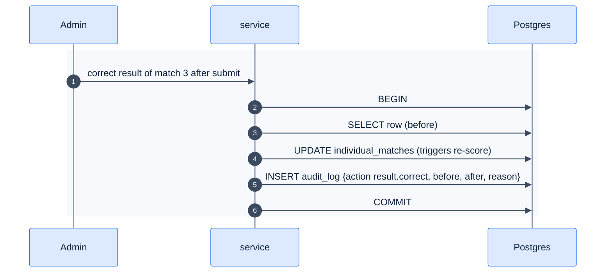

# F41 — Audit log

> [Feature specs](../README.md) › [E05 — Roster & Player Admin](README.md) › **F41** · Phase 2

| Phase | Status | Rules |
|---|---|---|
| 2 | 🎯 | [11 §5](../../11-security-and-roles.md), NFR-10 |

## Requirements

| ID | Requirement |
|---|---|
| FR-41.1 | Table `audit_log (id, actor_user_id, action, entity_type, entity_id, before jsonb, after jsonb, reason, ip, created_at)`. Append-only (no UPDATE/DELETE grants) |
| FR-41.2 | Logged actions: SL change, roster add / transfer / remove, admin result correction, post-submit edits, dispute resolution, role grants, payment overrides |
| FR-41.3 | Written in the **same transaction** as the change |
| FR-41.4 | Admin UI: filter by entity, actor and date; show a before/after diff |
| FR-41.5 | Retention 5 years (NFR-14) |

## Flow

## Acceptance criteria
- **AC-41.1** Every privileged action in FR-41.2 produces exactly one audit row, with before and after values.

---

[← F39c](F39c-roster-lock.md) · [E05 overview](README.md)
