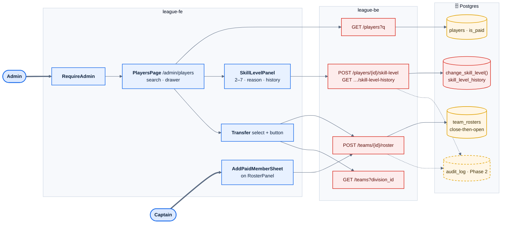
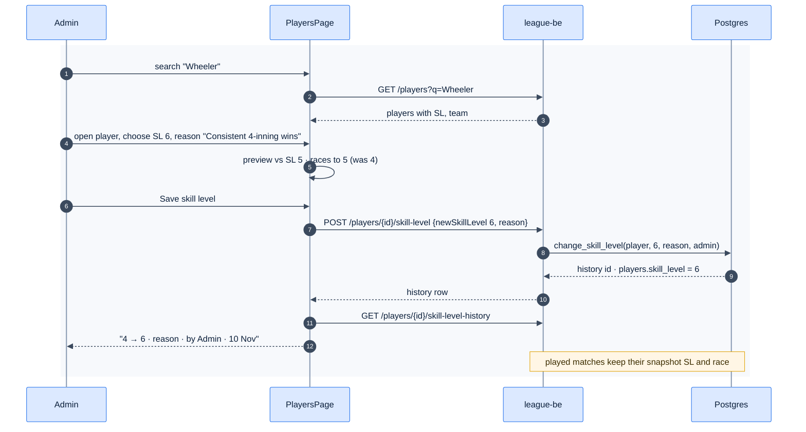
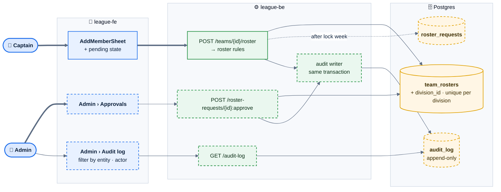
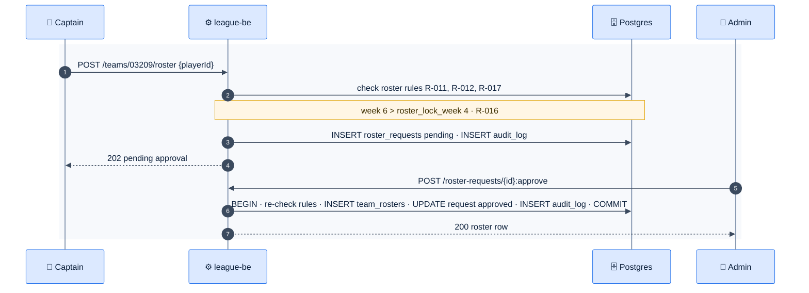

# E05 — Roster & Player Admin

> [Feature specs](../README.md) › **E05**

| | |
|---|---|
| **Goal** | Captains keep rosters filled with paid members. Admins find players, change skill levels with a reason, and move players between teams, all traceable |
| **Phase** | 1 (F16–F19) · 2 (F39c roster lock + one team per division, F41 audit log) |
| **Status** | 🅿️ Screens parked · ❌ endpoints and `change_skill_level()` missing (E02) |
| **Actors** | Captain, Admin |
| **Related** | [04 §3, §10](../../04-domain-rules.md) · [06 B.1](../../06-data-model.md) · [11 §2](../../11-security-and-roles.md) |

## Features by phase

### Phase 1

| # | Feature | Status |
|---|---|---|
| F16 | [Add paid member](F16-add-paid-member.md) | 🅿️ |
| F17 | [Player search](F17-player-search.md) | 🅿️ |
| F18 | [Skill-level change & history](F18-skill-level-change.md) | 🅿️ |
| F19 | [Player transfer](F19-player-transfer.md) | 🅿️ |

### Phase 2

| # | Feature | Status |
|---|---|---|
| F39c | [Roster lock](F39c-roster-lock.md) | 🎯 |
| F41 | [Audit log](F41-audit-log.md) | 🎯 |

## Phase 1 deep dive

### Components

### Main flow: admin changes a skill level

## Phase 2 deep dive

**Scope:** [F39c Roster lock and one team per division](F39c-roster-lock.md) and [F41 Audit log](F41-audit-log.md). Phase 1 lets admins and captains change rosters at any time. Phase 2 enforces the league bylaws (per-division membership, lock after week 4, no adds mid-night) and records every sensitive change.

### Components: what Phase 2 adds

### Key flow: a late roster add

### Data delta

| Change | Why |
|---|---|
| `team_rosters.division_id` + `UNIQUE (player_id, division_id) WHERE left_at IS NULL` | Replaces the Phase 1 single-active-roster index |
| `leagues.bylaws jsonb` (`roster_lock_week`, `allow_multi_division_same_night`) | Rules are configured, not hard-coded |
| New `roster_requests (id, team_id, player_id, requested_by, status, decided_by, decided_at)` | Late adds wait for approval |
| New `audit_log (id, at, actor_user_id, action, entity, entity_id, before jsonb, after jsonb, reason)` with no UPDATE or DELETE grant | Tamper-evident history (F41) |
