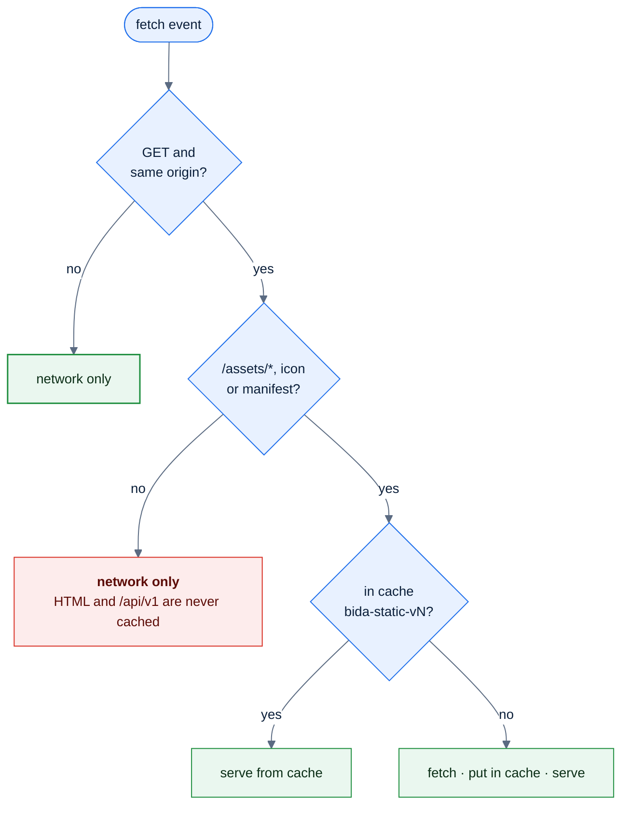
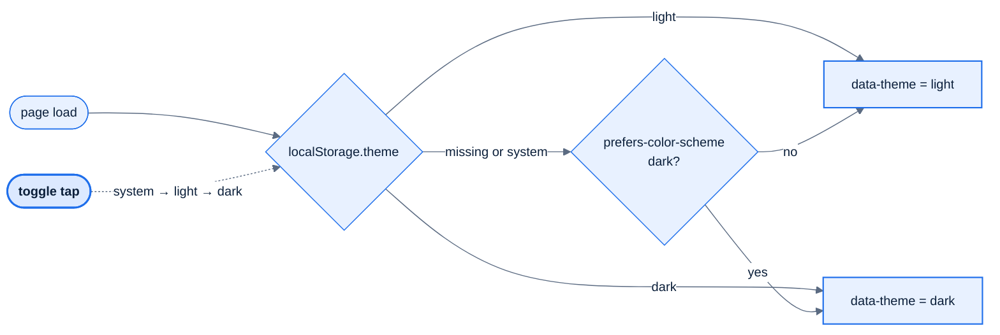
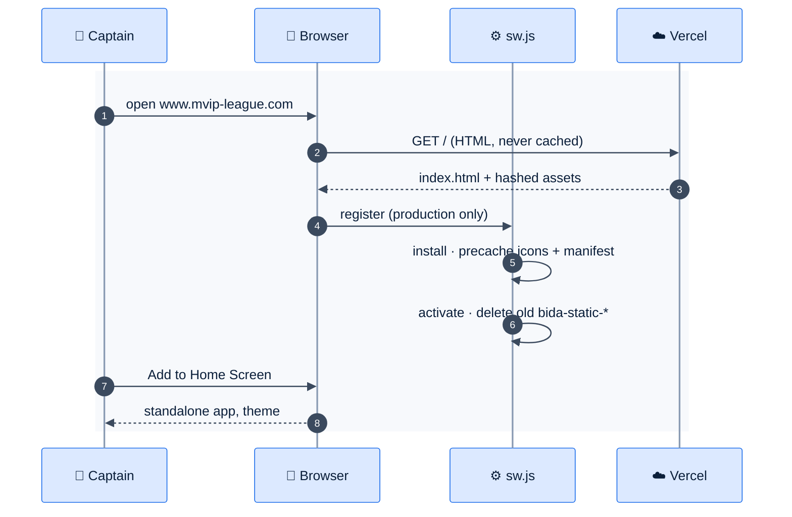

# F20 — PWA, theme, i18n, error copy

> [Feature specs](../README.md) › [E06 — Platform & Delivery](README.md) › **F20** · Phase 1

| Phase | Status | Rules | Repo refs |
|---|---|---|---|
| 1 | 🏗 | NFR-03, NFR-05, NFR-06 | `league-fe/public/{manifest.webmanifest,sw.js}` · `src/lib/register-sw.ts` · `src/index.css` · `src/components/ThemeToggle.tsx` · `src/i18n/{index.ts,en.json,vi.json}` · `src/lib/errors.ts` |

## Requirements

*As a captain at a pool hall, I add the app to my home screen, read it in my language, in light or dark, and every error tells me what to do.*

| ID | Requirement |
|---|---|
| FR-20.1 | Installable PWA named "Billiard League" (short name "Bida"): `display: standalone`, `orientation: portrait`, `theme_color #1F6FEB`, icons 192, 512 and maskable 512 |
| FR-20.2 | The service worker registers **only in production builds**. It caches `/assets/*` (hashed), icons and the manifest. It **never caches HTML or `/api/v1/*`**, so a signed-in page can't be replayed on a shared phone |
| FR-20.3 | Cache name `bida-static-v<n>`. On `activate`, delete every other `bida-static-*` cache |
| FR-20.4 | The theme toggle cycles `system → light → dark`. An explicit choice is saved in `localStorage.theme`, and `system` follows `prefers-color-scheme` live |
| FR-20.5 | A pre-paint inline script sets `data-theme` before React mounts (no flash of the wrong theme) |
| FR-20.6 | Design tokens on `:root` (15 colours, radius, spacing). Disabled = chip fill + muted text, never opacity. Tap targets ≥ 44 px. Focus ring 2 px accent. Motion 150/200 ms, 0 under `prefers-reduced-motion` |
| FR-20.7 | i18n `en` + `vi`: every user-visible string, including `aria-label`, `placeholder` and `alt`, comes from a key. Typecheck fails on key drift between the two files |
| FR-20.8 | Errors display `t('apiError.<code>')` only, never the backend `message`. An unknown code falls back to `apiError.50001` |

## Logic

### Service-worker fetch decision



*Red is the security rule. Hashed assets are immutable, so cache-first is safe for them only.*

### Theme resolution



### Error copy resolution

```text
messageFor(error):
  code = error.response?.data?.error?.code      // 5-digit, e.g. 40004
  if !code and network error  → t('apiError.network')
  if i18n.exists('apiError.' + code) → t('apiError.' + code)
  else → t('apiError.50001')
```

## Flow: install and first load



## UI

| Surface | Detail |
|---|---|
| Header menu | Theme toggle (`aria-label` = `theme.toggle`, announces the next mode); language switcher (F25) |
| Install hint | None in Phase 1. Rely on the browser's own prompt |
| Error banner | `ErrorBanner` with `role="alert"`, the copy from `messageFor`, and a Retry button when the query can retry |
| Toasts | Write errors use `sonner` toasts with the same copy |

## API & data

| Item | Value |
|---|---|
| Error envelope | `{"error": {"code": 40004, "message": "<internal>"}}` · only `code` is used |
| Key count | 140 keys per locale today, parity enforced by `src/i18n/index.ts` types |
| Storage | `localStorage.theme`, `localStorage.locale` (F25), wrapped in try/catch |

## Edge cases

| ID | Situation | Expected |
|---|---|---|
| EC-20.1 | New release deployed while the app is open | New hashed assets miss the cache and load fresh. The old cache is removed on the next activate |
| EC-20.2 | Logout on a shared device, then Back | The HTML and API calls are network-only, so the session-less API returns 401 and the app redirects to `/login` |
| EC-20.3 | Private browsing (storage throws) | The theme falls back to `system` and nothing crashes |
| EC-20.4 | The backend adds a new error code before the FE ships its copy | The generic `50001` copy shows; no raw backend text |
| EC-20.5 | iOS Safari standalone | `apple-touch-icon` and the status-bar meta are present; safe-area insets pad the sticky action bar |

## Acceptance criteria

- **AC-20.1** Given a production build, when Lighthouse runs, then the PWA is installable and axe reports 0 critical issues on every screen.
- **AC-20.2** Given a signed-in user who logs out, when another person opens the app offline, then no previous page or data is shown.
- **AC-20.3** Given `vi.json` misses a key that `en.json` has, when `pnpm typecheck` runs, then it fails.
- **AC-20.4** Given an API error `40004`, when it's displayed, then the text equals `t('apiError.40004')` in the current locale.

## Implementation gaps

- No language switcher yet; the default is still `en` (both in F25).
- Lighthouse, axe and real-device QA (iOS Safari; Android with the keyboard over the steppers) haven't been run (plan-9).
- Error copy for codes added by the missing league API (`40004`, `40901`, `40902`) must be added with E02.

## Open questions

- Should the app show its own "Install" hint after the second visit? (Default: no.)

---

[E06 overview](README.md) · [F21 →](F21-ci-cd.md)
