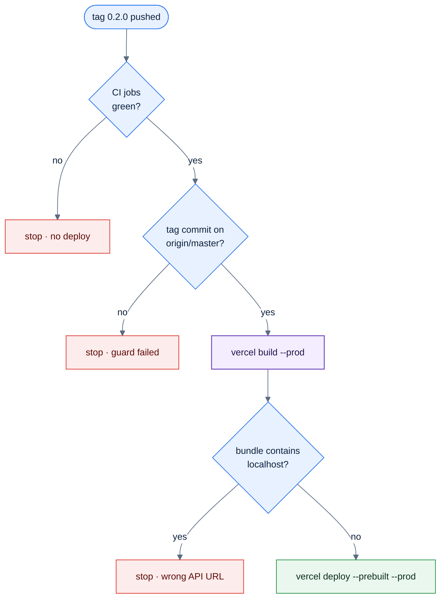
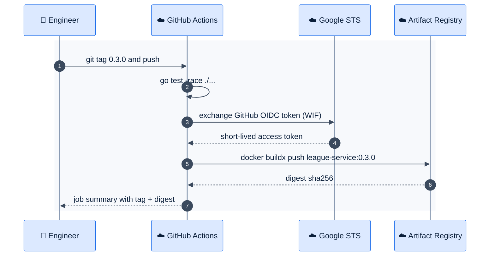

# F21 — CI/CD

> [Feature specs](../README.md) › [E06 — Platform & Delivery](README.md) › **F21** · Phase 1

| Phase | Status | Rules | Repo refs |
|---|---|---|---|
| 1 | 🏗 | ADR-010 | `league-fe/.github/workflows/{ci,cd}.yaml`, `vercel.json` · `league-be/.github/workflows/{ci,release}.yaml`, `Dockerfile`, `Makefile` |

## Requirements

*As an engineer, I open a PR and get a clear pass or fail. I push a tag and the release goes out without anyone holding a cloud key.*

| ID | Requirement |
|---|---|
| FR-21.1 | **FE CI** on every PR and push to `master`: `pnpm install --frozen-lockfile`, `format:check`, `lint --max-warnings 0`, `typecheck`, `test`, `build` (with a dummy `VITE_API_URL`) |
| FR-21.2 | **FE CD** on a `*.*.*` tag: re-run CI → `guard` (the tag commit is an ancestor of `origin/master`) → `vercel pull` + `vercel build --prod` → fail if the bundle contains `localhost` → `vercel deploy --prebuilt --prod` |
| FR-21.3 | **BE CI** on PRs and pushes: `golangci-lint`, `gofmt -l` empty, `go vet`, `go test -race ./...`, `go build ./...` |
| FR-21.4 | **BE release** on a `*.*.*` tag: tests → Workload Identity Federation → `docker buildx --platform linux/amd64` → push `asia-southeast1-docker.pkg.dev/vincent-mini-apps-project/<repo>/league-service:<tag>` and `:latest` |
| FR-21.5 | No long-lived keys. GCP via WIF only. The Vercel token, org ID and project ID live in the GitHub `production` environment, which needs approval |
| FR-21.6 | Workflows pin third-party actions to a commit SHA |
| FR-21.7 | Concurrency: one release per repo at a time (`concurrency: release-${{ github.repository }}`) |

## Logic: FE release gate

*Each red stop leaves production untouched. Prebuilt deploys mean Vercel ships exactly what CI built.*

## Flow: backend image release

## Pipelines at a glance

| Repo | Trigger | Jobs | Output |
|---|---|---|---|
| league-fe | PR, push `master` | format · lint · typecheck · test · build | status check |
| league-fe | tag `*.*.*` | ci → guard → build → bundle check → deploy | Vercel production |
| league-be | PR, push | lint · fmt · vet · test -race · build | status check |
| league-be | tag `*.*.*` | test → auth → build → push | image in Artifact Registry |
| league-be | tag `*.*.*` (F22) | + migrate Job → helm upgrade | GKE rollout |

## Edge cases

| ID | Situation | Expected |
|---|---|---|
| EC-21.1 | Tag pushed on a feature branch | FE `guard` fails. BE should add the same guard |
| EC-21.2 | Two tags pushed in a row | Concurrency queues them; the second runs after the first |
| EC-21.3 | Flaky test on release | Release fails; re-run the job. Never skip tests on tags |
| EC-21.4 | Need to roll back | Re-deploy the previous Vercel deployment (`vercel promote`) and `helm rollback` (F22) |

## Acceptance criteria

- **AC-21.1** Given a tag on a commit not on `master`, when FE CD runs, then `guard` fails and nothing deploys.
- **AC-21.2** Given a PR with a lint warning, when CI runs, then the PR is blocked.
- **AC-21.3** Given a BE tag, when release finishes, then the image with that tag exists and no JSON key was used.

## Implementation gaps

- league-be has no tag-on-master guard.
- No deploy job for the backend (F22).
- Actions aren't pinned to SHAs in either repo.

## Open questions

- Should merges to `master` deploy staging automatically (F23)? Default: yes.

---

[← F20](F20-pwa-theme-i18n.md) · [E06 overview](README.md) · [F22 →](F22-gke-deployment.md)
