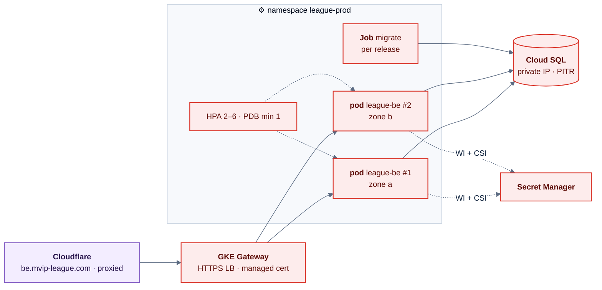
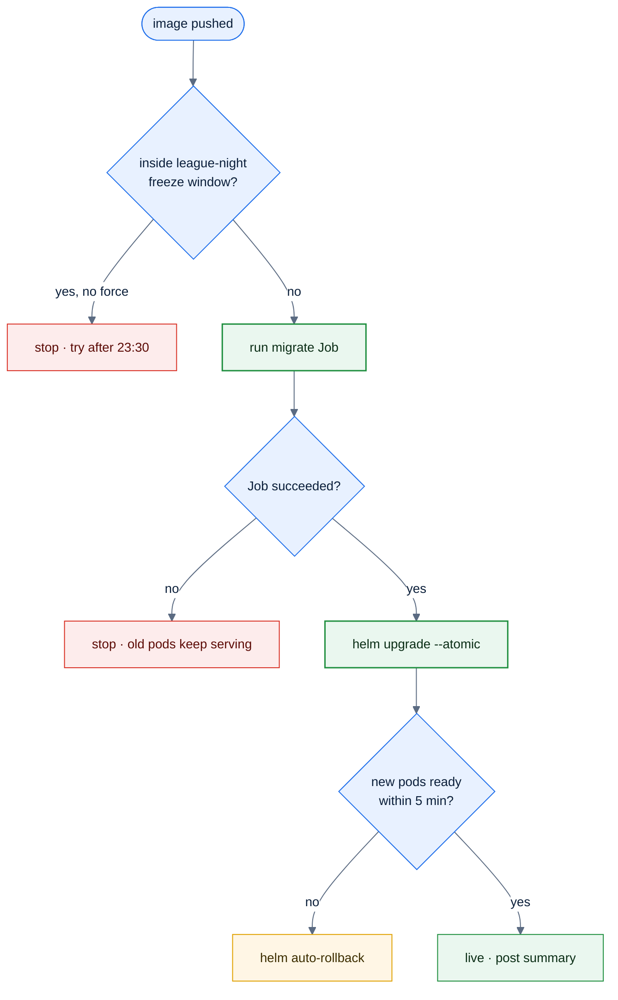
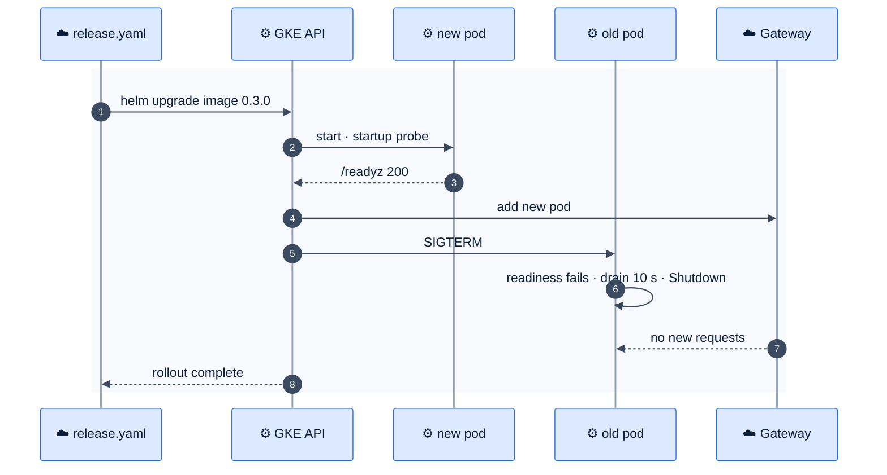

# F22 — GKE deployment

> [Feature specs](../README.md) › [E06 — Platform & Delivery](README.md) › **F22** · Phase 1

| Phase | Status | Rules | Repo refs |
|---|---|---|---|
| 1 | ⬜ | NFR-02, NFR-08 · [12 §4](../../12-infra-devops.md) | `league-be/Dockerfile` (EXPOSE 9200) · `config/*.yaml` (port 5001) · new `league-be/deploy/` |

## Requirements

*As an engineer, my backend tag becomes running pods behind `be.mvip-league.com`, with the schema migrated first and an automatic rollback if anything fails.*

| ID | Requirement |
|---|---|
| FR-22.1 | Helm chart in `league-be/deploy/helm/league-be`: Deployment (≥ 2 replicas, spread across zones), Service, HPA (CPU 70 %, 2–6 pods), PodDisruptionBudget (`minAvailable: 1`), Gateway HTTPRoute for `be.mvip-league.com` |
| FR-22.2 | One container port. Align the Dockerfile `EXPOSE 9200` and the YAML `5001` ([Q38](../../14-open-questions.md)). Default: `8080` everywhere |
| FR-22.3 | Probes: liveness `GET /api/v1/health` (no DB); readiness `GET /readyz` (new, pings the DB with a 1 s timeout); startup probe with a 30 s budget |
| FR-22.4 | Secrets (`GOOGLE_OAUTH_CLIENT_ID/SECRET`, `ENCRYPTION_KEY`, `DATABASE_URL`) come from Secret Manager through the Secret Store CSI driver and Workload Identity. Nothing secret in YAML or images |
| FR-22.5 | Cloud SQL Postgres 16 with private IP, automated daily backups, PITR 7 days, `max_connections` sized to pods × pool |
| FR-22.6 | `release.yaml` gains `deploy`: `get-gke-credentials` → run the `migrate` Job and wait → `helm upgrade --install --atomic --timeout 5m --set image.tag=<tag>` |
| FR-22.7 | Graceful shutdown: on SIGTERM, fail readiness, drain for 10 s, then `server.Shutdown` with a 20 s budget |
| FR-22.8 | Freeze window: no production deploy Mon–Fri 17:00–23:30 ICT (league nights). The job checks the time and fails unless `force_deploy` is set |
| FR-22.9 | Resources: requests 100m CPU / 128 Mi, limits 500m / 256 Mi. `securityContext` non-root, read-only root filesystem |

## Topology

*Everything here is red: none of it exists yet. It is the go-live blocker next to E02.*

## Logic: deploy job

## Flow: rolling update

## API & data

| Item | Value |
|---|---|
| `GET /api/v1/health` | `200 {"status":"ok"}` with no DB call |
| `GET /readyz` | `200` when the DB ping succeeds, `503` otherwise. Not under `/api/v1`, not exposed via the Gateway |
| Pool | `pgxpool` max 10 per pod → 6 pods × 10 + migrate + admin < 100 connections |
| Config | `APP_ENV=production`, `PORT=8080`, `ALLOWED_ORIGINS=https://www.mvip-league.com` |

## Edge cases

| ID | Situation | Expected |
|---|---|---|
| EC-22.1 | A migration takes a long table lock | Migrations follow expand/contract (F43). Use `lock_timeout = 5s` so the Job fails rather than blocking traffic |
| EC-22.2 | Cloud SQL failover | Readiness fails briefly; pods stay alive (liveness doesn't touch the DB) and recover |
| EC-22.3 | A node is drained during a league night | The PDB keeps one pod serving |
| EC-22.4 | Cookie domain | `__Host-sid` has no Domain and is bound to `be.mvip-league.com`. The FE calls it cross-site with `withCredentials` (see [05 §3](../../05-architecture.md)) |

## Acceptance criteria

- **AC-22.1** Given a new tag, when release finishes, then two pods run the new image and `/readyz` returns 200 through port-forward.
- **AC-22.2** Given a failing migration, when release runs, then the deploy stops and the previous pods still serve 200.
- **AC-22.3** Given a k6 smoke test during a rollout, then no request fails with 5xx.
- **AC-22.4** Given 18:00 ICT on a Tuesday, when a tag is pushed, then the deploy job refuses.

## Open questions

- GKE Autopilot vs Standard? Default: **Autopilot**, for less ops at this scale.
- [Q38](../../14-open-questions.md) port alignment.

---

[← F21](F21-ci-cd.md) · [E06 overview](README.md) · [F23 →](F23-staging-consent.md)
