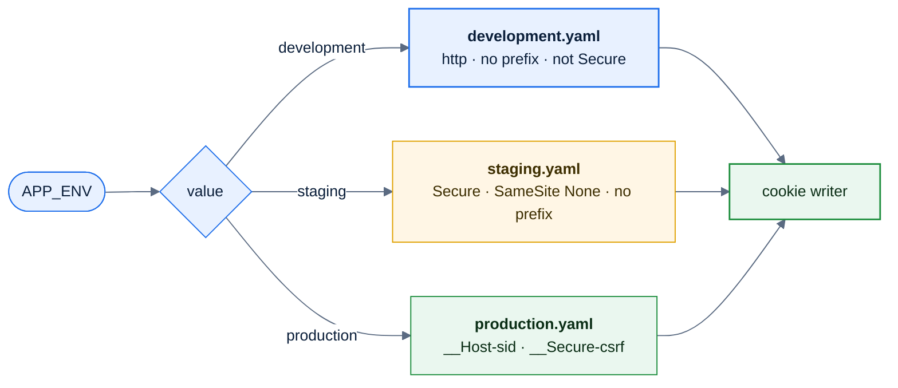
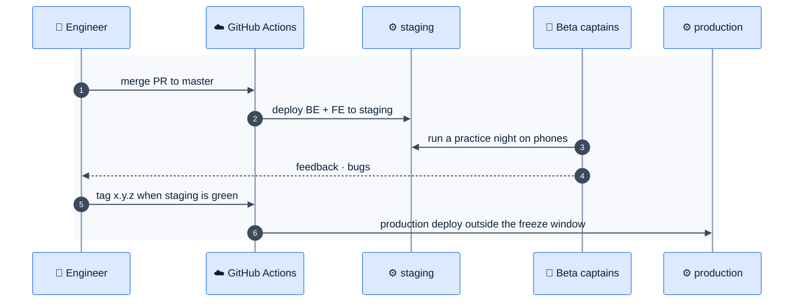

# F23 — Staging and Google consent screen

> [Feature specs](../README.md) › [E06 — Platform & Delivery](README.md) › **F23** · Phase 1

| Phase | Status | Rules | Repo refs |
|---|---|---|---|
| 1 | ⬜ | ADR-003 | `league-be/config/{development,production}.yaml` · `internal/auth/cookies.go` (`isSecure`) · `league-fe/.env.*` |

## Requirements

*As the league owner, I try every release with real captains on staging before it reaches league night, and players see a verified Google consent screen, not an "unverified app" warning.*

| ID | Requirement |
|---|---|
| FR-23.1 | Staging hosts `staging.mvip-league.com` (FE) and `be-staging.mvip-league.com` (BE), with their own Vercel project or environment, GKE namespace `league-staging`, and Cloud SQL database `league_staging` |
| FR-23.2 | A separate Google OAuth client for staging, with redirect `https://be-staging.mvip-league.com/api/v1/auth/google/callback` |
| FR-23.3 | `config/staging.yaml` with `APP_ENV=staging`. Cookies are `Secure` and `SameSite=None`, without the `__Host-`/`__Secure-` prefixes so they can't collide with production |
| FR-23.4 | Merges to `master` deploy staging automatically; tags deploy production (F21) |
| FR-23.5 | Seed staging with the beta division (F9 seed + anonymised player names) |
| FR-23.6 | Publish the Google OAuth consent screen (it's in Testing mode, capped at 100 test users): app name "MViP League", logo, support email, privacy policy and terms URLs on `www.mvip-league.com`, verified domain `mvip-league.com`, scopes `openid email profile` only |
| FR-23.7 | A visible "STAGING" ribbon in the FE when `VITE_APP_ENV=staging` |

## Logic: which config wins

## Flow: release through staging

## Consent screen checklist

| Item | Value |
|---|---|
| App name | MViP League |
| User support email | league owner's address |
| App logo | 120 × 120 PNG, same mark as the PWA icon |
| Authorized domains | `mvip-league.com` |
| Links | `/privacy`, `/terms` (static pages in league-fe) |
| Scopes | `openid`, `email`, `profile` (non-sensitive, so no security review) |
| Publishing status | Testing → **In production** |

## Edge cases

| ID | Situation | Expected |
|---|---|---|
| EC-23.1 | Someone signs in on staging with the same Google account as production | Separate DB and session tables, so two independent users exist |
| EC-23.2 | Staging is down during a demo | No impact on production; nothing is shared except Artifact Registry |
| EC-23.3 | Google verification takes days | Start in week 1. Until then, add beta testers as test users (≤ 100) |

## Acceptance criteria

- **AC-23.1** Given a session on staging, when the user opens production, then they are signed out there.
- **AC-23.2** Given the consent screen is published, when a new Google user signs in, then no "unverified app" screen appears.
- **AC-23.3** Given a merge to `master`, then staging runs the new build within 15 minutes.

## Implementation gaps

- No `staging.yaml`, no staging hosts, and no privacy or terms pages.

## Open questions

- Should staging share the production Cloud SQL instance (a separate database) to save cost? Default: yes, a separate database on the same small instance.

---

[← F22](F22-gke-deployment.md) · [E06 overview](README.md) · [F24 →](F24-api-types-integration.md)
