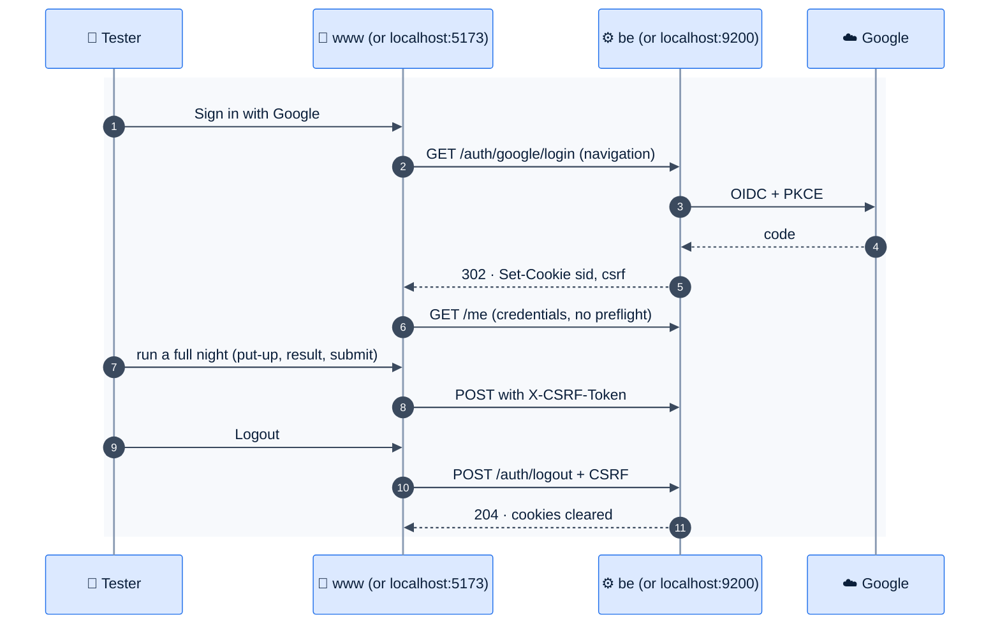

# F24 — Generated API types and FE/BE integration test

> [Feature specs](../README.md) › [E06 — Platform & Delivery](README.md) › **F24** · Phase 1

| Phase | Status | Rules | Repo refs |
|---|---|---|---|
| 1 | ⬜ | ADR-008 | `league-be/docs/swagger.json` (2.0, from swag annotations) · `league-fe/src/types/league.ts` (hand-written) · `src/api/leagueAPI.ts` |

## Requirements

*As an engineer, when the backend changes a field, the front end fails to compile instead of failing on league night.*

| ID | Requirement |
|---|---|
| FR-24.1 | The backend publishes an OpenAPI 3 document: `make swagger` runs swag, then `swagger2openapi` → `docs/openapi.json` (committed) |
| FR-24.2 | The FE runs `pnpm gen:api` = `openapi-typescript ../league-be/docs/openapi.json -o src/types/api.gen.ts` (or from a pinned URL/tag in CI) |
| FR-24.3 | `leagueAPI.ts` uses `components["schemas"][…]` types. Delete the hand-written `src/types/league.ts` |
| FR-24.4 | CI: BE fails if `openapi.json` is stale; FE fails if `api.gen.ts` differs from a fresh generation |
| FR-24.5 | Fix known swagger drift: user `id` is a UUID string, not an integer ([Q39](../../14-open-questions.md)); the envelope `{session_id, count, data, metadata}` is described once and reused |
| FR-24.6 | **Integration gate** before go-live: FE and BE together in a real browser, locally (`docker compose up` + `pnpm dev`) and against staging, using the checklist below |

## Flow: type generation

```mermaid
%%{init: {"theme": "base", "themeVariables": {"fontFamily": "Arial", "fontSize": "14px", "primaryColor": "#E8F1FF", "primaryBorderColor": "#1F6FEB", "primaryTextColor": "#0B1F3A", "lineColor": "#5B6B82", "secondaryColor": "#EAF7EF", "tertiaryColor": "#FFF6E5", "actorBkg": "#DCE9FF", "actorTextColor": "#0B1F3A", "actorBorder": "#1F6FEB", "actorLineColor": "#8A9BB3", "signalColor": "#3B4A5E", "signalTextColor": "#0B1F3A", "noteBkgColor": "#FFF6E5", "noteBorderColor": "#E0A100", "noteTextColor": "#3D2E00", "activationBkgColor": "#C7DBFF", "activationBorderColor": "#1F6FEB", "sequenceNumberColor": "#FFFFFF", "labelBoxBkgColor": "#1F6FEB", "labelBoxBorderColor": "#1F6FEB", "labelTextColor": "#FFFFFF", "loopTextColor": "#0B1F3A", "clusterBkg": "#F7F9FC", "clusterBorder": "#C9D3E0", "edgeLabelBackground": "#FFFFFF", "transitionLabelColor": "#0B1F3A", "cScale0": "#1F6FEB", "cScaleLabel0": "#FFFFFF", "cScale1": "#1E8E3E", "cScaleLabel1": "#FFFFFF", "cScale2": "#7E57C2", "cScaleLabel2": "#FFFFFF"}}}%%
flowchart LR
  A["<b>Go handlers</b><br/>swag annotations"]:::api --> B["make swagger"]:::api --> C["swagger.json<br/>2.0"]:::api
  C --> D["swagger2openapi"]:::ext --> E["<b>openapi.json</b><br/>3.0 · committed"]:::api
  E --> F["openapi-typescript"]:::ext --> G["<b>api.gen.ts</b>"]:::fe --> H["leagueAPI.ts · hooks"]:::fe
  G --> I{"CI: git diff<br/>clean?"}
  I -- no --> X["fail PR"]:::bad
  I -- yes --> OK["merge"]:::ok
  classDef fe fill:#E8F1FF,stroke:#1F6FEB,stroke-width:1.5px,color:#0B1F3A
  classDef api fill:#EAF7EF,stroke:#1E8E3E,stroke-width:1.5px,color:#0B2E16
  classDef db fill:#FFF6E5,stroke:#E0A100,stroke-width:1.5px,color:#3D2E00
  classDef ext fill:#F3EDFF,stroke:#7E57C2,stroke-width:1.5px,color:#25124A
  classDef gap fill:#FDECEC,stroke:#D93025,stroke-width:1.5px,color:#5C0B06
  classDef actor fill:#DCE9FF,stroke:#1F6FEB,stroke-width:2px,color:#0B1F3A,font-weight:bold
  classDef ok fill:#EAF7EF,stroke:#1E8E3E,color:#0B2E16
  classDef warn fill:#FFF6E5,stroke:#E0A100,color:#3D2E00
  classDef bad fill:#FDECEC,stroke:#D93025,color:#5C0B06
  classDef start fill:#E8F1FF,stroke:#1F6FEB,color:#0B1F3A
  classDef planned stroke-dasharray:5 4
```

## Flow: integration smoke test

## Integration checklist

| # | Check | Why |
|---|---|---|
| 1 | `GET` requests send no `OPTIONS` preflight | Only simple headers on reads |
| 2 | `POST`/`PUT` preflight allows `X-CSRF-Token` and credentials for the exact FE origin | CORS + CSRF |
| 3 | The session cookie reaches `be.` from `www.` in Safari, Chrome and Firefox | Third-party cookie rules; see [05 §3](../../05-architecture.md) |
| 4 | Logout without the CSRF header returns `40301` | CSRF works |
| 5 | A 401 on any call except `/me` hard-redirects to `/login` | The interceptor |
| 6 | The full seeded night totals match `team_standings` | Rules in Postgres agree with the UI |

## Edge cases

| ID | Situation | Expected |
|---|---|---|
| EC-24.1 | The backend adds an optional field | The generated type gains it; no FE break |
| EC-24.2 | The backend renames a field | The FE typecheck fails in the PR that regenerates |
| EC-24.3 | Safari blocks third-party cookies | If check 3 fails, serve the API under `www.mvip-league.com/api` through a Vercel rewrite (fallback in [05](../../05-architecture.md)) |

## Acceptance criteria

- **AC-24.1** Given a Go response field change without regeneration, when FE CI runs, then it fails.
- **AC-24.2** Given staging, when the checklist runs on iOS Safari and Android Chrome, then all six checks pass.

## Implementation gaps

- Swagger is 2.0 only, and `src/types/league.ts` is hand-written.
- The league endpoints don't exist yet (E02-F10), so they have no annotations.

## Open questions

- Generate from a URL (`/swagger/doc.json` on staging) or from the committed file? Default: the committed file at a pinned BE tag.

---

[← F23](F23-staging-consent.md) · [E06 overview](README.md) · [F25 →](F25-rate-limit-logs-locale.md)
