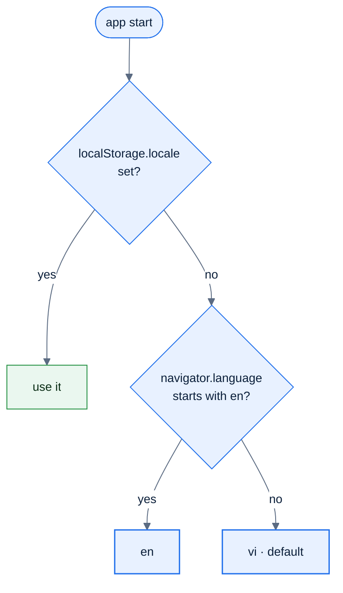
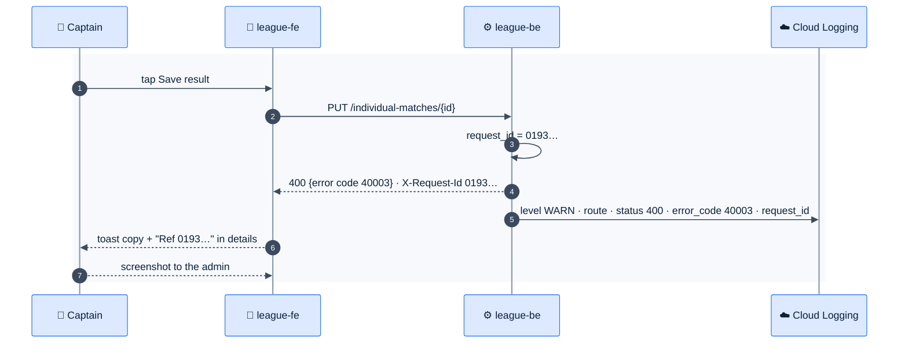

# F25 — Rate limiting, structured logs, Vietnamese default

> [Feature specs](../README.md) › [E06 — Platform & Delivery](README.md) › **F25** · Phase 1

| Phase | Status | Rules | Repo refs |
|---|---|---|---|
| 1 | ⬜ | NFR-07, NFR-09 · [11 §6](../../11-security-and-roles.md) | `league-be/internal/middleware/*` (`ContextKeyRequestID` exists, unused) · `league-fe/src/i18n/index.ts` (`lng: 'en'`) |

## Requirements

*As the operator, abusive traffic is stopped at the edge, every request can be traced in the logs, and Vietnamese players see Vietnamese first.*

| ID | Requirement |
|---|---|
| FR-25.1 | **Edge limits (Cloudflare rules, no code):** `/api/v1/auth/*` 10 req/min per IP; `/api/v1/members/preview` 20 req/min per IP; respond 429 with `Retry-After` |
| FR-25.2 | **App limiter** on writes (`POST/PUT/PATCH/DELETE`): token bucket of 60/min per user, burst 120. Over the limit → 429 with error `42901`. Phase 1 is in-memory per pod; Phase 2 moves it to Redis (F42) |
| FR-25.3 | **Request ID:** accept a valid inbound `X-Request-Id` or create a UUIDv7, put it in context, and echo it in the response header |
| FR-25.4 | **Structured logs** via `log/slog` JSON: `time, level, msg, request_id, method, route, status, latency_ms, user_id, error_code`. Cloud Logging severity mapping |
| FR-25.5 | **Never log** request or response bodies, cookies, `Authorization`, OAuth codes or tokens, or member IDs typed during onboarding |
| FR-25.6 | **Locale:** the default is `vi`. Order: `localStorage.locale` → `navigator.language` starts with `en` → `vi`. A switcher in the header menu ("Tiếng Việt" / "English") persists the choice and sets `<html lang>` |
| FR-25.7 | Dates and numbers use `Intl` with the active locale and the `Asia/Ho_Chi_Minh` time zone |

## Logic: request pipeline

```mermaid
%%{init: {"theme": "base", "themeVariables": {"fontFamily": "Arial", "fontSize": "14px", "primaryColor": "#E8F1FF", "primaryBorderColor": "#1F6FEB", "primaryTextColor": "#0B1F3A", "lineColor": "#5B6B82", "secondaryColor": "#EAF7EF", "tertiaryColor": "#FFF6E5", "actorBkg": "#DCE9FF", "actorTextColor": "#0B1F3A", "actorBorder": "#1F6FEB", "actorLineColor": "#8A9BB3", "signalColor": "#3B4A5E", "signalTextColor": "#0B1F3A", "noteBkgColor": "#FFF6E5", "noteBorderColor": "#E0A100", "noteTextColor": "#3D2E00", "activationBkgColor": "#C7DBFF", "activationBorderColor": "#1F6FEB", "sequenceNumberColor": "#FFFFFF", "labelBoxBkgColor": "#1F6FEB", "labelBoxBorderColor": "#1F6FEB", "labelTextColor": "#FFFFFF", "loopTextColor": "#0B1F3A", "clusterBkg": "#F7F9FC", "clusterBorder": "#C9D3E0", "edgeLabelBackground": "#FFFFFF", "transitionLabelColor": "#0B1F3A", "cScale0": "#1F6FEB", "cScaleLabel0": "#FFFFFF", "cScale1": "#1E8E3E", "cScaleLabel1": "#FFFFFF", "cScale2": "#7E57C2", "cScaleLabel2": "#FFFFFF"}}}%%
flowchart LR
  IN(["request"]):::start --> CF{"Cloudflare<br/>rule hit?"}
  CF -- yes --> R1["429 · edge"]:::bad
  CF -- no --> RID["request ID<br/>middleware"]:::api --> LOG["access log<br/>start"]:::api --> AU["auth + CSRF"]:::api
  AU --> W{"write method?"}
  W -- no --> H["handler"]:::api
  W -- yes --> B{"user bucket<br/>has a token?"}
  B -- no --> R2["429 · 42901"]:::bad
  B -- yes --> H
  H --> OUT["log line · status · latency"]:::ok
  classDef fe fill:#E8F1FF,stroke:#1F6FEB,stroke-width:1.5px,color:#0B1F3A
  classDef api fill:#EAF7EF,stroke:#1E8E3E,stroke-width:1.5px,color:#0B2E16
  classDef db fill:#FFF6E5,stroke:#E0A100,stroke-width:1.5px,color:#3D2E00
  classDef ext fill:#F3EDFF,stroke:#7E57C2,stroke-width:1.5px,color:#25124A
  classDef gap fill:#FDECEC,stroke:#D93025,stroke-width:1.5px,color:#5C0B06
  classDef actor fill:#DCE9FF,stroke:#1F6FEB,stroke-width:2px,color:#0B1F3A,font-weight:bold
  classDef ok fill:#EAF7EF,stroke:#1E8E3E,color:#0B2E16
  classDef warn fill:#FFF6E5,stroke:#E0A100,color:#3D2E00
  classDef bad fill:#FDECEC,stroke:#D93025,color:#5C0B06
  classDef start fill:#E8F1FF,stroke:#1F6FEB,color:#0B1F3A
  classDef planned stroke-dasharray:5 4
```

### Locale resolution

## Flow: tracing one bad request

*The reference shown in the toast lets the admin find the exact log line.*

## API & data

| Item | Value |
|---|---|
| New error code | `42901` Too many requests → `apiError.42901` "Too many attempts, wait a minute and try again" |
| Response header | `X-Request-Id` on every response, exposed via CORS `Access-Control-Expose-Headers` |
| Log example | `{"level":"INFO","msg":"http","request_id":"0193…","method":"PUT","route":"/api/v1/individual-matches/{id}","status":200,"latency_ms":41,"user_id":"a3f…"}` |

## Edge cases

| ID | Situation | Expected |
|---|---|---|
| EC-25.1 | Many players behind one venue Wi-Fi IP | Edge limits apply only to auth and preview. App limits are per user, so a hall doesn't get blocked |
| EC-25.2 | Two pods, in-memory limiter | The effective limit is up to 2×; acceptable in Phase 1 |
| EC-25.3 | Inbound `X-Request-Id` is huge or malformed | Ignore it and create a new one |
| EC-25.4 | A user switches language mid-night | Labels change immediately; drafts are kept |

## Acceptance criteria

- **AC-25.1** Given 21 preview requests from one IP in a minute, then the 21st returns 429.
- **AC-25.2** Given any response, then its `X-Request-Id` matches exactly one access-log line.
- **AC-25.3** Given a new device with a Vietnamese browser, when the app opens, then the copy is Vietnamese.
- **AC-25.4** Given a grep of a day's logs for `Cookie` or `code=`, then there are zero hits.

## Implementation gaps

- `ContextKeyRequestID` is defined but never set; logs use the default text logger.
- `i18n` hard-codes `lng: 'en'`.

## Open questions

- Should "Ref" IDs be shown to all users or only admins? Default: everyone, in a collapsed "Details".

---

[← F24](F24-api-types-integration.md) · [E06 overview](README.md) · [F42 →](F42-worker-outbox-redis.md)
