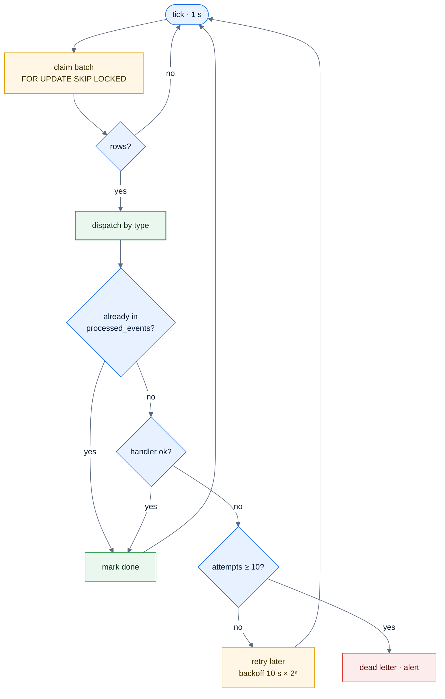
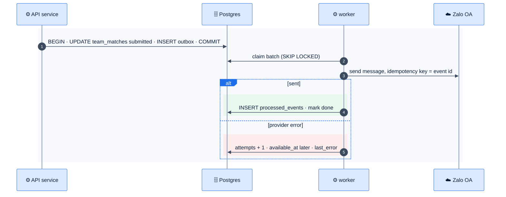

# F42 — Worker, outbox, Redis

> [Feature specs](../README.md) › [E06 — Platform & Delivery](README.md) › **F42** · Phase 2

| Phase | Status | Rules | Repo refs |
|---|---|---|---|
| 2 | 🎯 | ADR-006 · [10 §7](../../10-backend-design.md) | new `league-be/cmd/worker`, `internal/outbox`, `migrations/*_outbox.sql` |

## Requirements

*As an engineer, side effects (messages, fees, suggestions) happen reliably after a change commits. They are never lost and never sent twice, even if a pod dies.*

| ID | Requirement |
|---|---|
| FR-42.1 | Table `outbox (id uuid, type text, aggregate_id text, payload jsonb, created_at, available_at, attempts int, last_error text, done_at)` |
| FR-42.2 | Domain writes insert outbox rows **in the same transaction** (e.g. `TeamMatchSubmitted`, `SkillLevelChanged`, `RosterChanged`, `PaymentSucceeded`, `DisputeOpened`) |
| FR-42.3 | `cmd/worker` (its own Deployment, 1–2 replicas) loops: claim up to 100 rows `WHERE done_at IS NULL AND available_at <= now() ORDER BY created_at FOR UPDATE SKIP LOCKED`, dispatch by `type`, then mark done |
| FR-42.4 | Failure → `attempts + 1`, `available_at = now() + backoff(attempts)` (10 s × 2ⁿ, max 1 h). After 10 attempts, it's dead-lettered (`done_at` stays null, `type` flagged) and alerts (F44) |
| FR-42.5 | Handlers are idempotent: table `processed_events (handler, event_id) PRIMARY KEY` is checked and inserted in the handler's own transaction |
| FR-42.6 | Redis (Memorystore, Standard tier) for: live-scoring state and pub/sub (E07), scoring leases (F30), rate-limit buckets (F25), short caches. **Postgres stays the source of truth** |
| FR-42.7 | Housekeeping: delete done outbox rows older than 14 days, nightly |

## Logic: worker loop

## Flow

## Event catalogue

| Type | Produced by | Handlers |
|---|---|---|
| `TeamMatchSubmitted` | F15 submit | notify both teams (F40), standings cache bust (F35), SL suggestion check (F33) |
| `SkillLevelChanged` | F18 | notify the player (F40), audit (F41) |
| `RosterChanged` | F16, F19 | fee line for a new member (F36) |
| `PaymentSucceeded` | F36 webhook | mark member paid, receipt message (F40) |
| `DisputeOpened` / `DisputeResolved` | F31 | notify the admin and both captains (F40) |

## Edge cases

| ID | Situation | Expected |
|---|---|---|
| EC-42.1 | Worker killed mid-batch | The row locks release on disconnect; another worker reclaims them. `processed_events` prevents a double send |
| EC-42.2 | A transaction rolls back | No outbox row exists, so nothing is sent |
| EC-42.3 | Redis lost | Live views degrade to polling Postgres (E07). Rate limits fall back to in-memory |
| EC-42.4 | Event order for one aggregate | Handlers must not depend on order. Where they must, they read current state from Postgres |

## Acceptance criteria

- **AC-42.1** Given the worker is killed after the send but before marking done, when it restarts, then the message is not sent again.
- **AC-42.2** Given Zalo returns 500 three times, then the row is retried with growing delays and then succeeds.
- **AC-42.3** Given 10 failures, then the row is dead-lettered and an alert fires.

## Open questions

- Use LISTEN/NOTIFY to wake the worker instantly? Default: no; 1 s polling is enough.

---

[← F25](F25-rate-limit-logs-locale.md) · [E06 overview](README.md) · [F44 →](F44-monitoring.md)
