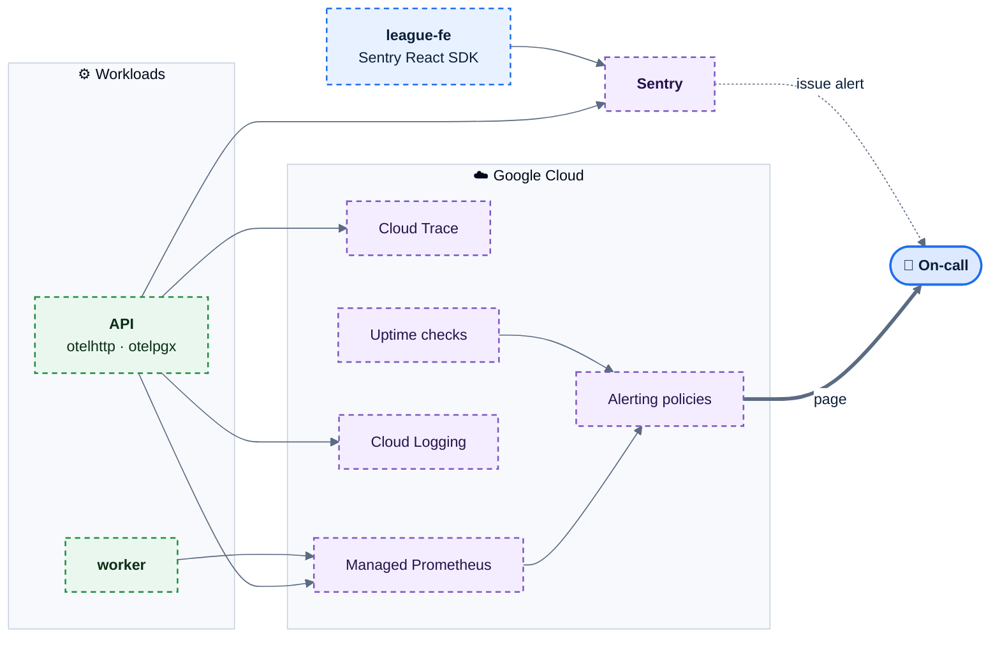
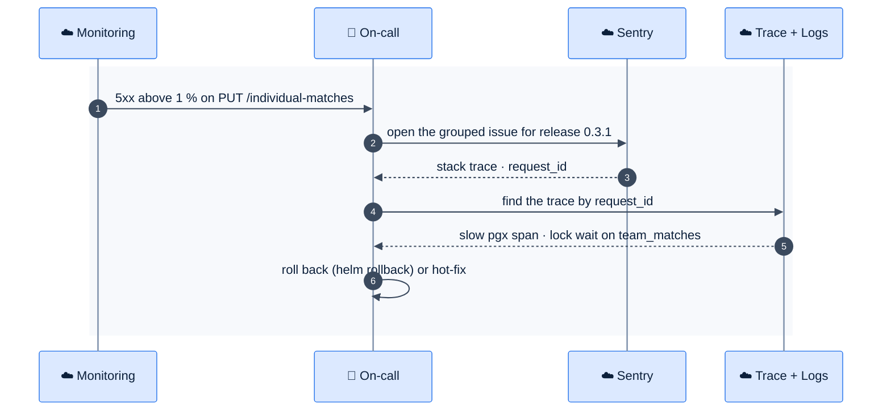

# F44 — Monitoring and error tracking

> [Feature specs](../README.md) › [E06 — Platform & Delivery](README.md) › **F44** · Phase 2

| Phase | Status | Rules | Repo refs |
|---|---|---|---|
| 2 | 🎯 | NFR-01, NFR-02, NFR-11 · [12 §6](../../12-infra-devops.md) | new `league-be/internal/telemetry` · `league-fe/src/lib/monitoring.ts` |

## Requirements

*As the on-call engineer, I know something is wrong on league night before a captain calls me, and I can see exactly which request failed.*

| ID | Requirement |
|---|---|
| FR-44.1 | OpenTelemetry SDK in the API and worker: HTTP server spans (route templates, not raw paths), pgx spans, outgoing HTTP spans. Export to Cloud Trace; sample 10 %, plus 100 % of errors |
| FR-44.2 | Metrics to Managed Prometheus: `http_server_duration` (route, status), `db_pool_in_use`, `outbox_lag_seconds`, `outbox_dead_letters`, `ws_connections` (E07), business counters `putups_total`, `results_total`, `nights_submitted_total` |
| FR-44.3 | Dashboards: **Golden signals** (rate, errors, p50/p95/p99, saturation) and **League night** (active nights, put-ups and results per minute, submit funnel, slowest routes) |
| FR-44.4 | Alerts, routed to Zalo/Telegram for the on-call: p95 > 500 ms for 5 min · 5xx > 1 % for 5 min · outbox lag > 60 s · any dead letter · DB CPU > 80 % for 10 min · uptime check failing 2 of 3 regions |
| FR-44.5 | Sentry for the FE (React error boundary, unhandled rejections) and the BE (panics, 5xx). Release = git tag; FE source maps uploaded in CD and not served publicly |
| FR-44.6 | PII: no emails, names or member IDs in spans, metrics labels or Sentry events. User = hashed user ID |
| FR-44.7 | Uptime checks: `https://www.mvip-league.com/` and `https://be.mvip-league.com/api/v1/health` every minute |

## Components

## Flow: from alert to fix

## Edge cases

| ID | Situation | Expected |
|---|---|---|
| EC-44.1 | Alert storm during an outage | Alerts group by policy; one page per incident |
| EC-44.2 | High-cardinality labels (IDs) | Forbidden in metrics; IDs belong in traces and logs only |
| EC-44.3 | Sentry quota | Sample FE errors at 50 % and drop known browser-extension noise |

## Acceptance criteria

- **AC-44.1** Given an injected 500 on staging, then a Sentry issue with the release tag appears within 1 minute and the trace is linked by request ID.
- **AC-44.2** Given the worker is stopped for 2 minutes, then the outbox-lag alert fires.

## Open questions

- Who is on call during league nights, and through which channel?

---

[← F42](F42-worker-outbox-redis.md) · [E06 overview](README.md) · [F45 →](F45-playwright-e2e.md)
