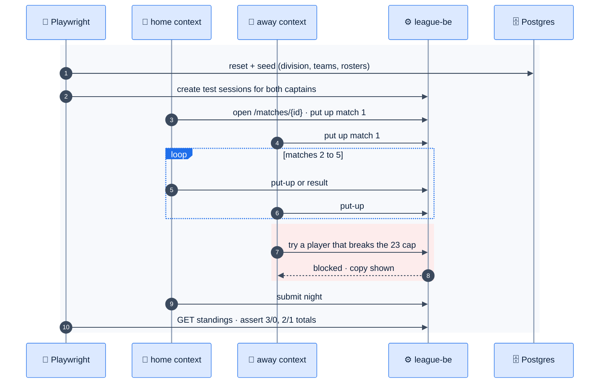
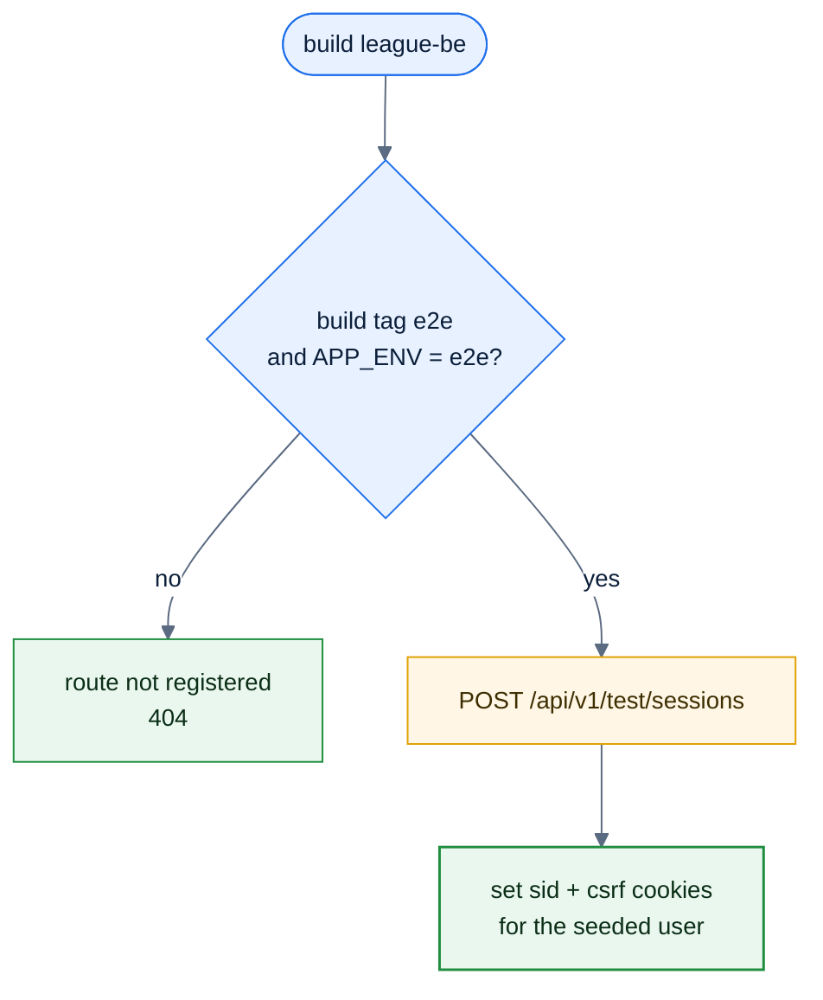

# F45 — Playwright E2E

> [Feature specs](../README.md) › [E06 — Platform & Delivery](README.md) › **F45** · Phase 2

| Phase | Status | Rules | Repo refs |
|---|---|---|---|
| 2 | 🎯 (new dependency, needs approval) | [13 §4](../../13-nfr-and-testing.md) | new `league-fe/e2e/`, `playwright.config.ts`, `league-be/docker-compose.e2e.yaml` |

## Requirements

*As an engineer, every release proves that two captains can run a full night end to end, in a real browser, against the real backend and database.*

| ID | Requirement |
|---|---|
| FR-45.1 | Two browser contexts, home captain and away captain, run a full seeded night: 5 put-ups per side (including one blocked by the 23 cap), 5 results (one hill-hill 2/1), submit, then check the standings |
| FR-45.2 | A third context with a player role verifies read-only access (no action bar, direct URLs give 403 copy) |
| FR-45.3 | Auth without Google: a test-only `POST /api/v1/test/sessions {userId}` route compiled in only when `APP_ENV=e2e`, which sets the normal cookies. It must not exist in staging or production builds |
| FR-45.4 | Stack: `docker compose -f docker-compose.e2e.yaml up` (Postgres + migrations + seed + league-be) and `vite preview` |
| FR-45.5 | Runs on PRs that touch `src/pages/**` or league endpoints, and on every release. Chromium + WebKit, mobile viewport 390 × 844 |
| FR-45.6 | Traces, videos and screenshots kept as CI artifacts on failure |
| FR-45.7 | Selectors by role and accessible name only (`getByRole`), which also checks accessibility |

## Flow: the night scenario

## Logic: test-only auth guard

*The route exists only in a separate build tag. A unit test asserts that the production router doesn't have it.*

## Edge cases

| ID | Situation | Expected |
|---|---|---|
| EC-45.1 | Flaky waits | Use web-first assertions; no `waitForTimeout` |
| EC-45.2 | Tests run in parallel | One database per worker (`league_e2e_<n>`) or serial execution in one project |
| EC-45.3 | WebKit cookie differences | The stack serves FE and BE on `localhost` with different ports, matching production's cross-site setup |

## Acceptance criteria

- **AC-45.1** Given a regression that breaks submit, when the PR runs E2E, then it fails with a trace.
- **AC-45.2** Given a production build, then `/api/v1/test/sessions` returns 404.

## Open questions

- Approve adding `@playwright/test` as a dev dependency.

---

[← F44](F44-monitoring.md) · [E06 overview](README.md) · [F46 →](F46-load-testing.md)
