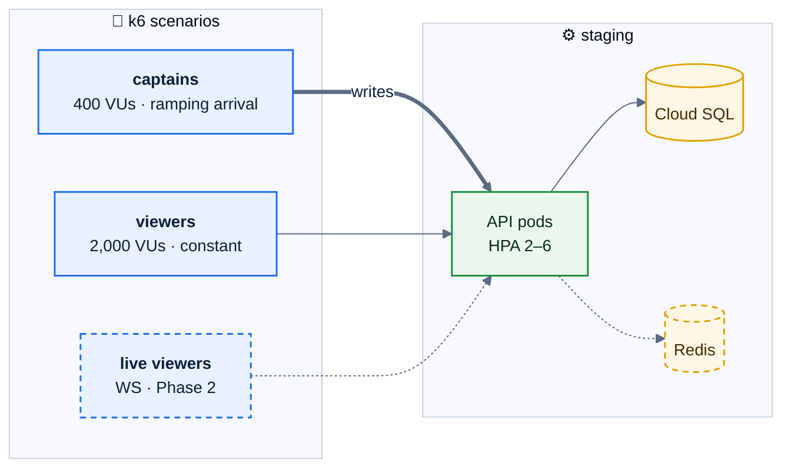
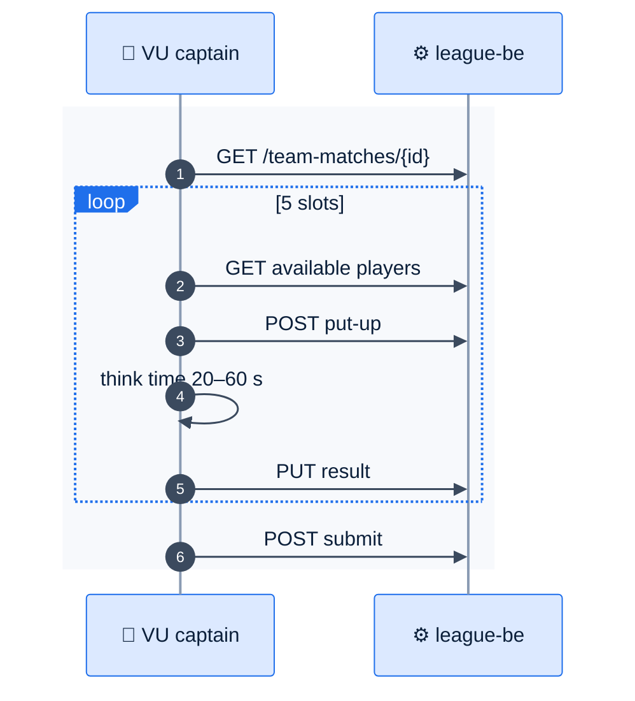

# F46 — Load testing

> [Feature specs](../README.md) › [E06 — Platform & Delivery](README.md) › **F46** · Phase 2

| Phase | Status | Rules | Repo refs |
|---|---|---|---|
| 2 | 🎯 | NFR-01, NFR-11 · [13 §5](../../13-nfr-and-testing.md) | new `league-be/loadtest/league-night.js` |

## Requirements

*As the owner, I know the platform holds up on our busiest night, plus headroom, before we sign up more venues.*

| ID | Requirement |
|---|---|
| FR-46.1 | A k6 scenario "league night": 200 concurrent team matches starting over 15 min. Each runs 10 put-ups, 5 results and 1 submit over 3 h (compressed ×12 to 15 min in CI) |
| FR-46.2 | Background readers: 2,000 virtual players polling the schedule and night view every 30 s; Phase 2 adds 20 live viewers per match over WebSocket |
| FR-46.3 | Auth uses pre-seeded sessions (as in F45); CSRF tokens are read from the cookie |
| FR-46.4 | Thresholds: `http_req_duration{p(95)} < 300 ms`, `http_req_failed < 0.1 %`, WS fan-out p95 < 1 s (NFR-11) |
| FR-46.5 | Runs against staging, scaled like production, before each minor release. Results (HTML summary + JSON) are archived as CI artifacts and trended |
| FR-46.6 | A soak variant: 1× load for 3 h to catch leaks and pool exhaustion |

## Load model

## Flow: one virtual captain

## Edge cases

| ID | Situation | Expected |
|---|---|---|
| EC-46.1 | DB pool exhaustion shows up first | Tune the pool and `max_connections`, or add PgBouncer, before adding pods |
| EC-46.2 | Hot rows (same team match updated by both captains) | Check lock waits in traces; the rule functions must keep transactions short |
| EC-46.3 | Rate limiter trips the test | Test users get a higher bucket via a staging-only config |

## Acceptance criteria

- **AC-46.1** Given the league-night scenario on staging, then all thresholds pass and the report is attached to the release.
- **AC-46.2** Given the 3 h soak, then memory per pod stays flat (± 10 %).

## Open questions

- What's the growth target: 200 concurrent nights, or more?

---

[← F45](F45-playwright-e2e.md) · [E06 overview](README.md)
