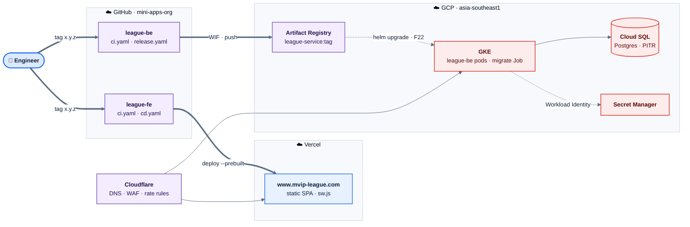
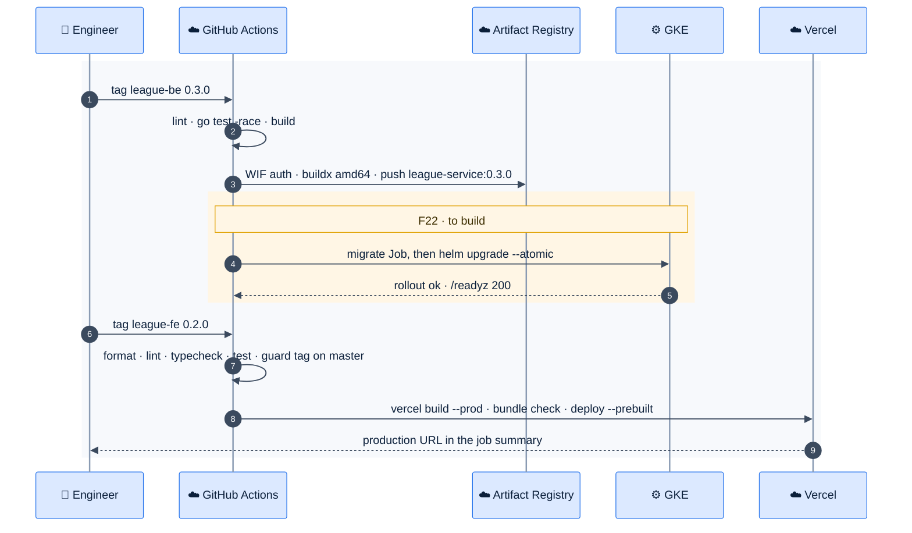
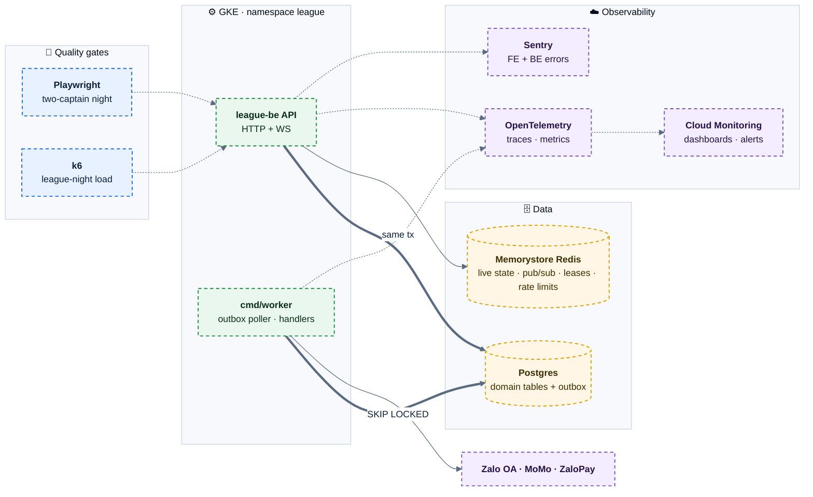
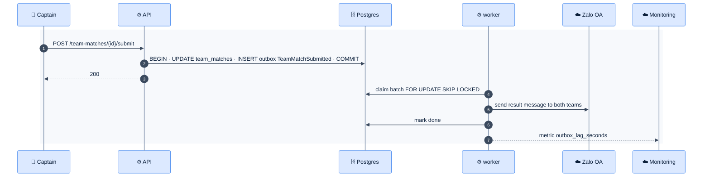

# E06 — Platform & Delivery

> [Feature specs](../README.md) › **E06**

| | |
|---|---|
| **Goal** | The app installs like a native app, works in English and Vietnamese, ships safely on a tag, and is observable and tested end to end |
| **Phase** | 1 (F20–F25) · 2 (F42, F44, F45, F46) |
| **Status** | 🏗 PWA, theme, i18n, both CI pipelines, Vercel deploy, image push · ⬜ GKE runtime, staging, generated types, rate limits, logs, worker, monitoring, E2E, load tests |
| **Actors** | Engineer, DevOps, every end user (indirectly) |
| **Related** | [12 infra & DevOps](../../12-infra-devops.md) · [13 NFR & testing](../../13-nfr-and-testing.md) · [09 frontend](../../09-frontend-design.md) · [11 security](../../11-security-and-roles.md) |

## Features by phase

### Phase 1: ship the MVP safely

| # | Feature | Status |
|---|---|---|
| F20 | [PWA, theme, i18n, error copy](F20-pwa-theme-i18n.md) | 🏗 |
| F21 | [CI/CD](F21-ci-cd.md) | 🏗 |
| F22 | [GKE deployment](F22-gke-deployment.md) | ⬜ |
| F23 | [Staging + Google consent screen](F23-staging-consent.md) | ⬜ |
| F24 | [Generated API types + FE/BE integration test](F24-api-types-integration.md) | ⬜ |
| F25 | [Rate limiting, structured logs, vi default](F25-rate-limit-logs-locale.md) | ⬜ |

### Phase 2: run it at league scale

| # | Feature | Status |
|---|---|---|
| F42 | [Worker, outbox, Redis](F42-worker-outbox-redis.md) | 🎯 |
| F44 | [Monitoring & error tracking](F44-monitoring.md) | 🎯 |
| F45 | [Playwright E2E](F45-playwright-e2e.md) | 🎯 |
| F46 | [Load testing](F46-load-testing.md) | 🎯 |

## Phase 1 deep dive

Phase 1 puts the two repos into production on GCP + Vercel behind Cloudflare. The front end ships today. The backend builds an image but has **no runtime yet** (F22), which blocks go-live together with E02.

### Components

*Green arrows exist today. Red boxes are the backend runtime still to build in F22. Cloudflare fronts both hosts.*

### Release sequence

*Backend first, then front end: the FE never ships against an API that lacks its endpoints.*

### Environments

| | Local | Staging (F23) | Production |
|---|---|---|---|
| FE host | `localhost:5173` | `staging.mvip-league.com` | `www.mvip-league.com` |
| BE host | `localhost:9200` | `be-staging.mvip-league.com` | `be.mvip-league.com` |
| `APP_ENV` | `development` | `staging` | `production` |
| Cookies | no prefix, not Secure | Secure, no prefix | `__Host-sid`, `__Secure-csrf` |
| Google OAuth client | dev client | staging client | prod client |
| Database | docker-compose Postgres | Cloud SQL `league-staging` | Cloud SQL `league-prod` |
| Deploy trigger | — | merge to `master` | tag `x.y.z` |

## Phase 2 deep dive

Phase 2 adds asynchronous work (notifications, fees, SL suggestions, live scoring), so it needs a **worker**, an **outbox**, **Redis**, and the tooling to prove the system holds up on a league night.

### Components

### Event path, end to end

### Service-level targets

| Target | Phase 1 | Phase 2 |
|---|---|---|
| API p95 latency | < 300 ms (NFR-01) | < 300 ms, and live-score fan-out < 1 s (NFR-11) |
| Availability on league nights | 99.5 % | 99.9 % |
| Error rate | < 1 % | < 0.1 % |
| Outbox lag | — | < 60 s |
| Recovery point (RPO) | 24 h backup | 5 min PITR |
