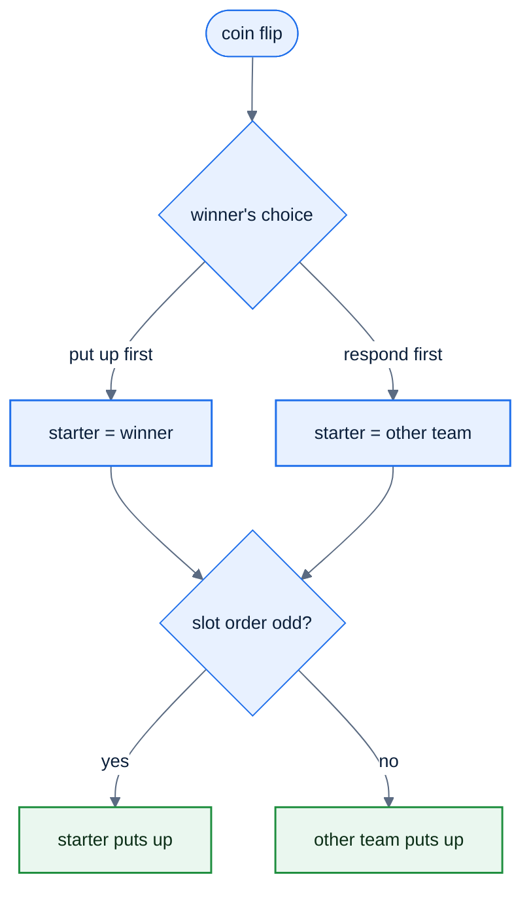
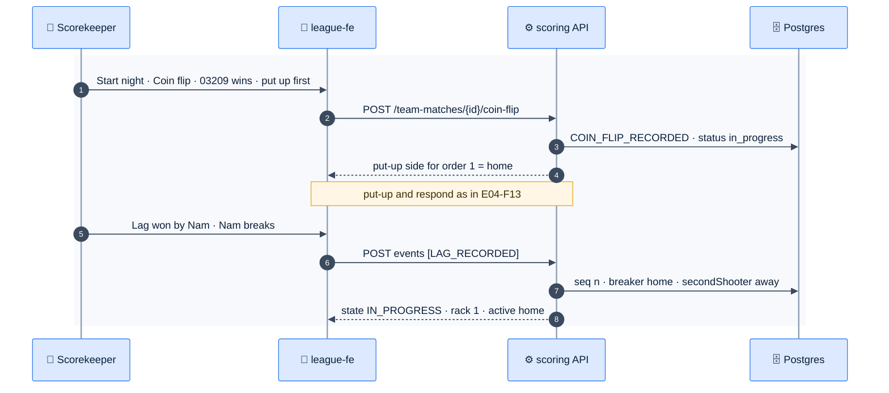

# F26 — Coin flip & lag

> [Feature specs](../README.md) › [E07 — Live Scoring](README.md) › **F26** · Phase 2

| Phase | Status | Rules | Repo refs |
|---|---|---|---|
| 2 | 🎯 | R-030, R-031, R-100 · [08 §2–§3](../../08-scorekeeping-engine.md) | Phase 1 analogue: `firstPutUpFor(order)` in `_parked/src/lib/night.ts` (odd → home) |

## Requirements

*As a scorekeeper, I record who won the coin flip (that decides who puts up first) and, for each match, who won the lag (that decides who breaks and how innings are counted).*

| ID | Requirement |
|---|---|
| FR-26.1 | Before match 1, the night records a **coin flip**: `{winnerTeamId, choice: "put_up_first" | "respond_first"}`. It can be recorded once, and corrected by an admin only before put-up 1 |
| FR-26.2 | The coin flip replaces the Phase 1 fixed rule (odd orders home). After it, put-up order alternates: the starting team puts up in orders 1, 3, 5 and the other team in 2, 4 (R-030/R-031) |
| FR-26.3 | After both players of a slot are up, the match enters **Lag**: the scorer taps the lag winner, then the lag winner's choice of breaker (usually themselves) |
| FR-26.4 | `LAG_RECORDED {winnerPlayerId, breakerPlayerId}` sets `breaker`, `activePlayer = breaker`, and `secondShooter = lag loser` (innings increment when the lag loser's turn ends, R-100) |
| FR-26.5 | Rack-to-rack break rule per division bylaw: `winner_breaks` (APA 8-Ball default) or `alternate` |
| FR-26.6 | The scorekeeper's name is recorded per individual match (R-105), prefilled with the device user's name |
| FR-26.7 | Undo is allowed for the lag until the first shot event of rack 1 |

## Logic

### Coin flip → put-up order



### Lag → breaker and innings side

```text
on LAG_RECORDED(winner, breaker):
  assert status == LAG and breaker in {home, away}
  lagWinner     = side(winner)
  secondShooter = other(lagWinner)            # R-100, innings side
  rack          = { no: 1, breaker: side(breaker), firstTurnLive: true,
                    timeoutsLeft: timeouts(SL) }  # R-104
  activePlayer  = side(breaker)
  status        = IN_PROGRESS
```

## Flow



## UI

| Screen | Content |
|---|---|
| Coin flip sheet | Two big team buttons ("Who won the toss?"), then two choices ("Put up first" / "Let them put up first"). Confirm |
| Lag sheet | The two put-up players as large cards with SL and race ("needs 4"); tap the lag winner, then "Who breaks?" defaulting to the winner |
| Header after lag | A "LAG" badge on the lag winner (R-144) and a break icon on the current breaker |

## API & data

```json
{
  "idempotencyKey": "<uuid>",
  "teamMatchId": "<team-match-uuid>",
  "expectedSeq": 12,
  "deviceId": "<device-uuid>",
  "clientTs": "2026-11-10T19:41:03+07:00",
  "type": "LAG_RECORDED",
  "payload": { "winnerPlayerId": "<player-uuid>", "breakerPlayerId": "<player-uuid>" }
}
```

| Error | When |
|---|---|
| `40910` | Coin flip already recorded |
| `40911` | Lag sent while the slot isn't in `LAG` |
| `40003` | The winner or breaker isn't one of the two players |

## Edge cases

| ID | Situation | Expected |
|---|---|---|
| EC-26.1 | Coin flip skipped (old client or Phase 1 fallback) | Default to Phase 1 alternation (odd → home) |
| EC-26.2 | Lag winner chooses the opponent to break | Allowed: `breaker = other(lagWinner)`; `secondShooter` stays the lag loser |
| EC-26.3 | Wrong lag winner tapped | Undo before the first shot; after that, an admin correction only |
| EC-26.4 | Forfeited slot (F39b) | No lag; the slot goes straight to `MATCH_DONE` |

## Acceptance criteria

- **AC-26.1** Given away wins the toss and chooses to put up first, then the put-up order is away in 1, 3, 5 and home in 2, 4.
- **AC-26.2** Given home wins the lag, when the away player's turn ends, then innings = 1, and when the home player's turn ends first, innings stays 0.
- **AC-26.3** Given a recorded lag and no shot yet, when Undo is tapped, then the slot returns to `LAG`.

## Open questions

- Does the league use "winner breaks" or "alternate break" for 8-Ball? (Bylaw per division; default winner breaks.)

---

[E07 overview](README.md) · [F27 →](F27-live-8ball-scoring.md)
