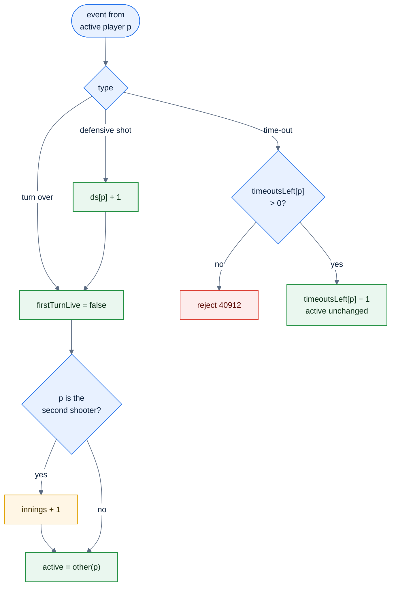
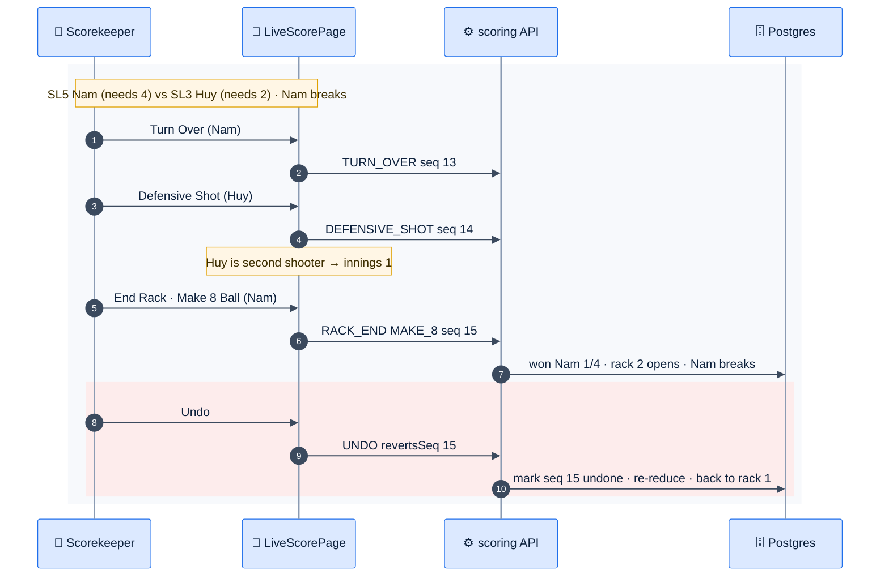
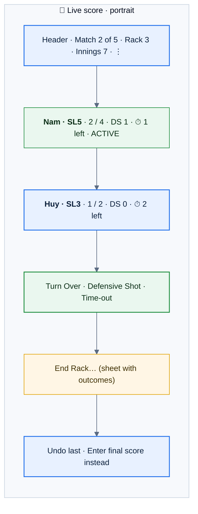

# F27 — Live 8-Ball scoring

> [Feature specs](../README.md) › [E07 — Live Scoring](README.md) › **F27** · Phase 2

| Phase | Status | Rules | Repo refs |
|---|---|---|---|
| 2 | 🎯 | R-060–R-062, R-100–R-106, R-050 · [08 §4.1](../../08-scorekeeping-engine.md) | Phase 1 analogue: `pointsFor()` in `_parked/src/lib/rules.ts` |

## Requirements

*As a scorekeeper, I tap through each turn of an 8-Ball match on one screen, and the app tracks games, innings, defensive shots and time-outs exactly as the paper scoresheet would.*

| ID | Requirement |
|---|---|
| FR-27.1 | The live screen shows both players (name, SL, games won / needed, DS count, time-outs left), the **active player** highlighted, rack number, match innings and a shot timer (informational, R-106) |
| FR-27.2 | Actions for the active player: **Turn Over**, **Defensive Shot**, **Time-out**, **End Rack…** |
| FR-27.3 | `TURN_OVER(p)`: `p` must be active. Sets `firstTurnLive = false`. If `p == secondShooter`, then `innings++`. Switches the active player (R-100, R-101) |
| FR-27.4 | `DEFENSIVE_SHOT(p)`: `ds[p]++`, then the same effect as Turn Over (R-102) |
| FR-27.5 | `TIMEOUT(p)`: only if `timeoutsLeft[p] > 0`; resets every rack. SL ≤ 3 → 2, SL ≥ 4 → 1 (R-104, configurable) |
| FR-27.6 | The match completes when a player reaches their race. Points use the same `points8` as Phase 1: 3/0 shutout, 2/1 hill-hill (loser = race − 1), otherwise 2/0 |
| FR-27.7 | **Undo** reverts only the last non-undone event of the match (`UNDO {revertsSeq}`); the projection is re-reduced. Undo after the match-ending rack re-opens the match and clears its points |
| FR-27.8 | **Switch active player** in the ⋮ menu corrects a wrong state without undoing (R-062) |
| FR-27.9 | Races come from the SL **snapshot** taken at put-up (R-125). An SL change mid-night affects later slots only (R-050) |

## Logic: turn reducer



### Match completion (shared with Phase 1)

```text
on rack won by w:
  won[w] += 1
  if won[w] == needed[w]:
     l = other(w)
     pts = won[l] == 0             ? (3,0)
         : won[l] == needed[l] - 1 ? (2,1)     # hill wins over standard (needed 2, won 1)
         :                           (2,0)
     status = COMPLETED
```

## Flow



## UI



*Buttons are at least 56 px tall for one-handed use at the table. The active player's card uses the green ok style; a haptic tick confirms each tap.*

## Edge cases

| ID | Situation | Expected |
|---|---|---|
| EC-27.1 | Rack ends during the first shooter's turn | Innings unchanged ([08 §8 #6](../../08-scorekeeping-engine.md)) |
| EC-27.2 | SL2 vs SL2, the loser wins 1 | Hill → 2/1 |
| EC-27.3 | Undo after the match-ending rack | The match re-opens and its points are cleared |
| EC-27.4 | Event from a player who isn't active | Rejected `40913`; the UI offers "Switch active player" |
| EC-27.5 | The scorer gives up on live scoring | "Enter final score instead" opens E04-F14 with the games so far prefilled; the event log is closed with `MANUAL_RESULT` |

## Acceptance criteria

- **AC-27.1** Given the shared fixture set `fixtures/8ball/*.json`, when both the TS and Go reducers run, then their final states are byte-identical.
- **AC-27.2** Given SL5 vs SL3 with a final of 4–1, then points = 2/1 (the loser needed 2 and won 1).
- **AC-27.3** Given an SL4 player with 1 time-out left, when a second time-out is tapped in the same rack, then it's rejected.

## Open questions

- Is the time-out count by SL (R-104) correct for this league?

---

[← F26](F26-coin-flip-lag.md) · [E07 overview](README.md) · [F28 →](F28-racks-accolades.md)
