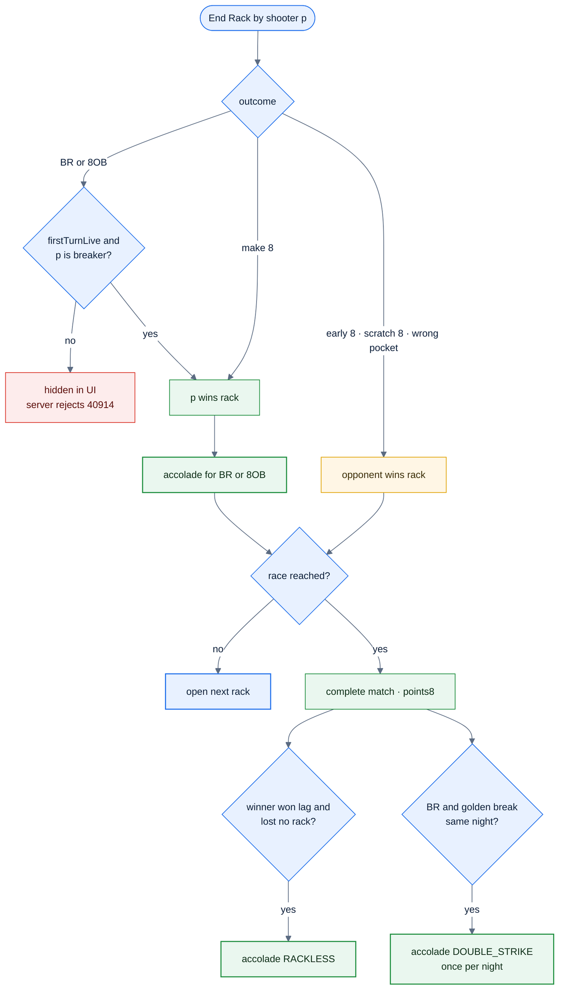
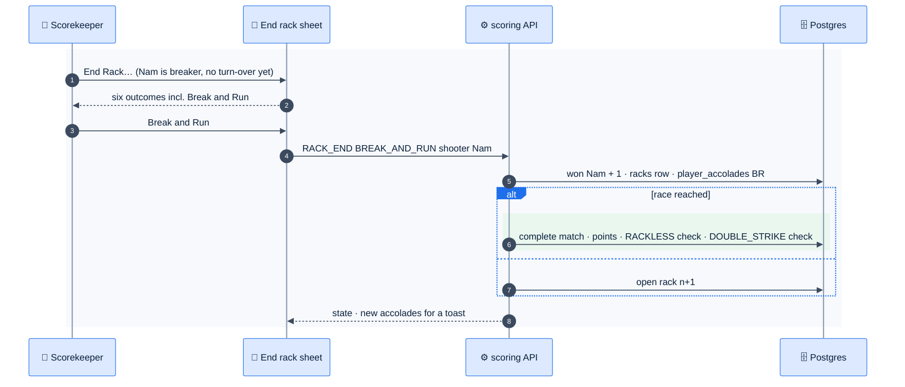

# F28 — Racks & accolades

> [Feature specs](../README.md) › [E07 — Live Scoring](README.md) › **F28** · Phase 2

| Phase | Status | Rules | Repo refs |
|---|---|---|---|
| 2 | 🎯 | R-060, R-061, R-062, R-084, R-144 · [04 §5.2, §9](../../04-domain-rules.md) | — |

## Requirements

*As a scorekeeper, I end a rack with the exact outcome. As a player, my break-and-runs and golden breaks are counted on my profile.*

| ID | Requirement |
|---|---|
| FR-28.1 | **End Rack…** opens a sheet with the six 8-Ball outcomes for the active player: Make 8 Ball, Break and Run, 8 on the Break (wins); Early 8, Scratch on 8, 8 in the Wrong Pocket (losses) |
| FR-28.2 | Break and Run and 8 on the Break are shown **only while** `rack.firstTurnLive` is true and the shooter is the breaker (R-060) |
| FR-28.3 | A win outcome gives +1 game to the shooter. A loss outcome gives +1 game to the opponent (R-061) |
| FR-28.4 | Accolades are derived **on the server** from events and written to `player_accolades`: `BR`, `8OB`, `RACKLESS` (won the lag and the match without losing a rack), `DOUBLE_STRIKE` (BR + golden break on the same league night, once per night) |
| FR-28.5 | A new rack opens with `breaker` per bylaw, `firstTurnLive = true`, time-outs reset, and rack DS = 0 |
| FR-28.6 | The match breakdown (R-144) lists racks: number, breaker, winner, outcome code, innings |
| FR-28.7 | Undo of a rack end also removes the accolades it created |

## Logic: end-of-rack decision

## Outcomes

| Code | Label | Result for shooter | Accolade |
|---|---|---|---|
| `MAKE_8` | Make 8 Ball | Win | — |
| `BREAK_AND_RUN` | Break and Run | Win | `BR` |
| `EIGHT_ON_BREAK` | 8 on the Break | Win | `8OB` |
| `EARLY_8` | Make 8 Ball Early | Loss | — (E8 code kept for stats) |
| `SCRATCH_8` | Scratch on 8 Ball | Loss | — (S8) |
| `WRONG_POCKET_8` | 8 Ball Wrong Pocket | Loss | — (8WP) |

## Flow

## Edge cases

| ID | Situation | Expected |
|---|---|---|
| EC-28.1 | 8 on the break after a turn-over in the same rack | Not offered; rejected if sent (R-060) |
| EC-28.2 | Early 8 by the breaker on the break | Loss for the breaker, opponent +1 |
| EC-28.3 | Same player gets BR in match 1 and 8OB in a later match the same night | One `DOUBLE_STRIKE` |
| EC-28.4 | Undo of a BR rack end | The rack and the BR accolade are both removed |
| EC-28.5 | Match finished by manual entry (fallback) | No rack-level accolades are inferred |

## Acceptance criteria

- **AC-28.1** Given a turn-over in rack 3, when End Rack opens, then Break and Run and 8 on the Break are hidden.
- **AC-28.2** Given Nam wins the lag and the match 4–0, then a `RACKLESS` accolade exists for Nam on that match.
- **AC-28.3** Given a Scratch on 8 by Huy, then Nam's games increase by 1.

## Open questions

- [Q5](../../14-open-questions.md): DOUBLE_STRIKE definition (BR + golden break, same night).

---

[← F27](F27-live-8ball-scoring.md) · [E07 overview](README.md) · [F29 →](F29-offline-sync.md)
