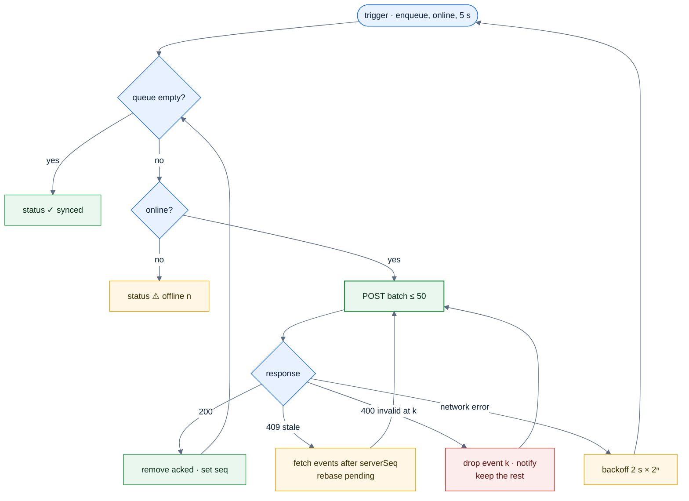
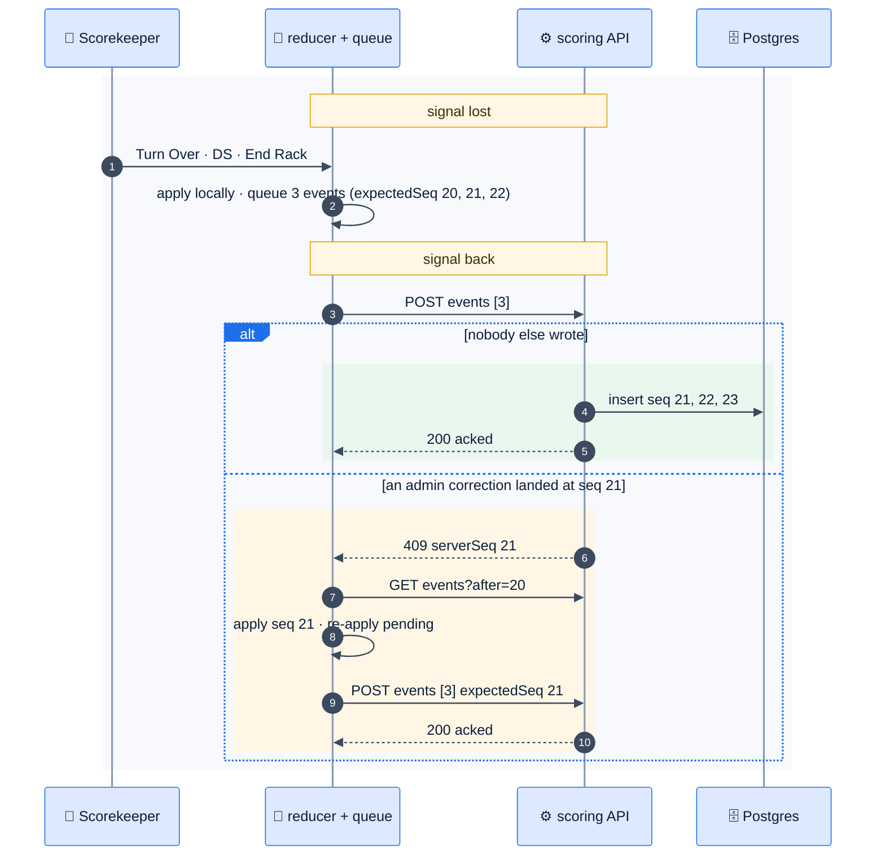

# F29 — Offline scoring sync

> [Feature specs](../README.md) › [E07 — Live Scoring](README.md) › **F29** · Phase 2

| Phase | Status | Rules | Repo refs |
|---|---|---|---|
| 2 | 🎯 | NFR-04 · [08 §5](../../08-scorekeeping-engine.md) | new `league-fe/src/lib/scoring/{queue,sync}.ts` |

## Requirements

*As a scorekeeper in a basement pool hall with bad signal, I keep scoring without waiting. Nothing I tap is lost or counted twice when the connection comes back.*

| ID | Requirement |
|---|---|
| FR-29.1 | Every event gets a client `idempotencyKey` (UUIDv7) and the `expectedSeq` the client believed was current |
| FR-29.2 | Events are applied to the local state at once (TS reducer) and written to an IndexedDB queue **before** any network call |
| FR-29.3 | A sync loop sends up to 50 queued events per request, in order. It runs on enqueue, on `online`, on visibility change, and every 5 s while the queue isn't empty |
| FR-29.4 | Server: duplicate `idempotencyKey` → 200 with the original `seq` (no-op). Events are processed in order in one transaction; the first invalid event stops the batch and is reported |
| FR-29.5 | `409 stale` → the client fetches `events?after=<serverSeq>`, applies them, re-applies its still-pending events on top (**rebase**), and retries. Pending events that become invalid after the rebase are dropped with a visible notice |
| FR-29.6 | The UI shows sync status: ✓ synced · ↻ syncing n · ⚠ offline n pending. Submitting the night (F15) needs an empty queue |
| FR-29.7 | The queue survives reloads and app restarts. It's keyed by team match and cleared after submit |
| FR-29.8 | The service worker still never caches `/api/v1` (F20). Offline support lives in app code, not in SW caching |

## Logic: sync loop



## Flow: offline then reconnect



## API & data

```json
{
  "error": { "code": 40920, "message": "stale expectedSeq" },
  "data": { "serverSeq": 21 }
}
```

| IndexedDB store | Key | Value |
|---|---|---|
| `pending` | `[teamMatchId, idempotencyKey]` | event + `enqueuedAt` |
| `snapshot` | `teamMatchId` | last server state + `seq` |

## Edge cases

| ID | Situation | Expected |
|---|---|---|
| EC-29.1 | The same batch is sent twice (timeout, then retry) | The second is an idempotent no-op ([08 §8 #9](../../08-scorekeeping-engine.md)) |
| EC-29.2 | Two devices write at the same seq | The one without the lease is rejected (F30); otherwise, 409 and rebase |
| EC-29.3 | Phone storage full | Show a blocking error; offer "Enter final score instead" |
| EC-29.4 | App killed mid-sync | Events not acked stay queued; resent on next open |
| EC-29.5 | Offline for the whole night | Scoring works; submit waits for sync with a clear "Connect to submit" state |

## Acceptance criteria

- **AC-29.1** Given airplane mode for 20 events, when the network returns, then the server holds exactly those 20 events in order.
- **AC-29.2** Given a 409, then after rebase the client state equals the server state plus the pending events.
- **AC-29.3** Given a non-empty queue, then "Submit night" is disabled with the pending count.

## Open questions

- Should pending events older than 24 h be discarded? Default: no; ask the user.

---

[← F28](F28-racks-accolades.md) · [E07 overview](README.md) · [F30 →](F30-scoring-lease-viewers.md)
